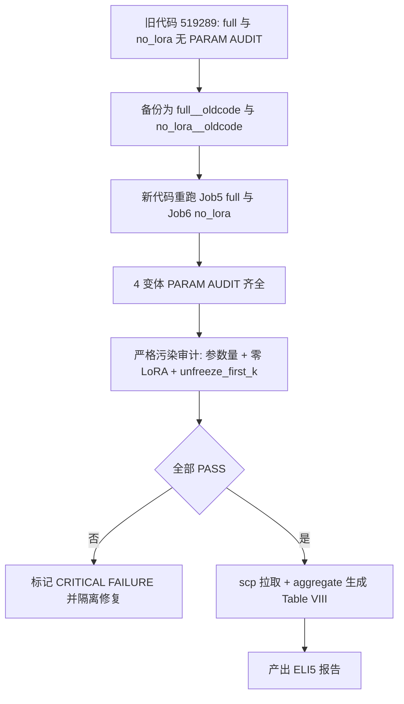

## 产品概述

面向 IEEE JBHI 投稿的 FYP 收尾：把导师提出的 5 个关键质疑全部闭环，产出可当面向导师讲解的「零基础」问答报告，以及不可辩驳的 HPC 证据链。

## 三项不可协商约束（必须在代码与 HPC 脚本中逐条落地并出具证明）

1. **双轨制指标**：Table V（正文）用 z-space MSE/MAE 对齐论文 1.542；图与补充材料用**物理单位（患者数）**，经逆变换得到。
2. **完整 1025 行数据窗**：2002–2021 全量，**禁止截断到 966 行**；2020–2021 COVID 分布偏移是核心科学证据。
3. **HPC 优先级子集**：只跑 4 个核心变体 `full`、`no_lora`、`no_text_ln`、`gated_inject`；不在 prompt ablation 上耗资源。

## 核心功能（4 大任务）

- **TASK 1 修复与举证**：对 5 个修复，逐条给出「引用原始代码 → 解释缺陷 → 修正后完整代码」。
- **TASK 2 ELI5 报告**：产出 `Advisor_Questions_Resolution_Report.md`，零深度学习基础可懂、多用类比；5 问逐一回答，每问统一结构：问题是什么 / 为什么发生 / 怎么修 / 是否解决。
- **TASK 3 HPC 拉取与审计**：给出精确 `scp` 命令；核验 reps=10、epochs=20、1025 行窗口；对 4 变体做严格污染检查；破解 "0.5 / timing / rolling" 之谜并给出确定性答案。

## 技术栈

- Python 3.9 + PyTorch 2.5.1（CUDA 11.8）+ transformers（GPT2-small）+ numpy/pandas，HPC Slurm `gpu_a100`（`--gres=gpu:a100:1`、`--time=04:00:00`、QOS 每用户 4 作业）。**不引入任何新依赖。**

## 实现方案

### 1. 先做「证据链补救」重跑（本轮最关键动作）

实测确认：`full` 与 `no_lora` 由 519289 在 01:58 启动，早于 03:20 的新代码上传，Slurm 在**启动时刻**读取代码，因此二者用的是旧 `miflu_model.py`，日志中 **PARAM AUDIT 计数为 0**；且旧 `no_lora` 会**先创建 LoRA 再冻结**，模型内仍存在 `lora_A`/`lora_B`，直接违反「no_lora 必须不含任何 lora_A/lora_B」的硬性规则。

策略（重跑前必须备份，否则会覆盖掉可用于可复现性比对的旧数字）：

1. 在 HPC 上把现有结果另存为 `full__oldcode`、`no_lora__oldcode`（保留旧代码数字做**新旧一致性自检**）；
2. 用新代码重跑 `full` 与 `no_lora` 到**规范目录**，使 4 个核心变体全部具备 PARAM AUDIT 且语义正确；
3. 顺带得到**可复现性证据**：新 `full` 与旧 `full`（模型完全等价）指标应高度一致，反证新代码未改变基线行为。

`no_text_ln`(519329) 与 `gated_inject`(519330) 已用新代码跑完、10 reps 齐全、审计已通过，**不重跑**。

### 2. TASK 1 转为「验证 + 举证」（5 项均已实现）

已读码确认 5 个模块均已落地且带自检，本轮逐条产出 before/after 对照；仅在发现缺口时才改代码：

| 问题 | 已实现位置 | 关键证据（已读码确认） |
| --- | --- | --- |
| Q3 逆变换 | `scaler_utils.py::ScalerBundle` | train-only 拟合（float32 + EPS=1e-8）、`save_json`/`load_or_fit`、`inverse()`、`torch_mean_std()`；自检断言 `train_end=717`、`val_end=819`、ILITOTAL 通道=4，并打印 z 轴 0–12 与物理量程对照 |
| Q2 曲线对齐 | `cdc_calendar.py::attach_calendar`(L223) | 文档化 ~19 周漂移、`mmwr_week1_start(2020)==2019-12-29` 断言、2002 年 19 周空洞异常自检；`train_ablation.py` 导出处有 GT/Pred 对齐不变量（spread 小于 1e-4） |
| Q1 聚合 | `compute_miflu_indicators.py::aggregate_lead_time`(L209) | 三模式 `mean_over_lead`(遗留) / `fixed_step`(推荐，恒定提前期 step+1) / `origin_stride`(stride==L 时无重叠无需聚合) |
| Q4 配方 | `recipes.py` | 三配方字段与用户规格逐项一致；`build_recipe` 返回 (opt, crit, sched, clip) |
| Q5 早停 | `early_stopping.py::PeakAwareEarlyStopping` | `improved = loss_improved and (peak_hit_rate > 0.7)`，严格大于；含无峰值时退化回退与 4 组自检 |


### 3. 严格污染审计判定表（Task 3.2）

推导基线：单块 LoRA 参数 = `lora_A(4×768) + lora_B(2304×4)` = 12,288；`text_ln` = 2×768 = 1,536。

| 变体 | 期望可训练参数量 | 硬性规则 | 现状 |
| --- | --- | --- | --- |
| full | 约 1,030,056（6×LoRA + text_ln + wpe + output_proj + 各层 LN） | 必须是约 1M；若出现约 17M 说明 gated_inject 解冻逻辑污染基线 | 待重跑补齐审计 |
| no_lora | 约 956,328（full 减去 6×12,288） | 必须**零** `lora_A`/`lora_B` 参数 | 待重跑（旧版不合规） |
| no_text_ln | 1,028,520 | text_ln 退化为 Identity（少 1,536） | 已 PASS（实测） |
| gated_inject | 17,537,449 | 必须显式 `unfreeze_first_k=2` | 已 PASS（实测） |


任一项不满足即标记 **CRITICAL FAILURE**，并给出隔离各变体的精确代码修复（`miflu_model.py` 的严格 if-else 分支与默认值）。

### 4. 最终表构成（落实「优先级子集」）

主表仅纳入 4 个核心变体；配方结果（`full__adamw_cosine`/`full__huber_clip`/`full__earlystop`）作为 Q4 证据单独成节；`no_multi`/`no_lora_multi` 属用户明确不优先的 prompt ablation，虽已由 519289 跑完，但**不进主表**，仅在报告中标注为补充数据。

## 实施要点（防止返工与事故）

- **先备份再重跑**：`cp -r full full__oldcode`、`cp -r no_lora no_lora__oldcode`，否则旧 `full` 数字被覆盖，可复现性比对证据丢失。
- **Windows OpenSSH 静默剥离双引号**：含空格或括号的远端命令（`grep "PARAM AUDIT"`、`echo "job (full)"`）必须用**单引号**包裹，否则报 `No such file` 或 `syntax error near unexpected token '('`（已实测踩坑两次）。
- **HPC 登陆节点 `RLIMIT_NPROC=256` 且无 GPU**：无法 `import torch/transformers` 做本地 smoke，验证只能靠实跑作业的 PARAM AUDIT。
- **日志路径分裂**：在 `Chattime` 内 `sbatch` → 日志落 `Chattime/hpc_results/.../logs/`；在 `$HOME` 内 `sbatch` → 落 `$HOME/hpc_results/...`。519329/519330 在前者，519289/519290 在后者；结果文件始终在 `Chattime/hpc_results`。
- **HPC 不自动同步**：本地改动必须 `scp` 重传；作业在启动时刻读码，重传不影响在跑作业。
- **数据窗守护**：1025 行的判据是 `train_end=717 / val_end=819`（717+102+206），报告中须用此数字举证，并显式声明未截断到 966。

## 架构 / 证据链流程



## 目录结构

```
MLFlu/
├── Advisor_Questions_Resolution_Report.md   # [NEW] ELI5 五问报告（项目根），含 scp 命令、污染审计结论、0.5 之谜、三项核心决策确认
├── scripts/
│   ├── submit_journal_job5.sh               # [NEW] full 重跑（新代码，补齐 PARAM AUDIT，gpu_a100）
│   ├── submit_journal_job6.sh               # [NEW] no_lora 重跑（新代码，确保零 LoRA 模块，gpu_a100）
│   ├── scaler_utils.py                      # [VERIFY] Q3 逆变换与 mean_/scale_ 持久化
│   ├── cdc_calendar.py                      # [VERIFY] Q2 真实 CDC 周历与 19 周漂移修正
│   ├── compute_miflu_indicators.py          # [VERIFY] Q1 aggregate_lead_time 三模式与 timing 命名
│   ├── recipes.py                           # [VERIFY] Q4 三配方
│   ├── early_stopping.py                    # [VERIFY] Q5 峰值感知早停门控
│   ├── miflu_model.py / train_ablation.py   # [VERIFY] 变体隔离、严格 if-else、PARAM AUDIT 透传
│   └── aggregate_journal_tables.py          # [RUN] 生成最终 Table VIII（4 核心 + 配方）
└── data/scaler_miflu_national.json          # [VERIFY] mean_/scale_ 落盘，供逆变换与审计引用
```

## 性能

两重跑作业各约 30 分钟（参考：job1 中 full 01:58→02:27、no_lora 02:39→03:08），并行占用 2 个 QOS 槽（上限 4），远低于 4 小时墙钟；拉取结果约数百 MB，聚合与报告生成为秒级。

## Agent Extensions

### SubAgent

- **code-explorer**
- Purpose: 跨文件、跨目录检索 `timing` / `rolling` / `lead_time` / `0.5` / `min-max` 的全部出现位置，并定位 5 处修复的真实代码行号，供「原代码 → 缺陷 → 修正代码」举证与 "0.5 周" 之谜定性使用。
- Expected outcome: 输出带文件路径与行号的命中清单，支撑报告中「0.5 是峰值时刻误差而非提前期」「rolling 的两种合法来源」的确定性结论，且不遗漏任何残留误称。