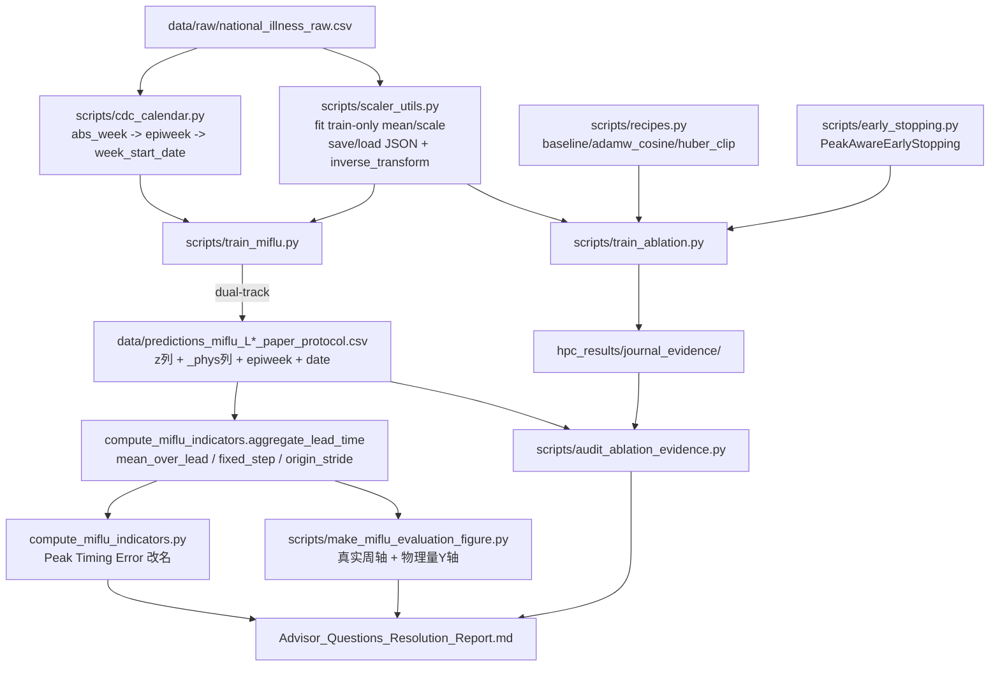

## Product Overview

为 MIFlu 复现项目（FYP，目标 IEEE JBHI 级投稿）建立一条可答辩的期刊级证据链：修复导师提出的 5 个质疑点所对应的真实代码缺陷，产出零基础可读的答疑报告，并完成消融实验审计、HPC 补跑脚本与"Timing/Rolling"术语溯源定论。

## Core Features

1. **Q3 单位与反变换（双轨）**：National 表 V 主口径 MSE/MAE 保留 StandardScaler（z）空间以与论文 1.542/0.726 可比；图与 CSV 新增物理量（患者数）列，并附物理量补充表。训练期持久化 scaler（`mean_`/`scale_`），推理期加载后反变换。
2. **Q2 曲线对齐**：X 轴改用 CDC 真实 `epiweek`（消除约 19 周漂移）；断言 GT/Pred 严格同周对齐无 off-by-one；确认 2021-02 的"幻影峰"为真实分布偏移现象而非尺度伪影，并在图上标注。
3. **Q1 聚合与提前期**：明确 stride=1（全重叠）现状，实现显式 `mean_aggregation`，并新增固定提前期模式（`fixed_step`）与 stride=L 非重叠模式，解决"曲线上有效提前期非平稳"的隐患。
4. **Q4 训练配方消融**：`train_ablation.py` 支持 `--recipe {baseline, adamw_cosine, huber_clip}`。
5. **Q5 峰值感知早停**：新增 `PeakAwareEarlyStopping`，仅当 `val_loss` 改善且 `Peak Hit Rate > 0.7` 时保存/停止。
6. **Task 2 报告**：`Advisor_Questions_Resolution_Report.md`，ELI5 语气，每题 4 段结构（问题/科学原因/修复/现状）。
7. **Task 3 审计与溯源**：消融证据 COMPLETE/INCOMPLETE 审计表、HPC 补跑 sbatch 脚本（严格 `hpc_results/journal_evidence/[exp]/reps_1_to_10/` 目录）、Timing/Rolling/0.5/min-max 的定论。

## 已确认的三项期刊口径

- 指标尺度：论文严格·双轨（z 空间为主，物理量为补充）
- 数据窗：统一完整 1025 行（200201–202152），现有 966 行窗口实验需重跑
- 补跑范围：`full`/`no_multi`/`no_lora`/`no_lora_multi` × L=24 × 10 reps + 3 个训练配方

## Tech Stack Selection

沿用项目现有栈，不引入新框架：

- **训练/模型**：PyTorch + `transformers.GPT2Model`（Python 3.9，见环境路径）
- **数据/指标**：pandas / numpy / scipy.signal.find_peaks / statsmodels STL
- **绘图**：matplotlib（Agg 后端，300 DPI，与现有 `make_miflu_evaluation_figure.py` 一致）
- **归一化**：手写 StandardScaler（train-only fit，与 `train_miflu.py::load_and_normalize` 现有约定一致）——**不引入 sklearn**，避免与现有 `+1e-8` 数值约定产生偏差
- **HPC**：SLURM（Burgundy `stingy` 分区，4h 上限，同时仅 1 pending 作业，A100×1）

## Implementation Approach

**总体策略**：以"双轨输出"为核心解耦方案——模型层已能同时产出 z 空间与物理量两套张量（`MIFlu.forward` 返回 `y_hat_rev, y_phys, means, stdevs`），只需在数据层补 scaler 持久化、在导出层补物理量列、在展示层切换到物理量，即可同时满足"论文可比"与"医生可读"两个诉求，且**完全向后兼容**（只追加列，不改名）。

**关键技术决策与权衡**：

1. **指标留 z 空间，图换物理量**。依据 `MIFlu_paper.md:254-260`：National 用 MSE/MAE 且只声明 StandardScaler 归一化；Regional 才"de-normalizing"。导师引句属 Regional 分支。若强行对 National 反归一化，MSE 将变成 10⁸ 量级且与论文表 V 不可比 → 双轨是唯一同时满足严格性与可读性的解。
2. **X 轴改用真实 epiweek，禁止合成网格**。实测数据有 7 处周次不规则（2002 年 19 周大洞 + 3 处跳周 + 3 处重复周标签），`_week_to_epiweek()` 的 `2002w01 + i weeks` 假设导致约 19 周漂移。修正：从 raw CSV 构建 `abs_week → epiweek → week_start_date` 真值表，用 MMWR 规则解析并对碰撞做单调递增修正，**保留真实缺口**（19 周空洞应被画出来，而非抹平）。
3. **聚合必须显式化 + 暴露有效提前期**。现状 `groupby("abs_week").mean()` 把提前 1~24 周的预测混平均，且覆盖数沿曲线变化（首周 1 个窗口、内部 24 个、末周仅 step 23）→ 有效提前期非平稳。提供三种模式：`mean_over_lead`（兼容现状，须标注）、`fixed_step`（每点恒定提前期，期刊主图推荐）、`origin_stride`（stride=L 非重叠，明确无需聚合）。
4. **早停为可选项，默认关闭**。`PeakAwareEarlyStopping` 只在 `--early-stop` 时启用，`train_miflu.py` 主协议仍是固定 20 epochs（Table IV），避免污染已有 10-rep 基线。
5. **Peak Hit Rate 退化处理**：验证集若 `n_true_peaks == 0`（`find_peaks` prominence/distance 下可能无峰），`peak_hit_rate` 无定义；此时记录 warning 并降级为纯 val_loss 判据，避免"永远不保存"。该降级必须在日志与报告中显式披露。

**性能与复杂度**：

- 反变换为 O(B·N·L) 元素级乘加，可忽略；但**必须在 GPU 上做**（`miflu_model.py:483-488` 已实现）再 `.cpu()`，避免额外 H2D 往返。
- `fixed_step` 模式把绘图数据从 ~5000 行降到 ~205 行/档，出图更快。
- 早停每轮需在验证集构建连续序列并跑 `find_peaks`：验证集约 102 个窗口，聚合后约 100 点，`find_peaks` 为 O(n)，可忽略；但**不要**每轮重算 STL（O(n·period)），只算 Peak 指标。
- HPC 串行补跑：4 变体 + 3 配方 = 7 个 L=24×10reps 任务，单个约 35–45 min，合计约 6–8 GPU 小时，一晚可完成；用 `auto_submit_diag.sh` 已验证的"squeue 出现→消失"双段轮询规避 QOS 单 pending 限制。

## Implementation Notes（执行细节，防回归）

- **`train_ablation.py` 现有 5 个硬 bug 必须一并修**，否则任何新功能都无法运行：

1. `L111/L122` `yh, _, _ = model(...)` 解包 3 个，但 `miflu_model.py:492` 返回 4 个 → `ValueError`（项目根 `verify_forward.py` 已为此断言 `len(out)==4`，注释明言"validate the train_ablation.py fix"，说明修复未落地）
2. `L255` 调用 `log_close()`，但本文件只定义 `log_init`(L71)/`log`(L76) → `NameError`
3. `load_and_normalize()`(L83-93) 未返回 `train_mean`/`train_std`，也未持久化 scaler
4. `L102` 切分边界两处均用 `<`（`< train_end` / `< val_end`），与 `train_miflu.py:111` 的 `<= val_end` 差一格 → 跨文件不可比，须统一为 `<=`
5. 无 checkpoint、无 prediction CSV、无早停、无 `--recipe`

- **Blast radius 控制**：prediction CSV 只**追加**列（`epiweek`、`week_start_date`、`ground_truth_ili_phys`、`prediction_ili_phys`），不改名不删除，保证 `compute_miflu_indicators.py` 与既有 figure 脚本不被打断；`make_miflu_evaluation_figure.py` 的 `_week_to_epiweek` 保留为 deprecated 兜底，新增 `week_calendar_from_raw()` 为默认路径。
- **已知证伪项勿重复**：LoRA 配置、PE 位置冲突、text_ln、时序嵌入器 GPT2 初始化均已证伪；原始配方 `lr=5e-4, epochs=20, lora_r=4` 不得擅自改动。
- **数据窗统一**：所有新跑实验使用完整 1025 行；`rows 20-985`(966) 与 TSLib 966 行的历史结果在审计表中标记为"WINDOW MISMATCH / 需重跑"，不得混入期刊主表。
- **HPC 脚本硬约束**：必须先 `module unload default && module load old_modules`；conda 用 PATH 前置（`~/.conda/envs/mlflu_hpc/bin`）而非 `conda activate`；`--time` 不超 `04:00:00`；Windows 侧 scp 前须 CRLF→LF；远端命令不写引号（OpenSSH 会剥离）。

## Architecture Design



数据流（双轨）：`x(z空间)` → `MIFlu` → `y_hat_rev(z)` 与 `y_phys(人数)` → **z 轨进 loss/MSE/MAE（主，对表 V）**；**phys 轨进 CSV 补充列 + 所有图 + 物理量补充表**。

## Directory Structure

```
c:\Users\Asus\Desktop\FYP code\MLFlu\
├── Advisor_Questions_Resolution_Report.md        # [NEW] Task 2 报告。ELI5 语气，5 个问题 × 4 段结构（The Problem / Scientific Reason / The Fix / Current Status），末尾附 Task 3.3 Timing-Rolling 定论与术语对照表。
├── scripts/
│   ├── scaler_utils.py                           # [NEW] Q3 核心。ScalerBundle：fit_from_train(df, var_cols, train_end) → mean_/scale_；save_json/load_json（复用 data/scaler_miflu_national.json 既有 schema：mean/std/train_end/val_end/var_cols）；inverse_transform(arr, ch_idx)。纯 numpy，不引入 sklearn，保持 +1e-8 数值约定。
│   ├── cdc_calendar.py                           # [NEW] Q2a 核心。load_week_calendar(raw_csv) → DataFrame(abs_week, epiweek, week_start_date)；epiweek_to_date() 用 MMWR 规则（含 Jan-4 的周日）；enforce_monotonic() 对碰撞/回退 +7 天；list_anomalies() 返回 7 处不规则（2002 年 19 周洞等）供图注披露。
│   ├── recipes.py                                # [NEW] Q4。RECIPES 字典 + build_recipe(name, params) → (optimizer, criterion, scheduler, clip_norm)。三配方：baseline(Adam, lr5e-4, wd0, 无 scheduler, MSE)、adamw_cosine(AdamW, lr5e-4, wd0.01, CosineAnnealingLR, MSE)、huber_clip(AdamW, lr1e-4, wd0.01, HuberLoss delta=1.0, clip_grad_norm_=5.0)。含 betas/eps 显式声明以补齐论文未披露项。
│   ├── early_stopping.py                         # [NEW] Q5。PeakAwareEarlyStopping(patience, min_delta, peak_hit_threshold=0.7, save_dir)。__call__(val_loss, peak_hit_rate, peak_timing_error, model, epoch) → dict。门控：val_loss 改善 AND peak_hit_rate > 0.7 才保存并重置计数；peak_hit_rate 为 None（验证集无真峰）时降级为纯 val_loss 并 log WARNING。
│   ├── train_miflu.py                            # [MODIFY] Q2+Q3 主实验侧。load_and_normalize 增加 scaler 持久化；export_prediction_csv 追加 epiweek/week_start_date/ground_truth_ili_phys/prediction_ili_phys 列；evaluate 增加物理量补充指标（mse_phys/mae_phys）；结果表增加 MSE_ILI_phys_mean/std 补充列。
│   ├── train_ablation.py                         # [MODIFY] 大修。修 5 个硬 bug（4 元组解包、log_close 定义、返回 train_mean/train_std、split 边界改 <=、补 scaler 持久化）；新增 --recipe / --early-stop / --export-dir / --stride；每 rep 保存 checkpoint 与 prediction CSV；窗口统一 1025 行。
│   ├── make_miflu_evaluation_figure.py           # [MODIFY] Q1+Q2+Q3 展示侧。默认走 cdc_calendar 真实周轴（_week_to_epiweek 降级为 deprecated 兜底）；Y 轴用 _phys 列并标注 ILITOTAL（patients）；新增 --lead_mode {mean_over_lead, fixed_step, origin_stride} 与 --lead_step；新增 lead-time-resolved 面板；图注披露 2002 年 19 周数据空洞。
│   ├── compute_miflu_indicators.py               # [MODIFY] 新增 aggregate_lead_time(df, mode, step) 供 figure 与本脚本共用（DRY：消除现有两处重复的 groupby().mean()）；mean_abs_delta_t 对外改名为 peak_timing_error_weeks（保留旧键做兼容别名）；match_tol 语义写入文档。
│   └── audit_ablation_evidence.py                # [NEW] Task 3.1。遍历 hpc_results/、data/、results/，解析 CSV 行数、日志 reps/epochs、窗口行数，产出 hpc_results/journal_evidence/ABLATION_AUDIT.md 与 ablation_audit.csv。
├── hpc_scripts/
│   ├── journal_evidence_submit.sh                # [NEW] Task 3.2 单任务模板。由 JE_VARIANT/JE_RECIPE/JE_L/JE_REPS/JE_EP 驱动；stingy + gpu:a100:1 + 04:00:00；module 前置 + conda PATH 前置 + HF_HOME；输出到 hpc_results/journal_evidence/${EXP}/reps_1_to_10/rep_${i}/{checkpoints,figures,metrics.csv}。
│   └── journal_evidence_run_all.sh               # [NEW] 串行驱动器。7 个任务（4 变体 + 3 配方）逐个提交，用"jobid 出现→消失"双段 squeue 轮询规避 QOS 单 pending 限制（照抄 auto_submit_diag.sh:26-53 已验证模式）。
├── hpc_results/journal_evidence/
│   ├── ABLATION_AUDIT.md                         # [NEW] Task 3.1 审计结论表
│   └── ablation_audit.csv                        # [NEW] 机器可读审计表
└── tests/
    ├── test_week_calendar.py                     # [NEW] 断言 abs_week 820 → 2018-01-28（非 2017-09-17）；断言 7 处异常被识别；断言日期严格单调递增。
    ├── test_window_alignment.py                  # [NEW] 断言 GT/Pred 同 abs_week 无 off-by-one；断言 split 边界与 train_miflu 一致（<=）。
    ├── test_aggregation.py                       # [NEW] 断言 mean_over_lead 计数正确；断言 fixed_step 下每点仅 1 个窗口；断言 origin_stride 无需聚合。
    ├── test_recipes.py                           # [NEW] 断言三配方 build_recipe 产出正确的 optimizer/criterion/scheduler/clip 组合。
    └── test_peak_early_stopping.py               # [NEW] 断言 val_loss 改善但 hit_rate<=0.7 时不保存；断言无真峰时降级路径。
```

## Key Code Structures

```python
# scripts/scaler_utils.py —— Q3 反变换唯一入口（纯 numpy，与现有 +1e-8 约定一致）
class ScalerBundle:
    mean_: np.ndarray        # (N,)  train-only
    scale_: np.ndarray       # (N,)  train-only
    train_end: int
    val_end: int
    var_cols: list[str]

    @classmethod
    def fit_from_train(cls, df, var_cols, train_end, val_end) -> "ScalerBundle": ...
    @classmethod
    def load_json(cls, path) -> "ScalerBundle": ...
    def save_json(self, path) -> None: ...
    def inverse(self, z: np.ndarray, ch: int) -> np.ndarray: ...   # z * scale_[ch] + mean_[ch]
```

```python
# scripts/early_stopping.py —— Q5 门控契约
class PeakAwareEarlyStopping:
    def __init__(self, patience: int = 5, min_delta: float = 0.0,
                 peak_hit_threshold: float = 0.7, save_dir: str | None = None): ...
    def __call__(self, val_loss: float, peak_hit_rate: float | None,
                 peak_timing_error: float | None, model, epoch: int) -> dict:
        """返回 {'improved': bool, 'saved': bool, 'stop': bool,
                 'best_val_loss': float, 'best_peak_hit_rate': float|None,
                 'best_peak_timing_error': float|None, 'degraded': bool}
        保存条件：val_loss < best - min_delta AND peak_hit_rate > 0.7
        退化：peak_hit_rate is None（验证集无真峰）→ 仅用 val_loss，degraded=True"""
```

```python
# scripts/compute_miflu_indicators.py —— Q1 聚合三模式（figure 与 indicator 共用，DRY）
def aggregate_lead_time(df: pd.DataFrame, mode: str = "fixed_step",
                        step: int = 0, stride: int | None = None,
                        gt_col: str = "ground_truth_ili_phys",
                        pred_col: str = "prediction_ili_phys") -> pd.DataFrame:
    """mode='mean_over_lead' : 全部可用 step 求均值（现状；有效提前期非平稳，须标注）
       mode='fixed_step'     : 仅取 step == h，每点恒定提前期 h+1 周（期刊主图推荐）
       mode='origin_stride'  : 仅保留 target_start % stride == 0 的窗口（stride=L 时非重叠，无需聚合）
       返回列：abs_week, epiweek, week_start_date, gt, pred, n_windows"""
```

## Agent Extensions

### SubAgent

- **code-explorer**
- Purpose：跨全仓库取证 Task 3.3 的 `timing` / `rolling` / `lead_time` / `0.5` / `min-max` 全部出现点，确认无遗漏调用点；同时排查 `scripts/submit_anchor_gpt4ts.sh`（本地缺失、仅存在于 HPC）在远端产生的消融日志位置，为 Task 3.1 审计补齐证据源
- Expected outcome：输出带文件路径+行号的取证清单与"每个术语的来源归属"结论，直接支撑报告 3.3 节的定论

### Skill

- **lsp-code-analysis**
- Purpose：在重构前用符号级调用层级校验 `MIFlu.forward`（返回值 4→被 3 处解包）、`_week_to_epiweek`、`build_windows`、`mean_abs_delta_t` 的全部引用点，确保追加式改动不打断既有调用方
- Expected outcome：得到完整的 call hierarchy 清单，使向后兼容改动零遗漏，避免引入回归