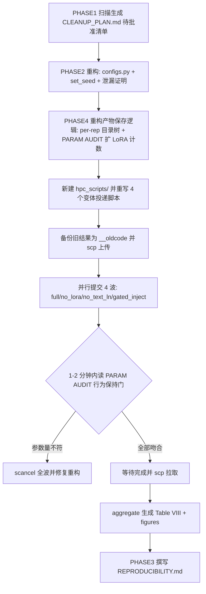

## 产品概述

面向开源级 IEEE JBHI 投稿，对 MIFlu 代码库执行一次彻底的本地工程化改造：审计清理杂物、重构为可复现架构、实现严格产物目录树、产出 `REPRODUCIBILITY.md`，最后用**最终重构代码并行重跑 4 个核心变体一次**，形成单一代码版本、单一布局的干净证据链。

## 三项不可协商约束（重构后必须继续成立并出具证明）

1. **双轨制指标**：Table V（正文）用 z-space MSE/MAE 对齐论文 1.542；图与补充材料用**物理单位（患者数）**经逆变换得到。
2. **完整 1025 行数据窗**：2002–2021 全量，**禁止截断到 966 行**；判据 `train_end=717 / val_end=819`（717+102+206=1025）。
3. **优先级子集**：只跑 4 个核心变体 `full`、`no_lora`、`no_text_ln`、`gated_inject`；不在 prompt ablation 上耗资源。

## 核心功能（4 个阶段）

- **PHASE 1 本地清理**：扫描全项目，识别散落 `.sh`/`.ps`、临时目录（`__pycache__/scratch/temp/debug`）、陈旧 CSV/PNG、备份目录、后台任务脚本，**仅生成安全的删除清单/脚本供批准**（不执行删除）。
- **PHASE 2 架构重构**：① 新建共享 `configs.py` 中央配置，5 个训练脚本统一引用，清除 `train_ablation.py`/`miflu_model.py` 内硬编码数字；② 审计并**证明** Scaler 只在训练集 `.fit()`、`mean_`/`scale_` 落盘且推理时重载；③ 新建全局 `set_seed()`，覆盖 `random`/`numpy`/`torch`/`cudnn`。
- **PHASE 3 顶刊文档**：生成 `REPRODUCIBILITY.md`（环境、数据准备、Table V/VIII 复现命令、图表复现命令）。
- **PHASE 4 严格产物树**：在 `train_ablation.py` / `aggregate_journal_tables.py` 实现 per-rep 目录树（逐 epoch `metrics.csv`、双轨预测 CSV、`checkpoints/best_model.pt`）与 `figures/`、`logs/job{id}_{variant}.out`。

## 用户已拍板的三个决策

1. **并行重跑全部 4 个核心变体**（4×A100 并行，约 40 分钟，单一代码版本）。
2. **新建 `hpc_scripts/` 并移入 14 个 sbatch 脚本**，训练代码与投递脚本分离。
3. **新建共享 `configs.py`，5 个脚本统一 import**（DRY、单一事实来源）。

## 关键顺序约束

**重构 → 验证行为不变 → 再重跑**。已实测的 `no_text_ln=1,028,520` 与 `gated_inject=17,537,449` 是基线事实，直接充当重构的**行为保持验证门**，避免重跑两次。

## 技术栈

Python 3.9 + PyTorch 2.5.1（CUDA 11.8）+ transformers（GPT2-small）+ numpy/pandas；HPC Slurm `gpu_a100`（`--gres=gpu:a100:1`、`--time=04:00:00`、QOS 每用户 4 作业）。**不引入任何新依赖**。

## 实现方案

### 1. 总体策略：先重构后重跑（避免二次算力开销）



### 2. PHASE 1：清理清单（只生成、不删除）

实测已确认的待清理对象：

- 根目录散落：`_tmp_hpc2.sh`、`_tmp_hpc3.sh`、`_tmp_hpc4.sh`、`_tmp_mon.sh`、`_tmp_pdftable_out.txt`、`_tmp_pdftable.py`、`auto_submit_anchor.sh`、`auto_submit_diag.sh`、`auto_submit_l36_48_60.sh`、`auto_submit_l48_60.sh`、`auto_submit_sens.sh`、`check_anchor_env.sh`、`hpc_gpu_check.sh`、`hpc_probe.sh`、`hpc_probe2.sh`、`verify_forward.py`。
- 陈旧备份目录：`_mlflu_wt_backup_20260830/`（8 png + 4 csv + txt + md）。
- 字节码缓存：`scripts/**/__pycache__/*.pyc`（实测 12 个）。
- 需逐个甄别后列入清单的：`analysis/`、`archive/`、`checkpoints/`、`results/` 下非最终期刊证据的旧 CSV/PNG；`data/` 下除 `raw/national_illness_raw.csv` 与 `scaler_miflu_national.json` 外的旧产物。

实测与用户描述不符之处（须在清单中显式说明）：**不存在 `hpc_scripts/` 目录**（14 个 `.sh` 全在 `scripts/` 下）；**`.ps` 文件 0 个**；**`watchdog*` 文件 0 个**。

### 3. PHASE 2.1：中央化配置

- 新建 `scripts/configs.py` 作为单一事实来源，容纳：`T/L_list/N/Lp/S/K/lora_r/lora_alpha/D/batch_size/learning_rate/epochs/num_repetitions/seed`、四项不可协商约束常量（`FULL_ROWS=1025`、`TRAIN_END=717`、`VAL_END=819`）、产物根目录与路径助手。
- 5 个训练脚本（`train_ablation.py:72`、`train_miflu.py:26`、`train_regional_miflu.py:18`、`train_regional_baseline.py:17`、`train_baseline.py:17`）删除各自重复的 `CONFIG = {}`，改为 `from configs import CONFIG, set_seed, ...`。
- `miflu_model.py` 的架构默认值（`D=768, N=7, T=104, K=6, S=2, Lp=24`）改为从配置注入；保留函数签名默认值以免破坏既有调用，但默认值本身取自配置常量。

### 4. PHASE 2.2：数据泄漏证明

审计 `scaler_utils.py::ScalerBundle` 与 `train_ablation.py::load_and_normalize`，并补强为可举证形式：

- 断言 scaler 拟合区间严格为 `[:train_end]`（717），并打印 `train_end/val_end` 与 `1025` 行总数；
- 断言 `val/test` 只走 `transform`（不得出现 `fit`/`fit_transform`）；
- 确保 `mean_`/`scale_` 写入 `data/scaler_miflu_national.json`，推理/导出阶段用 `load_or_fit` 重载而非重拟合，并在日志打印 scaler 来源（`loaded` vs `fitted`）；
- 输出一段可直接贴进 `REPRODUCIBILITY.md` 的泄漏自检证据。

### 5. PHASE 2.3：确定性执行

新建 `set_seed(seed)`，覆盖 `random.seed`、`np.random.seed`、`torch.manual_seed`、`torch.cuda.manual_seed_all`、`torch.backends.cudnn.deterministic=True`、`torch.backends.cudnn.benchmark=False`，并在**每个训练脚本最开头**调用（当前仅有 `torch.manual_seed(seed+L)` 于 `train_ablation.py:272`、`train_miflu.py:226`，属真实缺口）。需注明 `cudnn.deterministic=True` 会带来约 10–20% 训练降速，属可复现性的必要取舍。

### 6. PHASE 4：产物树与审计增强

- `train_ablation.py` 保存逻辑改造为 per-rep：每个 rep 输出 `rep_N/metrics.csv`（逐 epoch 的 train_loss / val_mse_all / val_mae_all / val_mse_ili / peak_hit 等）、`rep_N/predictions_miflu_L24_paper_protocol.csv`（双轨 z-space + 物理）、`rep_N/checkpoints/best_model.pt`。
- `best_model.pt` 语义：启用 `--early-stop` 时由 `PeakAwareEarlyStopping` 决定（门控 `loss 改善 且 peak_hit_rate > 0.7`）；未启用时退化为「验证集最优」检查点，并在产物内写 `checkpoint_meta.json` 标明来源，避免歧义。
- `early_stopping.py` 的 `save_dir` 指向 `rep_N/checkpoints/`。
- **扩展 PARAM AUDIT**：除总可训练参数量外，额外输出 LoRA 参数计数（名字含 `lora_A`/`lora_B` 的张量数与参数量），这是满足「`no_lora` 必须零 `lora_A`/`lora_B`」的**必要前提**（当前审计只打总数，无法证明）。
- `aggregate_journal_tables.py` 适配新布局：改为遍历 `{variant}/reps_1_to_10/rep_*/metrics.csv`，并保留既有的 `<10 有效 rep → [INCOMPLETE] 排除` 与「缺 prediction CSV → 排除」规则。
- 日志命名：投递脚本用 `#SBATCH --job-name={variant}` 配合 `--output=.../logs/job%j_%x.out`，得到 `job519329_no_text_ln.out`；**统一从项目根 `sbatch`**，消除既有的日志路径分裂问题。
- `figures/`：将物理单位评估图输出到 `hpc_results/journal_evidence/figures/fig_miflu_eval_continuous_L24.png`；`fig_attention_heatmap.png` 需新增脚本导出 `gated_inject` 的 `ModalityAligner.cross_attn` 注意力权重（作为「跨模态注意力被激活」的直接证据）。

### 7. 行为保持验证门（重跑前必过）

| 变体 | 期望可训练参数 | 硬性规则 |
| --- | --- | --- |
| full | ≈1,030,056 | 必须 ≈1M；若 ≈17M 说明解冻逻辑污染基线 |
| no_lora | ≈956,328 | **LoRA 参数计数必须为 0** |
| no_text_ln | 1,028,520（已实测） | text_ln 退化为 Identity |
| gated_inject | 17,537,449（已实测） | 必须显式 `unfreeze_first_k=2` |


验证方式：4 波提交后 **1–2 分钟内**读取各作业 rep_1 起始的 PARAM AUDIT 行比对；任一项不符即 `scancel` 全波并修复（登陆节点因 `RLIMIT_NPROC=256` 无法 import torch，故不能本地预验）。

## 实施要点（防返工与事故）

- **PHASE 1 只出清单**：生成 `CLEANUP_PLAN.md`（含删除理由与可逆备份建议），绝不直接删除；严禁触碰 `scripts/`、`hpc_scripts/`、`data/raw/`、`hpc_results/journal_evidence/`。
- **重跑前先备份**：`cp -r <variant> <variant>__oldcode`（4 个变体全备份），保留旧数字用于新旧一致性比对，这是可复现性证据的一部分。
- **Windows OpenSSH 静默剥离双引号**：含空格或括号的远端命令（`grep "PARAM AUDIT"`、`echo "job (full)"`）必须用**单引号**包裹，否则报 `No such file` 或 `syntax error near unexpected token '('`（已实测踩坑两次）。
- **HPC 不自动同步**：本地改动必须 `scp` 重传；作业在启动时刻读码，重传不影响在跑作业。
- **日志路径分裂修复**：统一从项目根提交，杜绝 `Chattime` 与 `$HOME` 两处日志。
- **GPU 任务一律上 HPC**（用户硬性偏好），本地仅编辑与轻量检查；结果落盘后按 `HPC_GUIDE.md` 用 `scp` 回传本地 `results/ili/`。

## 目录结构

```
MLFlu/
├── REPRODUCIBILITY.md                     # [NEW] 顶刊级复现文档：环境/数据/Table V&VIII 命令/图表命令
├── CLEANUP_PLAN.md                        # [NEW] PHASE 1 待批准删除清单（含理由，不含执行）
├── configs 相关内容
│   └── scripts/configs.py                 # [NEW] 中央配置 + set_seed + 路径助手（单一事实来源）
├── scripts/
│   ├── train_ablation.py                  # [MODIFY] 引用 configs/set_seed；per-rep 产物树；逐 epoch metrics；双轨预测 per-rep；扩展 PARAM AUDIT（含 LoRA 计数）
│   ├── miflu_model.py                     # [MODIFY] 架构默认值改为从 configs 注入（行为保持）
│   ├── train_miflu.py                     # [MODIFY] 统一 import configs + set_seed
│   ├── train_baseline.py                  # [MODIFY] 同上
│   ├── train_regional_miflu.py            # [MODIFY] 同上
│   ├── train_regional_baseline.py         # [MODIFY] 同上
│   ├── early_stopping.py                  # [MODIFY] save_dir 指向 rep_N/checkpoints/
│   ├── scaler_utils.py                    # [VERIFY] 证明 fit 仅训练集，补断言与来源日志
│   ├── aggregate_journal_tables.py        # [MODIFY] 适配 per-rep 新布局，保留 <10 rep 排除规则
│   ├── export_attention_heatmap.py        # [NEW] 导出 gated_inject 的 ModalityAligner 跨模态注意力权重
│   └── （既有 5 问修复模块保持不动）scaler_utils/cdc_calendar/compute_miflu_indicators/recipes/early_stopping
├── hpc_scripts/                           # [NEW] 由 scripts/ 移入并整理
│   ├── submit_full.sh                     # [NEW] --job-name=full, logs/job%j_%x.out
│   ├── submit_no_lora.sh                  # [NEW] --job-name=no_lora
│   ├── submit_no_text_ln.sh               # [NEW] --job-name=no_text_ln
│   ├── submit_gated_inject.sh             # [NEW] --job-name=gated_inject
│   └── submit_miflu_paper_protocol.sh     # [MOVE] Table V 主流程投递脚本
├── hpc_results/journal_evidence/          # 重跑后按严格树重建（旧结果先备份为 __oldcode）
│   ├── {variant}/reps_1_to_10/rep_N/{checkpoints/best_model.pt, metrics.csv, predictions_miflu_L24_paper_protocol.csv}
│   ├── figures/{fig_miflu_eval_continuous_L24.png, fig_attention_heatmap.png}
│   └── logs/job{id}_{variant}.out
└── data/
    ├── raw/national_illness_raw.csv
    └── scaler_miflu_national.json         # mean_/scale_ 落盘，推理重载
```

## 关键代码结构

```python
# scripts/configs.py —— 中央配置 + 确定性 + 路径助手（单一事实来源）
CONFIG = {
    "T": 104, "L_list": [24, 36, 48, 60], "N": 7,
    "Lp": 24, "S": 2, "K": 6, "lora_r": 4, "lora_alpha": 4.0, "D": 768,
    "batch_size": 16, "learning_rate": 5e-4, "epochs": 20,
    "num_repetitions": 10, "seed": 42,
}
# 不可协商约束常量（供断言与文档引用）
FULL_ROWS, TRAIN_END, VAL_END = 1025, 717, 819
CORE_VARIANTS = ("full", "no_lora", "no_text_ln", "gated_inject")

def set_seed(seed: int) -> None:
    """全局确定性：random / numpy / torch / cuda / cudnn。"""
    ...

def rep_dir(variant: str, rep: int) -> str:
    """{root}/{variant}/reps_1_to_10/rep_{rep:02d}"""
    ...
```

```python
# train_ablation.py —— 扩展后的 PARAM AUDIT（新增 LoRA 计数，用于证明 no_lora 零 LoRA）
trainable = {n: p.numel() for n, p in model.named_parameters() if p.requires_grad}
lora_names = [n for n, _ in model.named_parameters() if "lora_A" in n or "lora_B" in n]
lora_params = sum(p.numel() for n, p in model.named_parameters()
                  if "lora_A" in n or "lora_B" in n)
log(f"[PARAM AUDIT] Variant: {variant_name} | "
    f"Total Trainable Params: {sum(trainable.values()):,} | "
    f"LoRA tensors: {len(lora_names)} | LoRA params: {lora_params:,} | "
    f"use_text_ln={use_text_ln} use_lora={use_lora} "
    f"gated_inject={gated_inject} unfreeze_first_k={unfreeze_first_k}")
```

```python
# train_ablation.py —— per-rep 逐 epoch metrics（PHASE 4 要求）
epoch_rows.append({
    "epoch": ep + 1, "train_loss": tl_loss,
    "val_mse_all": v_mse_all, "val_mae_all": v_mae_all, "val_mse_ili": v_mse_ili,
    "peak_hit_rate": peak["peak_hit_rate"] if stopper else None,
})
pd.DataFrame(epoch_rows).to_csv(os.path.join(rep_dir, "metrics.csv"), index=False)
```

## 性能

4 个变体并行（QOS 上限 4），单变体约 30–40 分钟（参考：job1 中 full 01:58→02:27、no_lora 02:39→03:08；gated_inject 因 3.8s/epoch 更快），整波约 40 分钟，远低于 4 小时墙钟。`cudnn.deterministic=True` 预计带来 10–20% 降速，仍在预算内。per-rep 预测 CSV 使单变体产物增至约 30 MB，全量拉取约数百 MB，可接受。

## Agent Extensions

### SubAgent

- **code-explorer**
- Purpose: ① PHASE 1 全盘扫描待清理文件（根目录散落 `.sh`/`.ps`/`.py`、`__pycache__`、`_mlflu_wt_backup_20260830/`、`analysis`/`archive`/`checkpoints`/`results` 下的陈旧 CSV/PNG、`data/` 下非 `raw/` 与 scaler 的旧产物），输出带路径的清单；② PHASE 2.1 定位 `train_ablation.py` 与 `miflu_model.py` 内所有硬编码魔法数字（`24`、`2`、`768`、`104`、`6`、`4` 等）的确切行号；③ PHASE 4 定位 `train_ablation.py` 现有的 checkpoint / metrics / prediction 写入点，以及 `make_miflu_evaluation_figure.py` 的图表输出路径，供改造为严格产物树使用。
- Expected outcome: 三份带文件路径与行号的命中清单，确保清理无遗漏、中央化配置无遗漏数字、产物重定向无遗漏写入点；据此生成 `CLEANUP_PLAN.md` 并完成行为保持重构。