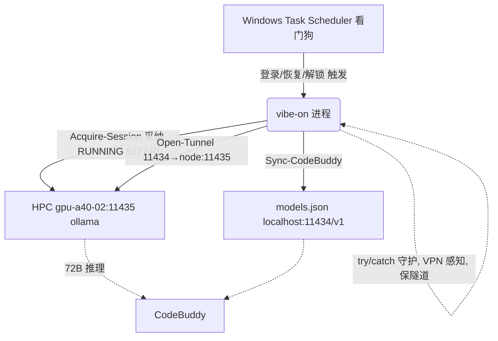

## 用户需求

针对 2026-08-30 23:31 发生的「CodeBuddy 报 10006 / Tunnel DOWN / 网关 daemon 进程死亡」事故，对 Burgundy Vibe Coding 网关做加固，使其不再复现，且严格保证**绝不误杀或重提活着的 72B 作业 517740**。

## 产品概述

网关是把 CityUHK Burgundy HPC 上的 ollama 透传为本地 `http://localhost:11434/v1` 的常驻守护进程。本次只加固其健壮性，不改变「采纳既有 RUNNING 作业、仅重建隧道」的核心行为。

## 核心特性

- **守护进程崩溃自愈**：主监督循环加 `try/catch`，任何瞬时异常（ssh 抖动、Get-Process/Invoke-RestMethod 偶发报错）只记录日志并回到监督状态，绝不让进程退出，也不撤隧道、不 `scancel`。
- **VPN 不可达感知**：把 ssh 失败的「 inconclusive（查不到）」与「作业真死」严格区分；VPN/集群断连时跳过冗余的 `scontrol` 复核，仅记日志并死等重连，隧道保持不动。
- **看门狗自动重启**：通过 Windows 任务计划程序在「登录 / 系统从睡眠恢复 / 解锁」时自动拉起 `vibe-on`，进程崩溃或笔记本重启后自行重新采纳活作业 517740，CodeBuddy 无需手工干预。
- **保活既有防护**：确认当前脚本已有的 `$MissThreshold=3` 连续未命中 + `Confirm-JobGone`（scontrol 二次确认） + 单实例锁三层防误判/防作业风暴逻辑完好，加固时不破坏。

## 技术栈

- 语言/运行时：Windows PowerShell 5.1（`vibe_gateway.ps1` 已是 pwsh 脚本）
- 操作系统：Windows 10/11（用户笔记本）；自动重启依赖 Windows 任务计划程序（Task Scheduler）
- 远程调用：OpenSSH（`ssh`/`scp`），无密码密钥，已验证可 `BatchMode` 无交互连通

## 实现方案

### 探查结论（关键事实）

通读 `$BvRoot\vibe_gateway.ps1`（1117 行）后确认：工作记忆里「Maintain-Session 误判 bug 未修」**已过时**——当前代码已具备：

- 三态 `Get-JobAlive`（返回 `$true/$false/$null`），`$null` 视为 inconclusive 仅记警告、保隧道；
- `$MissThreshold=3`：连续 3 次未命中才进入 `Confirm-JobGone`；
- `Confirm-JobGone` 用 `scontrol show job` 二次确认，未确认则「holding the tunnel」；
- `Acquire-InstanceLock`（内核 Mutex + WMI 进程兜底）已防多实例互杀隧道。

因此真正的剩余缺陷是两点：**(1) 主循环 `try/finally` 没有 `catch`**，`Maintain-Session` 内任何未处理异常会直接终止 daemon 进程（这正是本次 daemon 死亡的根因）；**(2) 进程死后无自动重启**（笔记本睡眠/重启后隧道永久 DOWN）。VPN 感知仅需增强日志与跳过冗余查询。

### 关键技术决策

1. **主监督循环加内层 `try/catch`**（最重要）：把 `Acquire-Session`/`Maintain-Session` 调用包进 `try/catch`，捕获后仅 `Write-Log` + `Start-Sleep` + 回到 `while($true)`，绝不进入 `finally` 退出。外层 `try/finally` 仅保留用于释放实例锁。这样 VPN/ssh 抖动、偶发 COM/网络异常都不再杀死进程，隧道由 `Maintain-Session` 内的 `Test-LocalPort`→`Open-Tunnel` 自动重建（该逻辑已存在）。
2. **VPN 不可达探测**：在 `Maintain-Session` 的 inconclusive 分支，依据 `Invoke-Hpc` 返回的 stderr 文本（`Could not resolve hostname` / `Name or service not known` / `Connection timed out` / `No route to host`）置 `$script:VpnDown`，跳过 `Confirm-JobGone` 不必要的 `scontrol` 调用，日志明确写「VPN/集群不可达，保隧道等重连」。不改变现有「保隧道」语义。
3. **看门狗（Task Scheduler）**：新建 `install_watchdog.ps1` 用 `Register-ScheduledTask` 注册一个任务，触发器为「At log on」「On workstation unlock」以及电源恢复事件（System/Power-Troubleshooter EventID 1）。动作 = 启动 `vibe-on.bat`（即 SSOT 的 `vibe_gateway.ps1`）。因单实例锁，活 daemon 在时该任务会 `exit 3` 无害退出；daemon 崩/重启后锁释放，任务重新拉起并 `Acquire-Session` 采纳 517740。

### 性能与可靠性

- 全部改动为零新增网络负载：VPN 探测只是复用已有 `Invoke-Hpc` 的返回文本判断；`HealthInterval=20s` 轮询节奏不变。
- 安全红线：所有 `catch` 分支**严禁**调用 `Stop-Tunnel`/`scancel`；只有 `node_failure.flag` 真命中节点名与 `Confirm-JobGone` 真确认才允许释放，现有逻辑保持不变。
- 看门狗幂等：任务多次触发安全；不重复提交作业（依赖 `Acquire-Session` 的 adopt 而非 submit）。

## 实现备注

- 修改前先 `git`/备份 `vibe_gateway.ps1`（它不是 MLFlu 仓库文件，属 `Burgundy-Vibe-Core` SSOT，按既有约定不回退 `$ScriptDir`）。
- 改完用 `vibe-on -DryRun` 验证审计路径不报错；再让活作业 517740 在线时实跑 `vibe-on`，确认状态 `LISTENING` 且 `/v1/chat/completions` 返回 `qwen2.5:72b`。
- 看门狗注册后用 `schtasks /Query /TN BurgundyVibeWatchdog` 校验，并模拟进程被杀后 10s 内自动复活。
- 爆炸半径控制：仅改 `Burgundy-Vibe-Core` 下两个文件 + 注册一个计划任务；不动 HPC 侧 `burgundy_smart_launcher.sh`、不动 `models.json`、不动 MLFlu 仓库。

## 架构设计

单文件加固 + 外部看门狗，组件关系不变：



## 目录结构

```
C:\Users\Asus\Desktop\Burgundy-Vibe-Core\
├── vibe_gateway.ps1     # [MODIFY] 主监督循环加内层 try/catch 防 daemon 崩溃；Maintain-Session 增加 VPN 不可达探测（跳过冗余 scontrol、明确日志）；保留 MissThreshold/Confirm-JobGone/单实例锁/保隧道语义不变。严禁在 catch 中 Stop-Tunnel 或 scancel。
└── install_watchdog.ps1 # [NEW] 幂等注册 Windows 计划任务 BurgundyVibeWatchdog：触发器=登录+解锁+电源恢复事件；动作=启动 vibe-on.bat（SSOT 网关）。依赖单实例锁，活 daemon 在时安全退出。
```

## 关键代码结构

主循环改造（保持现有 `finally` 释放锁，新增内层 `try/catch`，异常仅记录并继续监督，不退出、不撤隧道）：

```
try {
    while ($true) {
        try {
            $session = Acquire-Session
            if ($null -eq $session) {
                if ($DryRun) { Write-Log 'DryRun complete.' 'DRY'; break }
                Write-Log 'Could not acquire a session; retrying in 60s' 'ERROR'
                Start-Sleep -Seconds 60
                continue
            }
            if ($DryRun) { Write-Log 'DryRun complete (session path verified).' 'DRY'; break }
            Maintain-Session -Session $session
        }
        catch {
            Write-Log ("Supervise exception ({0}): {1} — tunnel/job preserved, re-supervising" -f $_.Exception.GetType().Name, $_.Exception.Message) 'ERROR'
            Start-Sleep -Seconds 15
        }
        Write-Log 'Session cycle ended; re-acquiring in 10s' 'WARN'
        Start-Sleep -Seconds 10
    }
}
finally {
    Release-InstanceLock
    Write-Log 'Gateway stopping (tunnel left running so CodeBuddy stays usable).'
    Write-Log 'Use "vibe-on -Stop" to also cancel the Slurm job.'
}
```

VPN 不可达探测（在 `Maintain-Session` 的 inconclusive 分支，依据 `Invoke-Hpc` 返回判断，置标志并跳过 `Confirm-JobGone`）：

```
$sshDead = $out -match 'Could not resolve hostname|Name or service not known|Connection timed out|No route to host'
if ($sshDead) {
    $script:VpnDown = $true
    Write-Log "Job $($Session.JobId) unreachable (VPN/cluster down) — holding tunnel, will retry" 'WARN'
}
else { $script:VpnDown = $false }
# 仅当 $script:MissCount -ge $MissThreshold 且 非 VPN 不可达 时调用 Confirm-JobGone
```