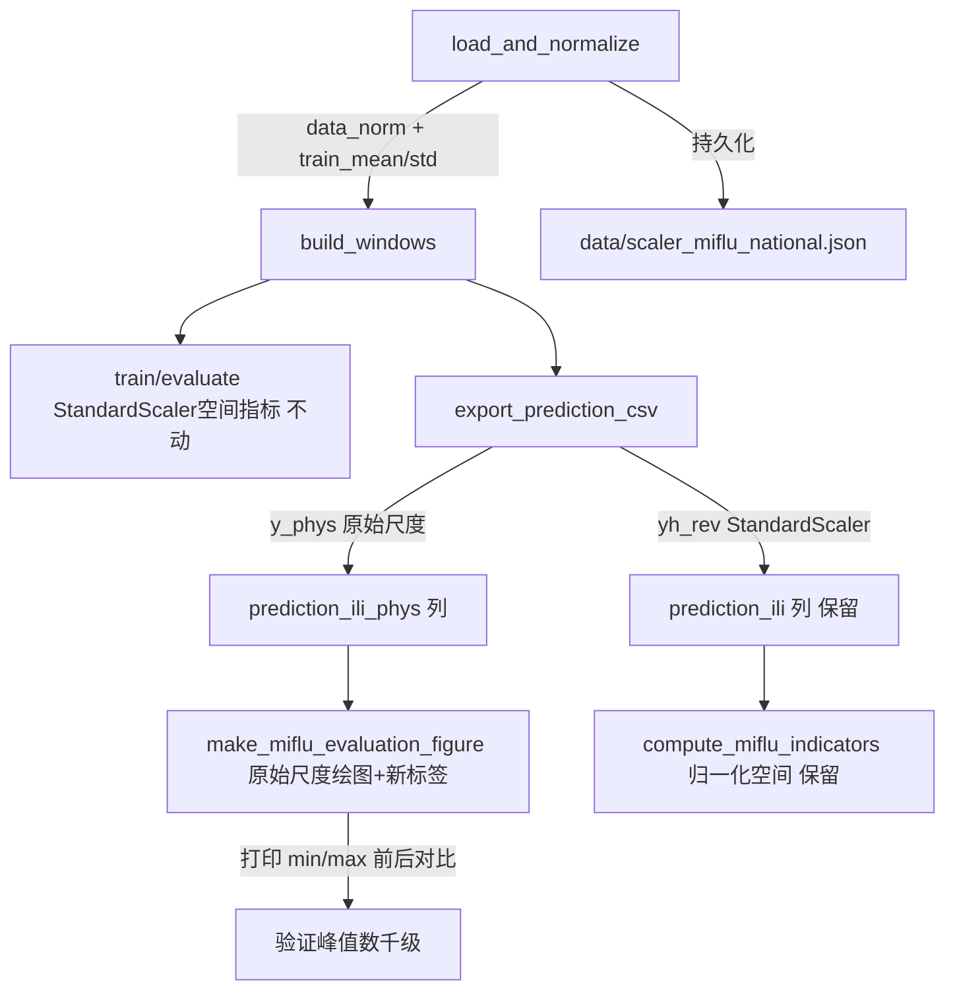

## 用户需求

### 第一步：诊断（仅输出报告，不改代码）

逐条核实归一化流水线并给出带证据（文件名+行号+代码片段）的结论：

1. 预处理是否每变量 StandardScaler 且 fit 训练集；mean_/scale_ 是否持久化到磁盘；
2. 模型内部是否有实例归一化、输出是否反算、输出张量处于哪个空间（StandardScaler 空间 / 窗口实例归一化空间 / 原始空间）；
3. 当前 MSE/MAE/RMSE/PCC 在哪个空间计算；
4. 当前绘图用哪个空间的值、Y 轴标签是什么、画的是哪一列（确认是 ILITOTAL 而非加权 ILI%）。

### 第二步：最小修复（本次唯一允许的改动）

a) 训练时把每个变量的 StandardScaler mean/std 持久化保存；
b) 推理后把预测还原到原始尺度（先 `win_std*pred+win_mean` 反 RevIN，再 `pred*scaler.scale_+scaler.mean_`）；
c) 绘图改用原始尺度，Y 轴标签改为 "Number of ILI patients (ILITOTAL)"；
d) 同时保留"归一化空间指标"计算路径并在输出中注明（论文国家任务 MSE/MAE 在 StandardScaler 空间；区域任务 RMSE/PCC 在原始尺度）；
e) 输出修复前后同一张图的 min/max 对比，确认峰值量级回到数千级。

## 产品概述

对 MIFlu 国家流感预测项目的归一化与绘图链路做一次性诊断 + 最小修复，使发布的评估曲线反映真实患者数量级（数千~十万），同时不破坏论文协议要求的 StandardScaler 空间指标。

## 核心特性

- 持久化每变量训练集 StandardScaler 均值/标准差
- 预测 CSV 同时包含 StandardScaler 空间与原始尺度两列
- 评估图默认使用原始尺度并修正 Y 轴标签
- 保留归一化空间指标路径并显式注明其论文协议归属
- 打印修复前后同图 min/max 以验证峰值量级恢复

## 技术栈

- 语言：Python 3.9（与 HPC 环境 `mlflu_hpc` 一致）
- 数值/绘图：numpy / pandas / matplotlib / scipy（现有依赖，无新增）
- 仅改动 `scripts/train_miflu.py` 与 `scripts/make_miflu_evaluation_figure.py` 两文件，新增一个 scaler 持久化文件（JSON/NPZ），不引入新第三方库。

## 诊断结论（已核实，作为计划依据）

### 1. 预处理

- `scripts/train_miflu.py:76-78`：手动 `(data - train_mean)/train_std`，`train_mean=data[:t_end].mean(axis=0)`、`train_std=data[:t_end].std(axis=0)+1e-8`，等价于每变量 StandardScaler 且 fit 训练集（train_end=int(n*0.70)）。
- **未持久化**：`train_mean`/`train_std` 仅存在于返回 dict，全局搜索无 `.save`/joblib/pickle/JSON 写盘。→ 缺口(a)。

### 2. 模型内部空间

- `scripts/miflu_model.py:165-171`：TimeSeriesEmbedder 做实例归一化（每窗口每变量减均值除标准差）。
- `scripts/miflu_model.py:480`：`y_hat_rev = y_hat_norm*stdevs+means`（**StandardScaler 空间**）。
- `scripts/miflu_model.py:487`：`y_phys = y_hat_rev*ts+tm`（**原始尺度**，clamp≥0）。模型返回 `(y_hat_rev, y_phys, means, stdevs)`。
- 结论：输出 `y_hat_rev` 处于 StandardScaler 空间；`y_phys` 处于原始尺度。

### 3. 指标计算空间

- `scripts/train_miflu.py:154-174`：`evaluate()` 用 `yh_rev`（StandardScaler 空间）vs `by`，`mse_all/mae_all/mse_ili/mae_ili/pcc_ili` 均在 StandardScaler 空间。RMSE=√MSE。→ 符合论文国家任务协议，本次**不改**。

### 4. 绘图空间与标签

- `scripts/make_miflu_evaluation_figure.py:342-347`：读 CSV 后 `groupby(abs_week).mean()` 取 `ground_truth_ili`/`prediction_ili`（**StandardScaler 空间**），用于绘图与 indicators。
- `scripts/make_miflu_evaluation_figure.py:211`：`ax.set_ylabel("ILITOTAL (patient count)")` —— 标签称患者数，但值为标准化小数（~0–12），**标签与空间不符**。
- 画的是列 `prediction_ili`（来自 ILITOTAL 通道 4，`train_miflu.py:279` `by.cpu().numpy()[:,4,:]`），**列选择正确（ILITOTAL 非加权 ILI%）**，仅尺度/标签错。

## 实现方案

### 总体策略

保持指标计算（evaluate）完全不动；在"导出 CSV"环节补全原始尺度列；在"绘图"环节切换到原始尺度列并修正标签；新增 scaler 持久化。修复前后对比通过脚本末尾打印 min/max 实现。

### 关键决策与权衡

- **为什么不改 evaluate()**：论文国家任务 MSE/MAE 明文在 StandardScaler 空间（`MIFlu_paper.md` Section V-B）。改指标空间会破坏与 Table V 的可比性。因此(d)要求"保留归一化空间指标路径并注明"，原路径原样保留。
- **为什么新增物理列而非替换**：indicators（`compute_miflu_indicators.py`）在 StandardScaler 空间算 Timing/Peak-Intensity，需与原空间列对齐；同时 region 任务 RMSE/PCC 在原始尺度，物理列也为其提供便利。两列并存零冲突。
- **持久化格式选 JSON（float 列表）**：轻量、可读、无 sklearn 版本依赖；与现有 `data/` 产物风格一致。
- **反算顺序严格遵循模型 forward**：先 RevIN（`y_hat_norm*stdevs+means` 已是 y_hat_rev），再 `y_hat_rev*scale_+mean_`。导出时直接取模型第二返回值 `y_phys` 即可，无需重复实现公式，避免漂移。

### 性能与可靠性

- CSV 体积：每 L 增加 2 列，L=60 约 2.5MB→3MB，可忽略；groupby 聚合次数翻倍但数据量小（千行级），开销可忽略。
- 向后兼容：旧 `predictions_miflu_L*_paper_protocol.csv` 缺物理列时，绘图脚本需优雅回退到原列（assert 改条件判断），避免破坏已有产物重绘。
- 不触发 leakage：物理还原只用训练集 mean/std 与窗口实例统计量（模型内部已算），无测试集信息泄露。

## 实现要点（执行细节，防回归）

- `export_prediction_csv` 改 `yh_rev, y_phys, _, _ = model(...)`（L277），`pr_phys=y_phys.cpu().numpy()[:,4,:]`，`gt_phys` 由 `by`（StandardScaler 空间）经 `y_rev*ts+tm` 反算（或直接对原始 data 取 ILITOTAL 通道，更稳：用 `data_dict` 原始值按 abs_week 取，避免双重缩放误差）。**推荐**：gt_phys 直接从 `data_dict["raw_ili"]`（新增，load 时缓存 ILITOTAL 原始列）按 `gi+s` 索引取，pred_phys 用 `y_phys`。二者同空间、零歧义。
- scaler 持久化：`main()` 在 `load_and_normalize()` 后写 `data/scaler_miflu_national.json`，含 `mean`（list）、`std`（list）、`train_end`、`val_end`、`VAR_COLS`。
- 图注注明：在 `build_continuous_panel` 或 `add_annotation_box` 增加一行 "Metrics (MSE/MAE) computed in StandardScaler space per paper protocol (MIFlu_paper.md V-B)"。

## 架构设计



## 目录结构

```
project-root/
├── data/
│   └── scaler_miflu_national.json      # [NEW] 持久化每变量 mean/std/train_end/val_end/VAR_COLS
├── scripts/
│   ├── train_miflu.py                  # [MODIFY] load_and_normalize 缓存原始 ILITOTAL 列；main 写 scaler JSON；export_prediction_csv 取 y_phys 并新增 *_phys 列
│   └── make_miflu_evaluation_figure.py # [MODIFY] 默认读 *_phys 列绘图，Y 标签改 "Number of ILI patients (ILITOTAL)"；保留 StandardScaler 列供 indicators；末尾打印修复前后 min/max
```

## 关键代码接口（仅签名/结构）

- `load_and_normalize()` 返回 dict 新增键：`"raw_ili"`（shape (n,) float32，ILITOTAL 原始列）、`"scaler_meta"`（mean/std 列表）。
- `export_prediction_csv` 写出列：`split, abs_week, step, ground_truth_ili, prediction_ili, ground_truth_ili_phys, prediction_ili_phys`。
- `make_miflu_evaluation_figure.py` 新增 CLI：`--space {phys,scaler}`，默认 `phys`。