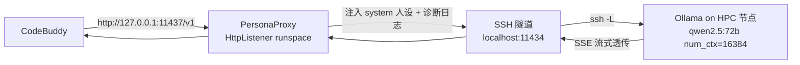

## 用户需求

- 在 CodeBuddy 与 SSH 隧道之间插入一个**本地反向代理（Proxy Interceptor）**，对每次 `/v1/chat/completions` 请求注入常驻的「静默代理工程师」系统人设，使本地 Qwen-72B 默认以代码优先的自主 agent 风格工作。
- 在 `models.json` 同步模块中保持 `supportsToolCall=true` 并把 URL 指向代理端口（原 11434 隧道保持不变，代理监听新端口 11437）。
- 增加**工具链路诊断**：记录 CodeBuddy 是否真的下发 `tools` schema、模型是否真的回 `tool_calls`，用于定位「无手」问题究竟在 models.json 层、CodeBuddy 调度层还是模型/格式对齐层。
- HPC 侧 Ollama 性能优化：`num_ctx` 由 65536 降到 16384、新增 `OLLAMA_NUM_PARALLEL`，缓解逐字卡顿。

## 核心特性

- **人设注入（可被覆盖）**：请求无 system 消息则插入，已有则把人设**前置拼接**到原 system 内容之前；不删除 CodeBuddy 原有 system，不在模型想给解释时强制闭嘴。
- **纯透传代理**：在独立 runspace 内用 HttpListener 监听 `127.0.0.1:11437`，向上游 `http://127.0.0.1:11434/v1`（隧道）转发；SSE 流式与工具调用 delta 逐字节透传；代理异常隔离在 runspace 内，绝不冒泡杀掉守护进程、绝不撤隧道或 scancel。
- **工具诊断日志**：`BURGUNDY_DIAG=1` 或 `-Diag` 时记录请求 `model`、是否含 `tools` 及数量/名称、响应是否含 `tool_calls`。
- **提速**：降低 KV cache 上下文长度 + 并发请求数，首 token 延迟与吞吐较 65536 明显改善。

## 已知边界（对用户诚实）

- 系统人设注入**不能**让 Qwen 真正「有手」；工具能力由 CodeBuddy 的 `supportsToolCall`（已为 true）与模型/工具格式对齐决定，诊断日志仅用于定位真实断点。
- 代理是常驻本地 HTTP 服务，SSE 与工具 delta 透传实现若有误反而会变卡或弄坏流式工具调用，需重点实测。
- `num_ctx=16384` 会截断超长上下文会话（编码任务通常够用），属已接受的权衡。

## 技术栈

- 语言：PowerShell 7（本地编排/代理）、Bash（HPC launcher）
- 本地代理：.NET `HttpListener` + `System.Net.Http.HttpClient`，运行在独立 PowerShell runspace
- 上游：既有 SSH 隧道（`11434 → <node>:11435`）+ Ollama（OpenAI 兼容 `/v1`）
- 配置注入点：`%USERPROFILE%/.codebuddy/models.json`

## 实现方案

在 `vibe_gateway.ps1` 现有守护进程内**新增**一个反向代理组件，而非重写；保留 2026-08-30 已加固的主循环 try/catch、三态存活探测、单实例锁、VPN 感知与看门狗。代理与隧道、各 HPC 会话完全解耦——代理只改请求体里的 system 消息并透传其余内容，红线是「代理故障只关自己，不碰隧道/作业」。

### 请求流（改造后）



### 关键技术决策

1. **新端口 11437 而非复用 11434**：避免与既有隧道端口冲突，models.json 仅改 URL，隧道/作业/看门狗逻辑零改动。
2. **runspace 隔离**：代理 `while($true)` 循环包在 runspace 的 `try/catch` 中，监听/转发异常只记日志并重启监听，不触发主进程退出、不触发 `Stop-Tunnel`/`scancel`（沿用既有加固红线）。
3. **人设前置拼接（q-2「可被覆盖」）**：若请求已带 system 消息，把 `$PersonaText` 拼到其最前；若没有则新建一条。绝不覆盖 CodeBuddy 自身的系统指令。
4. **SSE 透传**：用 `HttpClient` 取得上游响应后，将其 `Content` 流逐块拷贝到 `HttpListener` 的输出流，并透传 `Content-Type`/状态码；非流式请求读全量后写回。`tools` 数组原样透传。
5. **诊断（q-0）**：仅在 `$script:Diag` 时，对 chat 请求记录 `model` 与 `tools` 的存在/数量/名称；对响应记录是否出现 `tool_calls`（非流式可解析；流式记录首包是否含 `tool_calls` 标记），以此判定「无手」断点层。
6. **提速**：launcher 中 `BV_NUM_CTX` 默认由 32768 改 16384，并新增 `OLLAMA_NUM_PARALLEL`（A40 显存留余量取 2）；需先全局定位并清除 `BV_NUM_CTX=65536` 的硬编码覆盖。launcher 由 `Submit-VibeJob` 在每次提交时重传 HPC，故本地改文件即可在下次提交生效；对活作业 517740 需重提或节点内 `ollama create` 重建方能生效（计划中已标注）。

## 实现注意事项

- **性能**：代理只做轻量 JSON 改写 + 流拷贝，不缓冲全量响应（避免内存峰值与首 token 延迟）；使用 `HttpClient` 单例复用连接。
- **日志**：复用现有 `Write-Log`；诊断日志带 `[DIAG]` 级别，避免泄露请求体全量（仅记 model/tools 元信息），防止日志膨胀与敏感信息外泄。
- **爆炸半径控制**：代理新增代码绝不调用 `Stop-Tunnel`/`Invoke-Hpc "scancel"/Submit-VibeJob`；`-NoProxy` 开关可完全跳过代理、回退到直连隧道（models.json 退回 11434）。
- **回归红线**：改动后守护进程主循环、看门狗、`Acquire-InstanceLock`、作业自愈路径必须不受影响——杀 daemon 后看门狗重拉应同时重拉代理、采纳活作业、不产生新 sbatch。

## 架构设计

代理作为守护进程内的一个子组件随 daemon 同生共死：daemon 在 `Acquire-InstanceLock` 之后、`while($true)` 监督之前调用 `Start-PersonaProxy`（除非 `-NoProxy`）；daemon 全部退出路径（含 `Invoke-Stop`、捕获的终止）调用 `Stop-PersonaProxy` 释放 `HttpListener`。看门狗重拉 daemon 即重拉代理，无需单独编排。

## 目录结构

```
C:\Users\Asus\Desktop\Burgundy-Vibe-Core\
├── vibe_gateway.ps1          # [MODIFY] 新增代理+人设+诊断能力，保留全部既有健壮性
│   ├── param 块(27-44)        # 新增 [int]$ProxyPort=11437 / [switch]$Diag / [switch]$NoProxy
│   ├── 常量区(49-106)         # 新增 $ProxyPort / $EnableProxy / $PersonaText / $script:Diag
│   ├── Start-PersonaProxy     # [NEW] HttpListener runspace：监听11437、注入人设、透传SSE、诊断日志
│   ├── Stop-PersonaProxy      # [NEW] 释放 HttpListener
│   ├── Sync-CodeBuddy(535-605)# [MODIFY] url 改为 http://127.0.0.1:$ProxyPort/v1（启用代理时）
│   └── 主启动(1100-1115+)     # [MODIFY] 锁后启代理、退出路径停代理
└── burgundy_smart_launcher.sh # [MODIFY] OLLAMA 性能参数 + num_ctx 默认
    ├── OLLAMA env(81-94)      # [MODIFY] 新增 export OLLAMA_NUM_PARALLEL="2"
    └── LADDER(165)            # [MODIFY] ${BV_NUM_CTX:-32768} -> ${BV_NUM_CTX:-16384}
```

## 关键代码结构（接口级）

```
# 代理核心（runspace 内运行，异常隔离）
function Start-PersonaProxy {
    param([int]$ListenPort = 11437, [int]$UpstreamPort = 11434, [string]$Persona)
    # 1. HttpListener.Prefixes.Add("http://127.0.0.1:$ListenPort/")
    # 2. 循环 GetContext：
    #    - POST /v1/chat/completions -> 解析 body，合并 system 人设，HttpClient 转发上游，流拷贝响应
    #    - GET  /v1/models 及其它      -> 直接转发上游
    # 3. 仅 $script:Diag 时记录 model/tools/tool_calls 元信息
}

# 人设合并（满足 q-2 可被覆盖）
function Merge-Persona {
    param($Messages, [string]$Persona)
    # 无 system -> 插入 {role:system, content:$Persona}
    # 有 system -> 前置拼接：{role:system, content:"$Persona`n`n" + 原 content}
    # 返回修改后的 Messages（tools 数组不动）
}
```

## Agent Extensions

### SubAgent

- **code-explorer**
- Purpose: 跨文件定位 `BV_NUM_CTX=65536` 的硬编码赋值位置（vibe_gateway.ps1、scripts/submit_ablation.sh、vibe-on 函数/$PROFILE 等），以及任何覆盖 launcher 默认 num_ctx 的地方。
- Expected outcome: 列出所有需改为 16384 或删除的赋值点，确保 num_ctx 不会因遗漏的 65536 覆盖而维持原值。