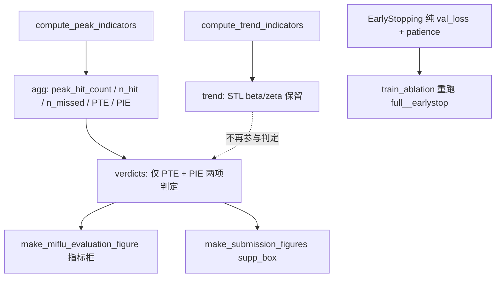

## 产品概述

将 MIFlu 项目的补充诊断指标从四项（Peak Hit / Peak Timing Error / Peak Intensity / Direction）精简为两项：**PTE（Peak Timing Error，峰值时间误差）** 与 **PIE（Peak Intensity Error，峰值强度误差）**，彻底移除峰值命中率（Peak Hit Rate）与方向准确率（Direction）在计算、判定、图形与训练早停中的所有痕迹。

## 核心功能

- **图形精简**：所有 matplotlib 图的补充指标框只保留 PTE 与 PIE 两行，删除 `Peak Hit = x.xx (n/m; k missed)` 与 `Direction = x.xx` 两行。
- **保留样本量限定语**：PTE/PIE 后仍标注 `(based on N matched peaks)`，因为二者只在匹配峰值上定义，不标样本量会被审稿人质疑。
- **彻底移除命中率**：删除 `peak_hit_rate` 的计算、`verdicts` 判定、CLI 阈值参数（`--thr_peak_hit_rate`）、控制台强制同显块，以及 `early_stopping.py` 的双闸门机制。
- **一并移除 Direction**：删除 `directional_accuracy` 的计算、判定与 CLI 阈值（`--thr_directional_accuracy`）；但**保留** STL 趋势强度（beta/zeta），它属趋势强度指标而非方向准确率。
- **早停退化为纯验证损失早停**：`PeakAwareEarlyStopping` 去掉峰值闸门后变为 patience 制早停，同步重命名与改写自检。
- **重跑受影响实验**：仅 `full__earlystop` 变体需重跑（其余变体为固定 20 epoch，未使用 stopper）。
- **文档与报告同步**：指标文档由四项改为两项，导师报告 `.md` 修订后重新生成 `.docx` 并通过一致性校验。

## 技术栈

- 语言/库：Python 3（pandas / numpy / scipy / statsmodels / matplotlib），沿用现有依赖，不新增。
- 训练与评估：`scripts/train_ablation.py`（HPC Slurm + A100）、`scripts/compute_miflu_indicators.py`（纯 CPU 指标计算）。
- 文档管线：`.md`（唯一可编辑源）→ `scripts/md_to_docx.py` → `.docx` → `scripts/verify_report_parity.py`（只读校验，当前 PARITY OK 504 单元）。
- HPC：Slurm `stingy` 分区（`--gres=gpu:a100:1 --mem=16G --time=04:00:00`），作业提交脚本模板 `hpc_scripts/submit_remaining3_stingy.sh`。

## 实现方法

**总体策略**：先精简"指标计算层"（单一数据源），再逐层向外同步消费者（早停 → 训练接线 → 图形 → 表格 → 文档 → 报告），最后本地验证 + HPC 重跑受影响实验。这样可保证每一层的改动都基于已收敛的下游契约，避免反复返工。

**核心数据流（改动后）**：



**关键技术决策与权衡**

1. **保留 `peak_hit_count` / `n_hit` / `n_missed`，仅删除 `peak_hit_rate`（比值）**。
依据：`compute_miflu_indicators.py` 第 210-214 行中 PTE/PIE 由 `hit_rows = peak_df[peak_df["status"] == "Hit"]` 计算，即二者**只在匹配峰值上有定义**；而 `peak_hit_count`（"3/5" 字符串）与 `peak_hit_rate`（0.6 浮点）是 `agg` 中两个独立字段。因此"删指标、留语义"可行：删掉比率，保留计数作为样本量标注。这是本次改动最重要的正确性保障——若连计数一起删，PTE/PIE 会退化为无法判断样本量的裸数字。

2. **保留 STL 趋势强度（beta/zeta），只删 `directional_accuracy`**。
依据：`compute_trend_indicators()` 中 STL 强度服务于其他趋势分析（Rethinking Tables 8/9），与"方向准确率"是两个概念，不可误删。

3. **`PeakAwareEarlyStopping` 重命名为 `EarlyStopping`**。
依据：峰值闸门移除后，该类的行为就是标准的 `val_loss + patience` 早停，保留 "PeakAware" 前缀会误导后续维护者与审稿人。代价是需同步 `train_ablation.py` 的 import 与全部引用——改动集中且可静态验证，值得。

4. **重跑范围收敛到单个变体**。
依据：`train_ablation.py` 第 358-362 行显示只有 `--early-stop` 为真时才实例化 stopper。已完成的 5 个变体中，仅 `full__earlystop` 使用了早停，其余（full / no_multi / no_lora_multi / full__adamw_cosine / full__huber_clip）均为固定 20 epoch，**结果不受影响**。这把 HPC 重跑成本从"全部重跑"降到约 28 分钟。

5. **保留弃用别名 `mean_abs_delta_t`**。
依据：Advisor Q1c 的兼容性约定——旧 JSON/CSV 消费者依赖该键，不得在本次精简中顺手删除。

6. **不变量必须保持**：补充指标仍标注 `supplementary, non-MIFlu-paper-protocol`；未匹配的真实峰值仍记为 `Missed`（一次 miss，绝不记 Timing=0）；零匹配时 PTE/PIE 仍报 `null`，绝不报 0.0。

## 实现注意事项（防回归）

- **CLI 参数的破坏性变更**：删除 `--peak-hit-threshold` / `--thr_peak_hit_rate` / `--thr_directional_accuracy` 后，任何仍在传这些参数的脚本会因 argparse `unrecognized arguments` 直接崩溃。必须同步检查并清理 `scripts/run_journal_experiments.py`、`scripts/submit_journal_job2.sh` 及 `hpc_scripts/` 下所有提交脚本。
- **`thr` 字典契约**：`verdicts(peak_agg, trend, thr)` 的 `thr` 由多个调用方各自构造（`make_miflu_evaluation_figure.py` 第 367-368 行、`compute_miflu_indicators.py` 第 429-434 行）。删键后所有构造点必须同步，否则 `KeyError`。
- **产物字段漂移**：`early_stopping.json`（由 `to_dict()` 写出）会少 `peak_hit_threshold` / `best_peak_hit_rate` 字段；`metrics.csv` 会少 `peak_hit_rate` 列。若下游有硬编码读取需一并处理。
- **性能影响（正向）**：训练每 epoch 不再调用 `stopper.peak_metrics()`（省去 `find_peaks` 扫描），指标侧不再计算 `directional_accuracy` 的 diff/sign，整体开销略降，无新增热点。
- **日志规范**：训练日志保留 `peak_hit=n_hit/n_true_peaks` 作为上下文（与保留限定语一致），但删除 `[WARN] peak gate DEGRADED` 分支；早停原因文案去掉 `peak gate blocked (hit_rate=...)` 表述。
- **爆炸半径控制**：不触碰 MSE/MAE 主协议、不改动模型结构、不改动 `match_tol` 峰值匹配逻辑；除 `full__earlystop` 外不重跑任何实验。

## 架构设计

本次为**纵向精简型重构**：在既有分层架构（指标计算层 → 早停决策层 → 训练编排层 → 可视化层 → 文档层）中，沿数据流自下而上移除两个横切指标。不引入新架构模式，不新增模块，仅删除与重写。

## 目录结构

```
project-root/
├── scripts/
│   ├── compute_miflu_indicators.py          # [MODIFY] 指标计算层（单一数据源）。删除 peak_hit_rate 计算（209/223 行）与 directional_accuracy（326-341 行，保留 STL beta/zeta）；verdicts() 只留 PTE/PIE（347-373 行）；删除 --thr_peak_hit_rate / --thr_directional_accuracy CLI 参数（385/399 行）与 thr 字典对应键（429-434 行）；docstring 四项改两项并改写 Fix Brief #3 注释（43-47 行）；[CONTEXT] 输出块改为只报 matched-peak 计数（476-479 行）。保留 peak_hit_count / n_hit / n_missed / mean_abs_delta_t 弃用别名。
│   ├── early_stopping.py                    # [MODIFY] 早停决策层。删除峰值闸门：类 PeakAwareEarlyStopping → EarlyStopping；__init__ 删 peak_hit_threshold 与 best_peak_hit_rate（89-104 行）；删除 peak_metrics()（115-140 行）；__call__ 改为纯 loss_improved 判定，删 degraded/gate_open 与相关文案（143-198 行）；to_dict() 同步删字段（204-212 行）；_self_check() 重写为纯早停断言，删 gate 1/2/3 与 degraded 与 peak_hit_rate 断言（224-267 行）；PROVENANCE docstring 重写，删 (c) 段双闸门论述（20-82 行）。
│   ├── train_ablation.py                    # [MODIFY] 训练编排层接线。第 79 行 import 改新类名；train_L 签名删 peak_hit_threshold（293-296 行）及实例化（358-362 行）与调用（719-727 行）传参；每 epoch 删 peak_hit_rate 变量与 peak_metrics 调用，删 DEGRADED 分支（376-389 行）；epoch_rows 删 peak_hit_rate 列（404-405 行）；checkpoint_meta 的 selection 文案改写（464-467 行）；CLI 删 --peak-hit-threshold（589-593 行）与日志（663-664 行）。
│   ├── make_miflu_evaluation_figure.py       # [MODIFY] 主评估图。指标框删 Peak Hit（166 行）与 Direction（169 行）两行，保留 Timing Err / Peak Int. 及 matched-peaks 限定语（159-162 行）；write_verdict_table 的 order/pretty 删两项（260-267 行）；thr 字典删两键（367-368 行）；docstring 四项改两项（18-24、140-148 行）；保留 build_peakbars_panel 逐峰 PTE/PIE 柱状图（237-258 行）。
│   ├── make_submission_figures.py            # [MODIFY] 投稿图。supp_box() 删 Peak Hit 行（128 行）与 Direction 行（131 行），保留 Timing/Intensity 的 matched-peaks 限定语（123-126 行）。
│   ├── summarize_regional_table_vi.py        # [MODIFY] 区域表输出，移除 Peak Hit / Direction 列（5 处）。
│   ├── run_journal_experiments.py            # [MODIFY] 检查并移除传入的 --peak-hit-threshold 参数。
│   └── md_to_docx.py / verify_report_parity.py  # [REUSE] 报告管线，不做修改，仅重跑。
├── hpc_scripts/
│   └── submit_journal_job2.sh                # [MODIFY] 检查并移除 --peak-hit-threshold 传参。
├── tests/
│   └── test_timing_metric.py                 # [MODIFY] 校验 peak_hit_count（"0/1"/"1/1"）与 mean_abs_delta_t 语义断言仍然成立，移除任何对 peak_hit_rate 的断言。
├── docs/
│   ├── ILI_FOUR_INDICATORS.md                # [MODIFY] 四项改为两项（PTE/PIE），重写阈值汇总表（41-46 行）与输出物说明。
│   ├── FIGURE_STYLE_GUIDE.md                 # [MODIFY] 同步图上指标项。
│   ├── Tutor_QA_Draft_2026-08-17.md          # [MODIFY] 同步指标口径。
│   └── full_repo_audit_report.md             # [MODIFY] 同步指标口径。
├── MIFlu_导师五大疑问_回复报告.md              # [MODIFY] 移除 Peak Hit ≥0.75、Direction ≥0.60 判定行与双闸门【订正3】（301-324 行），改述为 PTE/PIE 双指标与纯 patience 早停。
├── MIFlu_导师五大疑问_回复报告.docx            # [REGEN] 由 md_to_docx.py 从 .md 重新生成，verify_report_parity.py 校验 PARITY OK。
├── 导师五大疑问_零基础解答报告_最终版.md          # [MODIFY] 移除第 148-175 行对 peak_hit_rate 双闸门的详述。
├── Advisor_Questions_Resolution_Report.md    # [MODIFY] 同步指标与早停口径。
├── README.md / REPRODUCIBILITY.md / PROJECT_STATUS.md / HPC_GUIDE.md / hpc_results/journal_evidence/README.md  # [MODIFY] 同步指标清单与 CLI 参数说明。
├── CHANGELOG_2026-09-02_导师报告更新.md         # [MODIFY] 追加本次指标精简条目。
└── results/ili/metrics/                       # [REGEN] miflu_L{24,36,48,60}_ili_peak_trend_summary.json、miflu_ili_peak_trend_summary.json、miflu_verdict_table.md、National_Table_V_summary.{md,csv} 重新生成（不再含 peak_hit_rate / directional_accuracy）。
```

## 关键代码结构

改动后 `compute_peak_indicators()` 返回的 `agg` 契约（删除比率、保留计数）：

```python
agg = {
    # 样本量限定语（必须保留，PTE/PIE 只在匹配峰值上定义）
    "peak_hit_count": f"{n_hit}/{n_true}",   # 例如 "3/5"
    "n_true_peaks": int, "n_hit": int, "n_missed": int,
    # 保留的两个指标
    "peak_timing_error_weeks": float | None,        # PTE
    "mean_abs_delta_t": float | None,              # 弃用别名，保留兼容
    "mean_peak_magnitude_rel_err_pct": float | None,  # PIE
    "false_peak_count": int,
    # 已删除: "peak_hit_rate"（比率）、"directional_accuracy"（在 trend 中删除）
}
```

改动后早停类的对外契约（纯验证损失早停）：

```python
class EarlyStopping:                       # 原名 PeakAwareEarlyStopping
    def __init__(self, patience=5, min_delta=0.0, save_dir=None): ...
    def __call__(self, val_loss: float, model, epoch: int) -> dict: ...
        # 返回 {"improved","saved","stop","reason","best_val_loss","best_epoch","degraded":False,...}
    def to_dict(self) -> dict: ...         # 不再含 peak_hit_threshold / best_peak_hit_rate
    def save_report(self, path) -> None: ...
```