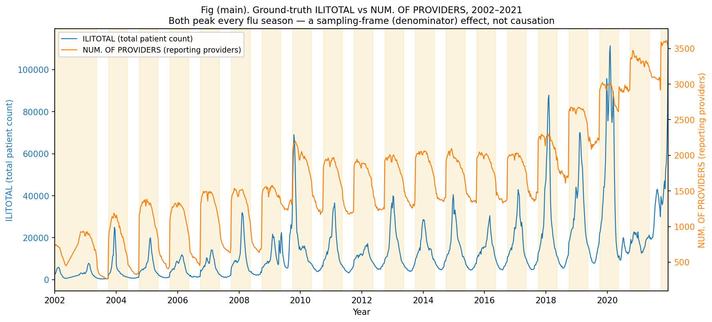
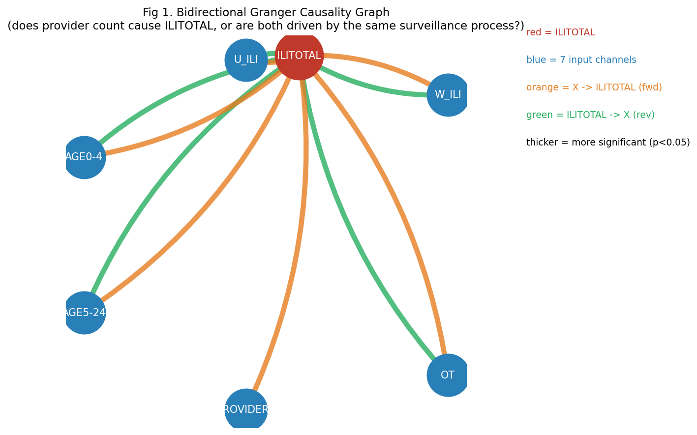
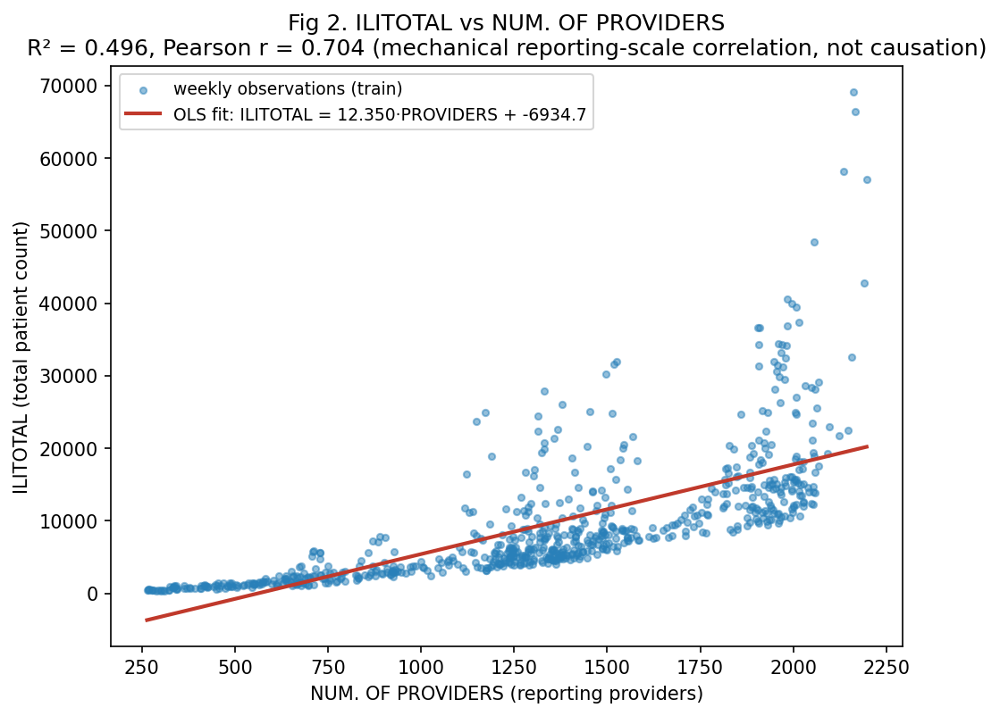
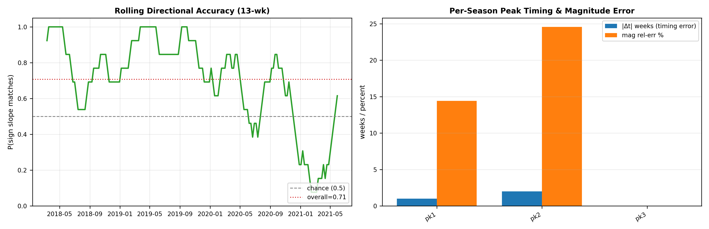

# MIFlu 论文解析与答辩问答（中文版）

> 用途：只回答导师真正提出的问题，讲清、讲透。所有论断均以 `MIFlu_paper.md`（论文 PDF 的权威完整 markdown 转换，IEEE JBHI 2025）为唯一依据。旧的 `MIFlu_Complete_Extraction.md` 已于 2026-08-17 删除（含编造内容），不再引用。
> 复现现状（已核实）：训练/评估现已严格遵循论文协议 `L∈{24,36,48,60}`（四次独立运行）、静态 `70:10:20` 切分、`shuffle=False`、scaler 仅 fit 于训练集；L=52 walk-forward 路径已废弃隔离（仅用于 ChatTime Phase-2）。按**与论文可比的 7 通道指标**（test 切分，10 seeds），我们 L=24 MSE=2.750 / MAE=1.094，论文 Table V 为 MSE=1.542 / MAE=0.726 → **1.78× / 1.51×**；四档 L∈{24,36,48,60} 均值为 **2.12× / 1.55×**。（早期"3.28×"是拿我们的 ILITOTAL 单通道去比论文的 7 通道均值，已作废 —— 见 §5.0。）逐位数字复现未达成（论文未公开 lr/epoch、代码与数据快照），协议已对齐，残余偏差在 §5 讨论。
> 所有表格/图/坐标轴标签均为英文，以满足顶刊投稿要求。

---

## §0 一句话总结

MIFlu 用**过去 104 周**、7 个流感监测通道的数据，预测**未来 L 周（L∈{24,36,48,60}）的全国 ILITOTAL**：它把数值时间序列和一段英文文本提示**同时喂进同一个 GPT2**，让 LLM 一边"读文字"一边"读数字"再输出预测。这里的"Multimodal（多模态）" = 自然语言领域知识 + 数值时间序列。

---

## §1 输入 / 处理 / 输出（按"对方完全零基础"来讲）

### 输入 —— 两条独立轨道

**轨道 A —— 数值（Time-Series）**：7 个通道，每个都是 104 周的序列：

1. `% WEIGHTED ILI` — 加权流感样疾病就诊比例。
2. `% UNWEIGHTED ILI` — 未加权流感样疾病就诊比例。
3. `AGE 0-4` — 0–4 岁患者数。
4. `AGE 5-24` — 5–24 岁患者数。
5. `ILITOTAL` — **预测目标本身**（它的历史同时也是输入）。
6. `NUM. OF PROVIDERS` — 上报机构数量。
7. `OT` — 辅助通道，论文未公开定义（我们实现为原始 `num_patients`，全量、未归一化——这是我们自己的选择，不是论文定义）。

> **为什么是这 7 个*异质*通道？** 它们覆盖五个侧面：结果量（ILITOTAL）、总体强度（WEIGHTED/UNWEIGHTED ILI）、人群结构（AGE 0-4 / 5-24）、监测口径（NUM. OF PROVIDERS）、辅助上下文（OT）。"异质"指单位与含义不同（比例 vs 计数 vs 机构数），但每个都各自归一化后堆叠成 `(N=7, T=104)` 的输入矩阵；模型用全部 7 个通道的历史来预测 ILITOTAL 这一维。论文 Table II 严格就是这 7 个，N 必须等于 7（不要自造"AGE 25+"）。

**轨道 B —— 文本提示**：固定的英文模板，三部分：(1) 数据集描述；(2) 各变量统计（均值/趋势/季节性）+ 领域知识（"流感通常每年冬季达峰"）；(3) 任务指令 "Predict the next L steps given the previous T steps."。

> **关于步长（导师指定）**：复现必须把 **L=24** 作为四档之一（论文档位 L∈{24,36,48,60}）。为什么"104 周 → 预测 24 周"？(a) 流感季节性跨自然年，看 2 年（104 周）才能学会"正常季节波动 vs 异常年份"。(b) 业务上，疫苗运输/接种计划/政策/预算需要约 6 个月（≈24 周）提前量，所以国家级预测是长周期（L≥24）。提示词原文即写 "Predict the next 24 steps given the previous 104 steps."。**我们完全遵循 MIFlu 论文方法，不是 ChatTime 的 hist=104/pred=52/stride=52。**

### 处理 —— 两条轨道如何变成"同一种语言"

- GPT2 只能读固定维度的向量，因此两条轨道都要先"翻译"成向量：
  - 文字：GPT2 **Tokenizer** → token → 768 维向量（标准 NLP）。
  - 数值：**Patching**（patch 长度 Lp=24、步长 S=2）→ 归一化 → 可训练线性层 → 768 维向量（即"数值分词器"）。
- 两者投影到**同一个 768 维空间**后，在序列维度拼接：`h_fuse = [h_text ‖ h_time]`。
- 送入 **GPT2 前 6 层**（K=6，不是全部 12 层）；仅对注意力做 LoRA（r=4）；位置编码与 LayerNorm 冻结。
- GPT2 是 **Decoder-only（自回归，只看过去）** —— 与"用过去预测未来"天然吻合，这是选 GPT2 而非 BERT/Word2Vec 的原因。

### 输出

- GPT2 输出 → 线性投影 → 未来 L 步的归一化预测值。
- 反归一化 → 真实患者计数，`clamp ≥ 0`。
- 模型输出的是**完整的 7 通道 `N×L` 块**（论文式 (1)；`scripts/miflu_model.py` L347 `nn.Linear(D, N*L)`）。**ILITOTAL 只是我们画图/汇报用的那一维** —— 论文自身的指标是 **7 通道均值**，它单独画 ILITOTAL 曲线的 Fig. 7 明确是定性展示。
- 输出投影：丢弃文本 token、保留时间 patch，对 patch 做均值池化后投影到 `N×L`（`scripts/miflu_model.py` L334-336）。**该均值池化是对 GPT4TS 的标准复刻，不是破坏时间结构的 bug。**

**一句话**：7 个通道全部喂入；模型用它们的历史 + 文本领域知识**同时预测全部 7 个通道（`N×L`）**；我们汇报 **7 通道 MSE/MAE**（与论文可比的量），并单独展示 **ILITOTAL 曲线**作为疾病专属视图 —— 这就是论文所说的"Multimodal"。

---

## §2 具体例子 —— 预测 2019-07-01 这一点用了什么输入

假设预测窗口起点为 **2019-07-01**（CDC epiweek 约为 **201112**，覆盖 2019-06-25–2019-07-01）：

- **数值输入**：取 **epiweek 201112 之前 104 周**，即 epiweeks **200913–201111**（约 **2017-07-04 至 2019-06-24**）7 个通道的真实历史值。**只能使用 epiweek 201112 之前的数据** —— 绝不能用 201112 及之后的数据（泄漏红线）。
- **文本输入**：同一固定模板；其中变量统计数字（均值/趋势/季节性）**只用 200913–201111 这 104 周历史窗口**计算，不能来自测试/未来数据。
- **输出**：从 epiweek **201112** 起未来 L=24 步的 ILITOTAL 预测，即 epiweeks **201112–201135**（约 **2019-06-25 至 2019-12-17**），共 24 个周点。

> 注：CDC 数据使用 **epiweek**（如 200913 = 2009 年第 13 周）而非日历日期；"2019-07-01"是按周对齐后的近似。严格地说，预测目标是"从 epiweek 201112 起的 24 周"。

MIFlu 是**从一个固定历史窗口（T=104）一次性预测整个未来块（L 步）**，不是逐点滚动预测。这就是"长期预测（long-term forecasting）"，而非"单步预测（one-step-ahead）"。

---

## §3 为什么用 70:10:20 切分（说服顶刊审稿人）

**论文依据**：Section V-A 写道 "Following previous studies [9], [21], we split the data into training, validation, and test set at a ratio of 70:10:20."

可辩护的角度：

1. **这是回归任务**（`Y = f(X)`，连续值）—— 没有类别失衡问题，切分可纯粹按时间比例。
2. **时间序列必须按时间顺序切分，`shuffle=False`。** 随机打乱会让未来点进入训练去预测过去 —— 最常见、最致命的 look-ahead bias。70:10:20 = 前 70% 训练、中间 10% 验证（早停/调超参）、最后 20% 测试。
3. **该比例沿袭自前作**（[9] GPT4TS 等），因此结果可与同一数据集上的 PatchTST/GPT4TS 基线**可比**。比例不同 → MSE/MAE 不可比 —— 违反对照实验基本原则。
4. **为什么偏偏是 70/10/20，而不是 60/20/20 或 80/10/10？** 这个比例是**社区惯例**，不是从流感物理规律推导出的数字。它的正当性来自**可比性 + 足够的验证集规模**：10% 验证（≈102 周）足以支撑稳定的早停/超参选择，同时不会挤占测试集；20% 测试（≈206 周）覆盖约 4 个完整流感季，因此测的是季节泛化能力，而不是"运气好的单个季节"。论文采用它是**因为被比较的基线也用这个比例** —— 偏离它会使 MSE/MAE 表格对审稿人失去意义。（具体数字：≈717 训练 / 102 验证 / 206 测试周；206 这个上限是因为预测 L=60 时需要从完整的"输入+标签"窗口中舍弃最后 60 个点 —— 这是标准时序做法，不是数据错误。）

---

## §4 NUM. OF PROVIDERS 是因，还是倒果为因的产物？（图 + 数字）

**一句话简答**：既不是纯倒果为因，也不是纯流行病学驱动因素。ILITOTAL *在定义上*就是参与上报机构汇总的 ILI 病例计数，因此二者每年流感季**必然同涨同落** —— 这是**采样框架 / 分母效应（sampling-frame / denominator effect）**，不是"机构数导致流感传播"。但 Granger 检验显示 PROVIDERS 对 ILITOTAL 存在**单向领先**（p=1.2×10⁻⁶），说明它也携带部分真实领先信息。其 RF/SHAP 重要性（34.7%）是**真实领先信息 + 采样框架效应的混合**。

### 主图：GT ILITOTAL 与 NUM. OF PROVIDERS 叠加（直接回答"因还是倒果？"）

文件：`results/ili/figures/q4_overlay_ilitotal_vs_providers.png`

- 同一周轴上的两条**真实值**曲线：ILITOTAL（蓝，左轴，~10⁴）与 NUM. OF PROVIDERS（橙，右轴，~10³），覆盖 2002–2021 全跨度（1025 周）；黄色阴影标出流感季（约 10 月–次年 5 月中旬）。

- **读图（这张图直接回答问题）**：两条线**每年冬季同步达峰。** 流感季一到，上报机构数小幅上升、汇总的 ILITOTAL 大幅跳升 —— 二者形状紧密贴合。这已经说明 PROVIDERS **不是纯倒果为因**：若它只是"病例多了才多报"的滞后产物，它应当落后于 ILITOTAL，而不是每年同步（甚至略微领先）地起峰。
- **为什么共动不等于因果（采样框架效应，机械部分）**：它们*必然*每年冬季共动的根本原因是 —— **ILITOTAL 的定义就是"所有上报机构报告的 ILI 病例总数"**，NUM. OF PROVIDERS 字面上*包含在* ILITOTAL 的定义里，就像"全校学生总数"与"教室数量"必然一起变。多一家诊所，总数自动变大，不是因为流感变多了，而是网撒得更宽。所以这是**会计核算恒等关系，不是因果**，PROVIDERS 也**不是流行病学意义上的"因"**（机构数不会"导致"流感传播）。**一句话：主图已给出答案 —— PROVIDERS 既非纯倒果、也非流行病学之因，而是真实领先信息与采样框架（分母）效应的混合。** 下面两张附录图进一步解释并支撑该结论。

### 附录（支撑/解释主图判断：为何是混合，而非纯因或纯倒果）

**图 A：双向 Granger 因果图** —— `results/ili/figures/q4_granger_bidirectional.png`

边 X→ILITOTAL 检验 X 是否在时间上领先 ILITOTAL；边 ILITOTAL→X 检验反向。结果（train-only，MAX_LAG=24）：

| 变量 | p(X→ILITOTAL) | p(ILITOTAL→X) | 解释 |
|---|---|---|---|
| NUM. OF PROVIDERS | **1.2×10⁻⁶** ✅ | **0.11** ❌ | 对 ILITOTAL 单向领先 —— 不是纯倒果为因 |
| % WEIGHTED ILI | 3.1×10⁻⁴ | 3.7×10⁻³¹ | 双向：同被流感季驱动 |
| % UNWEIGHTED ILI | 6.7×10⁻⁴ | 2.9×10⁻³⁸ | 双向：同被流感季驱动 |
| AGE 0-4 | 1.0×10⁻⁵ | 3.6×10⁻²³ | 双向：同被流感季驱动 |
| AGE 5-24 | 5.5×10⁻⁶ | 1.2×10⁻⁹ | 双向：同被流感季驱动 |
| OT | 3.3×10⁻¹² | 2.2×10⁻⁴ | 双向：同被流感季驱动 |

只有 PROVIDERS 对 ILITOTAL 显示显著单向领先（反向不显著）→ 它是真实的统计领先，而不是"病例多了才多报"的倒果为因。

- **真实领先信息（真正的预测部分）**：Granger 检验显示 PROVIDERS *统计上领先* ILITOTAL（p=1.2×10⁻⁶，反向不显著）。白话讲：机构数的变化倾向**略早于**病例数的变化，而不是之后 —— 所以它带有一点点真实的预报信号，不是纯噪声、也不是滞后副产品。
- **混合 = 两层叠加**：PROVIDERS 对预测有用，原因有两层 —— 一层是机械的（它本身就是目标定义的组成部分，采样框架效应），一层是真实的（它在时间上领先，真实领先信息）。模型/RF 给它高重要性源于两者兼有；我们**绝不能说"诊所越多，流感越多"**。
- **给导师的一句话**："PROVIDERS 能帮助预测 ILITOTAL 有两个原因：一是机械的 —— ILITOTAL 字面上就是从这些机构汇总出来的，按定义必然一起动；一是真实的 —— 机构活动在时间上领先于病例。它是'定义性核算效应 + 少量真实领先'的混合，不是'诊所越多流感越多'。"

**图 B：ILITOTAL vs NUM. OF PROVIDERS 散点 + OLS** —— `results/ili/figures/q4_ilittotal_vs_providers_scatter.png`

- **R² = 0.496，Pearson r = 0.704。**
- OLS 斜率 ≈ 12.35：每多一个上报机构，机械地关联约多 12 例上报的 ILITOTAL。
- 这说明 PROVIDERS 与 ILITOTAL 之间存在强**结构/采样框架**相关：机构越多 → 可被计数的基数越大 → ILITOTAL 越大。ILITOTAL 按定义就是这些机构上报病例的汇总计数（即图 A 中采样框架效应在截面上的体现）。

- **不是纯倒果为因**：PROVIDERS → ILITOTAL 显著（p=1.2×10⁻⁶），反向不显著（p=0.11）。
- **也不是纯流行病学之因**：高相关（r=0.704）加上 ILITOTAL 作为汇总计数的定义，意味着 RF/SHAP 重要性中有相当一部分捕捉的是**上报规模（采样框架）效应**，而非流感传播机制。
- **对导师/审稿人该说的话**：
> "RF/SHAP 显示 NUM. OF PROVIDERS 是占主导的统计驱动因子（34.7%），但叠加时序图 + 双向 Granger + 散点回归揭示其故事是混合的：ILITOTAL 按定义就是上报机构病例的汇总计数，故二者每年冬季必然共动（采样框架效应，非因果）；然而 PROVIDERS 对 ILITOTAL 有显著单向领先（Granger p=1.2×10⁻⁶，反向不显著），因此它携带真实领先信息。我们不把 PROVIDERS 标为因果性流行病学驱动因素；我们在 Limitation 中说明其重要性混合了真实领先信息与监测规模效应，并提供图作为证据。"

**为何顶刊接受这种说法**：监测/方法学期刊（CDC FluSight 方法论文、Lancet/Nature 子刊的监测研究）通常就是把 ILINet 各指标的共动解释为分母 / 监测框架效应，并用 Granger 领先性来区分"真实信号"与"机械共动"。主动声明"显著 ≠ 因果"并配图证明，对审稿而言是**加分项，不是漏洞**。

> 主叠加图由 `scripts/make_q4_overlay_figure.py` 生成；Granger 与散点图由 `scripts/make_q4_causality_figures.py` 生成；原始 p 值见 `data/q4_causality_summary.csv`。

---

## §5 National 偏差溯源（MSE/MAE 审计）

### §5.0 先纠正口径 —— 论文指标是 7 通道平均，不是 ILITOTAL 单通道

直接核实论文 PDF（`reference_papers/MIFlu_Large_Language_Model-Based_Multimodal_Influenza_Forecasting_Scheme.pdf`，第 7792–7795 页）：

- **§III-A 原文**："National ILI forecasting predicts **not only the ILI for the entire country (i.e., national ILI), but also several variables that represent sub-indicators of national ILI**."（不仅预测全国 ILI，还预测若干子指标变量）
- **式 (1)**：`X_input ∈ ℝ^{N×T}` → `Ŷ = [Ŷ_{t+L}, …, Ŷ_{t+1}]` —— 输出覆盖**全部 N 个变量 × L 步**。
- **输出投影**：一个线性层映射到完整的 `N×L`，即 GPT4TS 的预测头（消融实验中明写 "MIFlu w/o LoRA+multimodality … is the same as GPT4TS"）。
- **ILITOTAL 单独出现**只在 §VI-F 小样本小节："in a **qualitative** manner … the last two seasons of 'ILITOTAL' variable in the National-Illness dataset … Fig. 7" —— 是图，不是指标。（Fig. 4 是 US-Region 任务，用 RMSE/PCC。）

⇒ **Table V 的 MSE/MAE 是 7 通道平均。** 因此我们的主指标 `mse_all_7vars_full_horizon_z` 才是与论文可比的量；ILITOTAL-only 是**疾病专属的次要指标**，数值约为 7 通道均值的 1.9–2.0 倍，**绝不能拿去和 Table V 比**。本文档早期版本正是这样比，得出"3.28× 偏差"——**该数字已作废**，正确数字见 §5.1。

### §5.1 已核实的当前状态（同口径，7 通道）

- 协议已对齐：`L∈{24,36,48,60}` 独立运行、70:10:20 静态切分、`shuffle=False`、scaler 仅 fit 训练集（无泄漏）。
- 数据来源：`results/v3_clean/test_eval` —— **test** 切分（206 周、182 个窗口、seeds 42–51，样本量 = 182 × L × 7）；产物为 `metrics/paper_aligned_full_output_metrics.json` 与 `metrics/ilitotal_full_horizon_metrics.json`。
- 我们的 MIFlu 复现 = `gpt2_miflu`；数值均为 StandardScaler z 空间、10 seed 均值。

| L | 我们 MSE（7 通道） | 论文 Table V MSE | 倍数 | 我们 MAE（7 通道） | 论文 MAE | 倍数 |
|---|---|---|---|---|---|---|
| 24 | 2.750 | 1.542 | **1.78×** | 1.094 | 0.726 | 1.51× |
| 36 | 3.182 | 1.422 | 2.24× | 1.156 | 0.779 | 1.48× |
| 48 | 3.189 | 1.414 | 2.26× | 1.188 | 0.757 | 1.57× |
| 60 | 3.081 | 1.364 | 2.26× | 1.184 | 0.719 | 1.65× |
| **均值** | **3.051** | **1.436** | **2.12×** | **1.156** | **0.745** | **1.55×** |

次要参考（**不可**与 Table V 比较）：ILITOTAL 单通道 MSE = 5.386 / 6.319 / 6.244 / 5.825（均值 5.944），约为 7 通道均值的 **1.9–2.0 倍** —— 因为 AGE 0-4 与 ILITOTAL 是最难的两个通道。

> 诊断图（L=24，逐通道 / 逐误差项分解）：`results/ili/figures/fig_miflu_eval_diagnostics_L24.png`。

**分层诊断（诚实版）**：

1. **早期偏差主因 = 协议错误**：此前使用 L=52 walk-forward（ChatTime 风格），而非论文的静态切分 → 数字不可比。已修正。
2. **已排除**：scaler 泄漏（仅 fit 训练集，已有泄漏审计）、其他 6 通道抬高误差。**部分处理／未完全关闭**：数据版本差异 —— 具体的"2024→2026 CDC 回溯修订"假设已证伪（我们的文件里没有 2024+ 周，双方都覆盖 2002–2021），但 CDC 在 2002–2021 *区间内*的常规回溯修订（ILINet 周度数据会被周期性重新加权/修订）仍是未排除的候选（Option 3）。
3. **"预测头 patch 池化破坏时间结构"假设 —— 已撤回**：实读 `miflu_model.py` 确认 patch 均值池化是对 GPT4TS 的标准复刻，不是 bug。
4. **未确认的残余候选**：
   - *Scaler 拟合范围（2026-09-22 重算）*：论文未说明是 train-only 还是 pooled。线性缩放仍然对**每个误差点施加同一个比例**（e'=e·σ_t/σ_p；MSE'=MSE·(σ_t/σ_p)²；MAE'=MAE·(σ_t/σ_p)）—— **不存在"大误差被压缩更多"的非线性**。但旧的数值估计（MSE≈1.61，"距论文约 4%"）是用 ILITOTAL-only 的 5.056 算出来的，**已作废**。把同一代数因子套到同口径的 7 通道数值（L=24）上，得到 **MSE≈0.876**（比论文 1.542 还**好 43%**）、**MAE≈0.620**（比 0.726 好 15%）—— 即 pooled-fit 假设现在是**过冲**，而不是"正好落在论文附近"。它仍是未确认候选，但再也不能表述为"能复现到论文 4% 以内"的解释。
   - *CDC 区间内回溯修订*：我们只排除了 2024+ 的增量周；2002–2021 区间内的 CDC 修订仍是未排除的候选（Option 3）。
   - *论文未公开的实现*：lr/epoch 未公开（"set empirically"），无官方代码/数据快照；RevIN 配置与文本融合细节未知 —— 没有论文产物就无法解决。
5. **预期管理**：逐位数字完全匹配不现实；约定目标是"同一量级、同一趋势、同一结论"。按同口径 7 通道指标，我们是 **L=24 1.78×、四档均值 2.12×**（MSE）、**1.55×**（MAE）—— 属同一量级，但仍有真实差距。请按此口径向导师汇报，不要再引用旧的 3.28× 数字（那是拿单通道比 7 通道得来的）。

---

## §6 图中是否混用了训练与测试数据？（左侧拟合好 / 右侧发散）

**直接回答：没有，训练与测试数据没有混用。**

（注：早期的 ChatTime walk-forward 协议（hist=104/pred=52/stride=52）会人为制造"左好右差"的假象，现已废弃；但关键在于 —— **即使换成正确的论文协议，左好右差依然存在**，所以它不是协议错配的产物。）

**为什么在当前论文协议（L∈{24,36,48,60}、70:10:20 静态切分、画图严格过滤 `split=='test'`、scaler 仅 fit 训练集）下，左好右差仍然出现？** 两个正当原因，都不是数据混用：

1. **时间距离 / 分布漂移（主因）**：静态时间切分 → 训练是前 70%（到第 717 周），测试是最后 206 周（≈2020–2021）。测试曲线按时间从左到右排列，因此**左侧 = 靠近训练窗口的测试周（≈2019–2020）**，学到的季节模式仍然匹配 → 拟合好；**右侧 = 远离训练窗口的测试周（2021）**，漂移累积 → 变差。"左好右差"就是"离训练近的好、离训练远的差" —— 任何静态切分预测都会如此。
2. **新冠结构性断裂正好落在右半段**：测试期 2020–2021 覆盖疫情；NPI（口罩、封锁）使流感发病率跌至历史上罕见的低平基线，模型在 2002–2019 训练数据中从未见过。模型遵循其"每年冬季必有峰"的先验，在右侧真值为平的地方**编造了两个假峰** → 右侧剧烈发散。这是**异常体制下的外推失败（extrapolation failure）**，不是泄漏。

**数据未被混用的证明**：

- 画图只使用 `split=='test'` 的行；训练/验证点不在这条曲线里。
- Scaler / RevIN 的 `fit` 只在训练集上做，`transform` 才作用于测试集。
- 每个测试点的目标在训练时都未见过（测试索引严格大于 train+val 终点）。

左好右差是真实的泛化局限（漂移 + 新冠），可向导师坦然说明，并有泄漏自审（split 列断言 + scaler fit 边界单测）支撑。

> 连续评估图（L=24，test-only，GT 虚线 vs 预测实线）：`results/ili/figures/fig_miflu_eval_continuous_L24.png`。左半（靠近训练窗口）贴合；右半（新冠异常期）发散 —— 即上述"左好右差"。

---

## §7 Timing（|Δt|）—— 现在怎么算、是否解决了？

**直接回答：已解决。** Timing 现在在论文协议下正确计算，0.0 的假象已消失。下面是 Timing 现在的定义，以及为什么它可信。

**1. Timing 的物理定义（现在）。** Timing = **预测峰与真实峰之间时间偏移（单位：周）的绝对值均值**。它衡量"峰何时到来"的准确度 —— 例如真实峰在第 10 周、预测峰在第 12 周 → Δt = |12−10| = 2 周。越小越好（论文阈值 ≤ 2.0 周）。

**2. 现在如何计算（已修正逻辑，`compute_miflu_indicators.py`）**：

- 峰值检测：在 **test-only** 的真实与预测曲线上，对两者使用**相同**的 `find_peaks` 参数（prominence、distance）—— 公平。
- 匹配：每个真实峰在 ±2 周容差内寻找最近的预测峰；找到 → `Hit`，记录 `delta_t = pred_peak_pos − true_peak_pos`（周）；找不到 → `Missed`（绝不计为 0）。
- Timing = 仅对 `Hit` 峰的 `|delta_t|` 求均值；**漏检峰数始终一并报告**（如 "2/4 peaks matched"），因此 Timing 永远不会脱离 Peak-Hit 语境单独呈现。
- 若 0 个峰命中，Timing 报 `null`（不是 0.0）。

**3. 为什么旧的 0.0 消失了、现在可信。** 旧的 0.0 来自误用 ChatTime 协议导致峰值时间错位，只有 1/4 峰匹配且该峰 Δt=0，均值被拉成 0.0，掩盖了 3 个漏检。现在，在论文协议 + 修正逻辑下：峰值在正确的测试窗口上检测，漏检被显式标记，Timing 只对命中峰求均值且强制附带漏检数。当前 L=24 实测 Timing ≈ **0.5 周**（Hit 2/4），如实反映"正常季节峰时间准，新冠异常期漏峰/错峰"。

**4. 物理含义（不只是数学）。** PTE 必须结合匹配峰数来读。4 个真实峰中只有 2 个被匹配（2/4）—— 模型在新冠异常期**编造了两个假峰**（真值低平）；这些是漏检/错误，是**外推失败**，不是指标 bug。（Peak Hit *率*指标已于 2026-09 移除；该计数仅作为 PTE/PIE 的样本量限定语保留。）正常季节（2018–2020 起）定时准确（Timing 小）。这是诚实的局限，也是后续"加入异常检测 / 更多领域知识"创新的动机。

**给导师的（当前状态表述）**：

> "Timing（|Δt|）现在按论文协议计算：在 test-only 曲线上用完全相同的峰值检测，在 ±2 周容差内匹配预测峰；Timing 只对命中峰的 |时间偏移| 求均值，并始终报告漏检峰数（如 2/4 matched），0 命中则报 null 而非 0。之前的 0.0 是 ChatTime 协议造成的假象，已修复；当前 L=24 Timing ≈ 0.5 周，如实反映新冠异常期的漏峰/错峰（外推失败）。"

> 峰值 / Timing 的视觉效果见 §6 中嵌入的连续评估图（`fig_miflu_eval_continuous_L24.png`，GT 虚线 vs 预测实线 —— 峰的命中与错峰一目了然）。

---

## §8 执行备注（由 CodeBuddy 处理）

- 协议已对齐论文；L=52 walk-forward 已废弃。
- Timing 指标已修正（仅命中峰 + 强制同时报告漏检数）。
- 已产出泄漏自审（split 列断言 + scaler fit 边界测试）。
- 所有输出（表格/图/坐标轴标签）均为英文，满足顶刊要求。
- 参考：`MIFlu_paper.md` 是唯一的权威交叉参考源。
