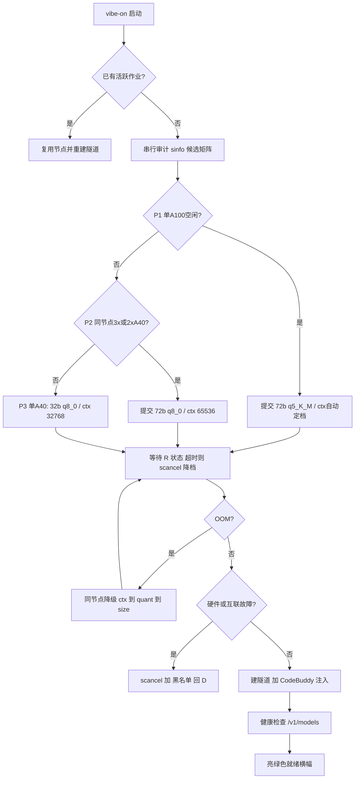

## 产品概述

对 CityUHK Burgundy HPC 上的 Vibe Coding 基础设施做最终架构重写：把 HPC 上的大模型推理服务（Ollama）通过 SSH 保活隧道暴露成本机 `localhost:11434` 的 OpenAI 兼容端点，并让 CodeBuddy 像使用云原生模型一样**零点击自动接入**。全套产物打包输出到桌面文件夹 `Burgundy-Vibe-Core`，可从任意终端、任意项目目录一键拉起。

## 核心功能

**1. 串行智能路由（禁并发 sbatch）**
按优先级逐个分区 `sinfo` 审计，**全程只提交 1 个作业**：

- P1 单 A100（HBM2e）→ `qwen2.5-coder:72b` (q5_K_M)，`num_ctx` 按实测显存自动定档（≥80GB 取 128k，40GB 取 64k）
- P2 单节点 3×/2× A40（GDDR6，同物理主机保障张量并行）→ `qwen2.5-coder:72b` (q8_0)，`num_ctx 65536`
- P3 单 A40 → `qwen2.5-coder:32b` (q8_0)，`num_ctx 32768`
严格遵守 stingy QOS「同时仅 1 作业、1 pending」与集群资源红线。

**2. 双层自愈循环**

- 场景 A（VRAM OOM）：优雅终止并**在同节点内**级联降级——先降上下文（128k→64k→32k→16k），再降量化（Q8→Q5_K_M→Q4_K_M），最后降档（72b→32b→7b），全程保活不换作业
- 场景 B（节点硬件/多卡互联故障：device busy、ECC、NVLink、Xid）：`scancel` → 节点写入 `node_blacklist.txt` → 重新审计并申请**不同**节点 → 回到 P1

**3. CodeBuddy 自动配置引擎**

- Legacy Purge：每次初始化先备份再**彻底清除** `models.json` 中所有 `vendor:"user"` 旧模型（含 3 条 NVIDIA NIM 及其密钥），消除供应商路由冲突（`-NoPurge` 为逃生舱）
- Auto-Setup：程序化注入 Custom 供应商 / `http://localhost:11434/v1` / `burgundy-vibe-coding` / 当前实际部署的 Model ID，强制开启工具调用，`deepseek-r1` 时自动适配推理 I/O 解析

**4. 隧道与全局持久化**
`-L 11434:<node>:11434` + `ServerAliveInterval=60/CountMax=3` 保活；状态（节点/作业/PID/模型/黑名单/备份）全部持久化到 `%USERPROFILE%\.burgundy_vibe\`；输出亮绿色就绪横幅；`vibe-on` 别名可从任意终端、任意路径恢复。

**5. 交付物**
`Burgundy-Vibe-Core/` 下 3 个文件（HPC 侧 bash、本机侧 PowerShell、安装指南），并同步覆盖仓库 `scripts\` 内的两份旧脚本。

## 技术栈选型

沿用项目既有技术栈，不引入新框架：

| 层 | 选型 | 依据 |
| --- | --- | --- |
| HPC 侧 | Bash + Slurm（`sbatch`/`sinfo`/`squeue`/`scancel`/`scontrol`） | 现有 `scripts/*.sh` 全部为 bash；HPC_GUIDE.md 已确立命令约定 |
| 运行时 | Ollama **原生二进制优先**（实测登录节点已有 `/usr/local/bin/ollama` v0.12.0；`singularity`/`apptainer` 均不在 PATH），容器仅在其存在时启用 | 实测确认，详见「实测集群事实」 |
| 本机侧 | Windows PowerShell 5.1+（原生 OpenSSH） | 现有 `vibe_gateway.ps1`；Windows 10 1809+ 自带 ssh |
| 传输 | SSH 本地端口转发 + TCP keep-alive | 唯一可穿透到计算节点的通道 |
| 状态 | `%USERPROFILE%\.burgundy_vibe\` 文件持久化 | 沿用既有约定，跨会话/跨重启可恢复 |
| 配置注入 | `%USERPROFILE%\.codebuddy\models.json`（实测确认的唯一注入点） | 已探测确认，工作区级 `.codebuddy` 无 `models.json` |


## 实现方案

### 关键设计决策（含权衡）

**决策 1：规范服务名策略（解决 Model ID 漂移）**
不再生成 `-ctx65536` 后缀名，而是固定以规范名 `qwen2.5-coder:72b` / `qwen2.5-coder:32b` 作为 `ollama create` 的**目标名**，Modelfile 内 `FROM` 具体量化版 + `PARAMETER num_ctx N`。

- 收益：量化降级（Q8→Q5→Q4）时 CodeBuddy 的 Model ID **完全不变**，无需重新注入，从根本消除路由冲突；仅在 72b↔32b 换档时才重新注入
- 代价：换档时需 `ollama rm` 旧规范名重建；已接受（换档是低频事件）

**决策 2：修复 `OLLAMA_HOST=0.0.0.0:11434`（致命缺陷）**
Ollama 默认只监听 127.0.0.1，从登录节点发起的 SSH `-L` 转发根本连不上。同时设 `OLLAMA_MODELS=/gpfs1/scratch/sychan552/CHATTIME/.ollama/models`（跨作业复用模型缓存，否则每次重下 40-80GB，4h QOS 内下载不完）、`OLLAMA_KEEP_ALIVE=-1`、`OLLAMA_FLASH_ATTENTION=1`。

**决策 3：单节点多卡张量并行**
`--nodes=1 --ntasks-per-node=1 --gres=gpu:a40:3` + `OLLAMA_SCHED_SPREAD=1`。必须同节点（PCIe/NVLink 本地互联）。按实时容量级联 3→2→1，**使多卡请求可被真实工作负载自证合理**，符合 HPC_GUIDE §10 资源红线。

**决策 4：真实"瞬时空闲"审计 + 串行提交**
解析 `sinfo -N -h` 得到候选节点（状态 `idle`/`mixed`、GRES 含目标 GPU 型、不在黑名单），按 P1→P2→P3 排序后**只提交 1 个**；提交前先 `squeue -u` 确认无自己的 pending 作业（否则必踩 `QOSMaxSubmitJobPerUserLimit`）；提交后等待 `R` 状态，超时未运行则 `scancel` 再降一档——**任何时刻绝不持有两个 pending**。

**决策 5：精确进程管理替代 `pkill -x ollama`**
记录 PID 用 `kill` 精确终止，避免误杀同节点其他用户实例。本机侧隧道 PID 持久化到状态文件，并用 `Get-NetTCPConnection -LocalPort 11434` 双向校验（`Get-Process` 在 PS 5.1 无 `CommandLine` 属性，旧代码该过滤逻辑无效）。

**决策 6：`vibe-on` 用 function 而非 `Set-Alias`**
`Set-Alias` 不支持参数转发且解析优先级低于函数；改为 `function vibe-on { & "<绝对路径>\vibe_gateway.ps1" @args }`，并额外生成 `vibe-on.bat` 供 cmd.exe 使用，实现任意终端/任意路径调用。

### 上下文与降级档位表

| 档 | 触发 | GPU 请求 | 量化来源 | num_ctx | 规范服务名 |
| --- | --- | --- | --- | --- | --- |
| P1 | 空闲单 A100 | `--gres=gpu:a100:1` | `qwen2.5-coder:72b-instruct-q5_K_M` | VRAM≥80GB→131072 / 否则 65536 | `qwen2.5-coder:72b` |
| P2a | 同节点 3×A40 | `--gres=gpu:a40:3` | `qwen2.5-coder:72b-instruct-q8_0` | 65536 | `qwen2.5-coder:72b` |
| P2b | 同节点 2×A40 | `--gres=gpu:a40:2` | `qwen2.5-coder:72b-instruct-q8_0` | 65536 | `qwen2.5-coder:72b` |
| P3 | 单 A40 | `--gres=gpu:a40:1` | `qwen2.5-coder:32b-instruct-q8_0` | 32768 | `qwen2.5-coder:32b` |


次选模型 `deepseek-r1:70b`（注入时 `supportsReasoning=$true`）。

### 自愈架构



### 实测集群事实（2026-08-30 在线核实 — 权威，优先于 HPC_GUIDE.md 的过时描述）

| 项 | 实测值 | 对实现的影响 |
| --- | --- | --- |
| Ollama | `/usr/local/bin/ollama`，**v0.12.0** | **无需容器**，原生二进制直接跑 |
| Singularity / Apptainer | **均不在 PATH** | 用户原设想的「Singularity 容器内 Ollama」不成立 → 改为「容器若存在则用，否则原生」 |
| `~/.ollama` | **不存在** | 必须显式设 `OLLAMA_MODELS` 到 scratch，否则模型落 home（配额风险） |
| 出网 | `ollama.com`=200、`huggingface.co`=200 | 计算节点可 `ollama pull`；首次拉 72B 需预留时间 |
| A40 节点 | `gpu-a40-01`(8×A40, MIXED, 7 空闲)、`gpu-a40-02`(8×A40, **IDLE, 8 全空闲**) | **P2 单节点 3 卡当下即可立即运行** |
| A100(stingy) | `gpu-a100-[03-06]`，各 4×A100；**`gpu-a100-03` 为 `IDLE+RESERVED`(resv=itrlau)** | ⚠️ 审计必须剔除 State 含 `RESERVED` 的节点，否则作业永久 PD |
| A100(gpu_a100) | `gpu-a100-[07-12]`，各 4×A100；`gpu-a100-07` 已 MIXED 且 4 卡占满 | 通常需排队 |
| GRES 名 | `gpu:a40:8`、`gpu:a100:4` | `--gres=gpu:a40:3` / `--gres=gpu:a100:1` 写法正确 |
| stingy 分区 | MaxTime=**UNLIMITED**，QoS=`partition-stingy`，含 a40/a100/v100s/cpunode | 仍按 HPC_GUIDE 经验提交 `--time=04:00:00`，做成 config 可覆盖 |
| gpu_a100 分区 | MaxTime=5-00:00:00，6 节点 24 卡 | P1 备选 |
| 当前队列 | `squeue -u sychan552` **为空** | 无 pending 冲突 |
| scratch | `/gpfs1/scratch` 余 811T | 模型缓存放这里安全 |
| Slurm | 23.11.10 | — |


**A100 显存（40GB vs 80GB）无法从 `scontrol` 判读** → 由 launcher 在计算节点上用 `nvidia-smi --query-gpu=memory.total` 实测后定档（≥80GB→131072，否则 65536），与已确认的「按 VRAM 自动定档」决策一致。

## 实现注意事项（防回归）

- **绝不能硬编码**分区 GRES、容器运行时、Ollama 路径；全部运行期自发现：`command -v ollama` → `singularity`/`apptainer` + SIF → 兜底报错（实测原生可用，容器分支仅为可移植性保留）。脚本须带 `-DryRun` 保证离线可自检本地逻辑（purge/注入/别名）。
- **SSH 主机串必须用全域名** `sychan552@burgundy.hpc.cityu.edu.hk`；`.ssh/config` 里的 `cityu` 别名是 `keyboard-interactive` 密码认证，会阻塞自动化。
- **stingy 绝不用裸 `--gres=gpu:1`**（会被调度到 `gpu-v100s-01` 混合节点 → OOM）；实测 stingy 分区 MaxTime=UNLIMITED，但按 HPC_GUIDE 经验仍提交 `--time=04:00:00`（QOS 层历史 4h 上限），做成 config 可覆盖项。
- **审计需同时排除 `RESERVED`/`DRAIN`/`DOWN`/`NO_RESPOND` 状态的节点**（实测 `gpu-a100-03` 表面 IDLE 实为 IDLE+RESERVED），否则会提交一个永远不启动的作业。
- **日志解析是热路径**：Ollama 日志用增量 tail（记录上次字节偏移）而非每轮全量 `grep`，避免 4 小时长跑下反复扫描大文件；错误匹配用 `grep -E` 单次多模式。
- **注入必须原子写**：先写 `.tmp` 再 `[System.IO.File]::Move(..., $true)` 覆盖，写前留 `.bak`；**绝不打印或落盘 API Key**（日志只记录模型 id 与 url）。
- **黑名单需修复旧 bug**：原 `Is-NodeBlacklisted` 括号错误且 `Where-Object` 内多值展开会误删条目导致黑名单被清空；改为逐行解析 `node,timestamp` 并做过期剔除。
- **blast radius**：仅改这 3 个交付文件 + 同步 2 份仓库副本；不动 `%APPDATA%\CodeBuddy*\User\settings.json`（纯 IDE 偏好，误改会破坏用户设置）。注入后 CodeBuddy 可能需重载窗口才生效，须在指南中写明。

## 目录结构

```
C:\Users\Asus\Desktop\Burgundy-Vibe-Core\          # [NEW] 桌面交付包（可整体拷贝到任意机器）
├── burgundy_smart_launcher.sh   # [NEW] HPC 侧主脚本。运行期自发现 GPU/显存/容器运行时；
│                                #        VRAM 感知的 num_ctx 定档；规范服务名 Modelfile 构建；
│                                #        OOM 同节点级联降级；硬件故障写 node_failure.flag 并 exit 2
├── vibe_gateway.ps1             # [NEW] 本机侧编排引擎。串行审计矩阵（sinfo 解析 + 单作业提交 +
│                                #        pending 预检）；隧道 PID 持久化与 keep-alive；
│                                #        CodeBuddy 注入引擎（备份→purge→注入→原子写）；
│                                #        黑名单自愈；/v1/models 健康检查与就绪横幅
└── GLOBAL_INSTALLATION_GUIDE.md # [NEW] 安装指南。自愈布局、自动同步行为、
                                 #        vibe-on function + vibe-on.bat 实现任意目录全局访问

c:\Users\Asus\Desktop\FYP code\MLFlu\scripts\      # 同步覆盖（HPC_GUIDE.md 已引用此路径做上传）
├── burgundy_smart_launcher.sh   # [MODIFY] 与桌面版逐字节一致
└── vibe_gateway.ps1             # [MODIFY] 与桌面版逐字节一致

%USERPROFILE%\.burgundy_vibe\                      # 运行期状态（脚本自建，已存在则升级 schema）
├── config.json                  # 新 schema：档位表 / 分区 / 超时 / 降级链
├── active_node, active_job, active_model, active_ctx, ssh_pid.txt
├── node_blacklist.txt           # node,timestamp 格式，24h 过期
├── backups\models.json.<ts>.bak # 注入前备份
└── logs\gateway_<date>.log
```

## 关键代码结构

**1) CodeBuddy 注入条目（`models.json` → `models[]` 单条，字段名与实测完全一致，不可臆改）**

```
{
  "id": "qwen2.5-coder:72b",
  "name": "qwen2.5-coder:72b",
  "vendor": "user",
  "url": "http://localhost:11434/v1",
  "apiKey": "burgundy-vibe-coding",
  "supportsToolCall": true,
  "supportsImages": false,
  "supportsReasoning": false
}
```

`supportsReasoning` 仅当服务模型为 `deepseek-r1:70b` 时置 `true`（对应 UI 推理 I/O 解析）；qwen2.5-coder 非视觉模型，`supportsImages` 置 `false`。Purge 规则：移除所有 `vendor -eq "user"` 条目（保留非 user 条目）。

**2) 跨进程状态契约（两个脚本通过这些文件握手，路径与字段名必须严格对齐）**

| 文件 | 写入方 | 读取方 | 内容 |
| --- | --- | --- | --- |
| `active_model` | launcher（降级后重写） | gateway | 规范服务名，如 `qwen2.5-coder:72b` |
| `active_ctx` | launcher | gateway | 当前生效 `num_ctx` |
| `node_failure.flag` | launcher（硬件故障时） | gateway | 故障节点名；launcher 随后 `exit 2` |
| `node_blacklist.txt` | gateway | gateway | `node,timestamp`，24h 过期 |
| `ssh_pid.txt` | gateway | gateway | 隧道进程 PID，用于幂等清理 |