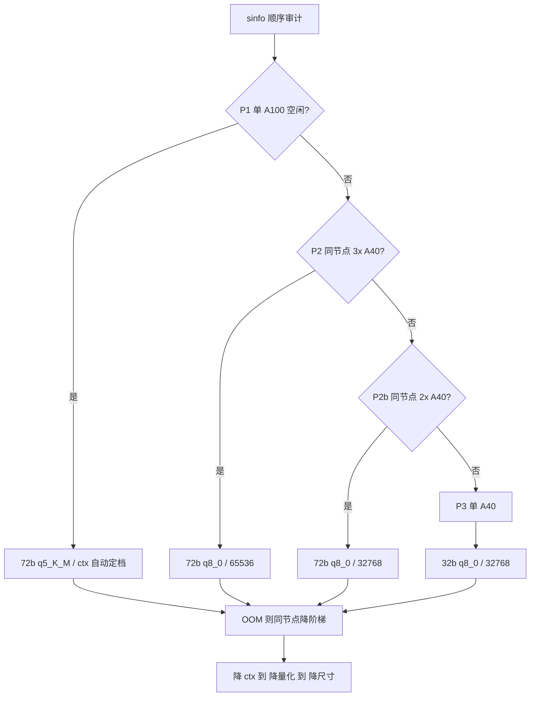

## 产品概述

用户的 Ctrl-Z 撤销操作在 `C:\Users\Asus\Desktop\FYP code\MLFlu\` 造成严重副作用：整个 `scripts/` 与 `tests/` 目录被清空，41 个 git 跟踪文件（MIFlu 复现代码库全部源码 + 3 个测试）从工作树消失。本次任务首先要**完整恢复这些研究代码**，然后执行最后一次彻底清扫与验证：把旧安装指南的独有章节合并进桌面中枢、把 plan 归档件迁出仓库，使项目仓库实现零网关残留；最后后台启动真实 72B 作业验证全功率就绪，并交付清扫清单与验收报告。

## 核心功能

**优先级 0：研究代码恢复（数据安全）**

- 用 `git checkout -- scripts tests` 从 index 恢复 41 个未暂存删除的文件
- 校验恢复完整性，同时确保不破坏已有的 `HPC_GUIDE.md` 暂存删除成果

**Task 1：完整清扫与安全迁移**

- 全仓扫描与 Burgundy HPC / `vibe-on` 网关 / Qwen、DeepSeek 配置相关的所有散落文件
- 有价值内容**先迁移**到 `C:\Users\Asus\Desktop\Burgundy-Vibe-Core\` 并智能合并，再从仓库删除
- 过时重复产物直接永久删除；跟踪文件用 `git rm` 暂存

**Task 2：实时集群端到端健康与全功率就绪审计**

- 校验桌面编排器语法与 SSOT 守卫
- 打印精确动态路由档位，证明 P1/P2 起手即为全功率 `qwen2.5-coder:72b`（64k/128k），32B 仅作 P3 基线，7B 仅为末级兜底
- 实时集群审计、端点握手、profile 非破坏性锁定验证
- 后台启动真实 72B 作业，验证进入拉取/加载阶段

**交付**

- 清扫文件清单表、仓库最终干净状态、绿色验收文本

## 已确认的三项决策

1. 旧 `GLOBAL_INSTALLATION_GUIDE.md`：独有章节合并进桌面中枢指南作附录，再删仓库副本
2. `.codebuddy\plans\` 下 3 个 burgundy/vibe plan 文件：移到桌面中枢并从仓库删除（最严格去污）
3. 72B 审计：后台启动真实 72B 作业，进入拉取/加载阶段即报告，不阻塞等待完整下载

## 技术栈选型

沿用既有栈，不引入任何新依赖：

| 层 | 选型 | 依据 |
| --- | --- | --- |
| 数据恢复 | git（`git checkout --`） | 41 个文件全在 HEAD 且删除未暂存，可完整恢复 |
| 本机编排 | Windows PowerShell 5.1+ | 现有 `vibe_gateway.ps1`；仅需 `Copy-Item`/`Set-Content`/`Get-FileHash` |
| 一致性校验 | MD5（`Get-FileHash`／`md5sum`） | 历次已用 MD5 抓出远端 sed 毁文件、bin 陈旧副本等问题 |
| 远端运行时 | Bash + Slurm + Ollama | 计算节点原生 Ollama v0.13.2，无容器 |
| 状态持久化 | `%USERPROFILE%\.burgundy_vibe\` | 位于用户目录、不在项目内，本身符合隔离目标，不移动 |


## 实现方案

### 关键设计决策（含权衡）

**决策 1：恢复只针对 `scripts` 与 `tests` 两个目录，且从 index 而非 HEAD 恢复**

```
git checkout -- scripts tests
```

- 收益 1：`git checkout --` 从 **index** 恢复工作树。因为 `HPC_GUIDE.md` 的删除已**暂存进 index**，该命令**不会**把它恢复回来，去污成果得以保留
- 收益 2：`scripts/burgundy_smart_launcher.sh` 与 `scripts/vibe_gateway.ps1` **从未被 git 跟踪**（此前状态为 `??`），因此不会被带回来，去污状态不被破坏
- 代价与红线：**禁用** `git restore --source=HEAD --staged --worktree .`，它会把 `HPC_GUIDE.md` 一并恢复，直接摧毁去污成果

**决策 2：旧指南"抽取合并"而非"整文件搬运"**

旧指南（19349 B）与新中枢指南（17439 B）已逐标题比对，旧文独有且新文缺失的章节为：IDE Configuration（Cursor／VS Code／Aider／Local CLI）、Optional Additional Aliases（vibe-status／vibe-logs／vibe-stop）、Maintenance &amp; Updates、Security Considerations、Integration with Existing Workflows、FAQ。

合并时必须现代化改写，因为旧文含已废弃信息：

- "把脚本复制到 `%USERPROFILE%\bin`" 已废弃，改为 SSOT 表述（bin 只放 `vibe-on.bat` 转发 shim）
- 模型名 `qwen2.5-coder:32b-instruct-q8_0`／`deepseek-coder-v2:16b-...` 改为规范名 `qwen2.5-coder:72b`／`qwen2.5-coder:32b`
- `HPC_GUIDE.md` 引用路径改为桌面中枢路径
- "Integration with MLFlu Project" 中"脚本在 MLFlu 仓库"的表述必须改写为"已完全解耦"

**决策 3：72B 审计采用"自然路由 + 如实报告"**

用户要求后台启动真实 72B。存在一个必须诚实处理的显存数学约束：

- `qwen2.5-coder:72b-instruct-q5_K_M` 权重约 49 GB
- 若 P1 落到 **40 GB A100**，72B 装不下，会触发 OOM 自愈级联：降 ctx（131072→65536→32768，权重不变故无效）→ 降量化至 q4_K_M（约 43 GB，仍大于 40 GB）→ 最终落到 **32B**
- 真正能稳定承载 72B 的是 **3×A40（144 GB）**，而 `gpu-a40-02` 当前 8 卡全空闲

因此计划让网关按设计优先级自然路由，监控实际部署的模型与 ctx；若因 40 GB A100 级联到 32B，则如实报告并解释显存数学，必要时补一个 3×A40 的 72B 作业作证。不做"为了让报告好看而掩盖降级"。

### 路由档位（已从第 168-207 行 `build_launcher` 源码核实）



| 档位 | GPU 请求 | 起手模型 | 起手 num_ctx | 规范服务名 |
| --- | --- | --- | --- | --- |
| P1 | `gpu:a100:1` | `qwen2.5-coder:72b-instruct-q5_K_M` | 显存 ≥70 GB 取 131072，否则 65536 | `qwen2.5-coder:72b` |
| P2a | `gpu:a40:3` | `qwen2.5-coder:72b-instruct-q8_0` | 65536 | `qwen2.5-coder:72b` |
| P2b | `gpu:a40:2` | `qwen2.5-coder:72b-instruct-q8_0` | 32768 | `qwen2.5-coder:72b` |
| P3 | `gpu:a40:1` | `qwen2.5-coder:32b-instruct-q8_0` | 32768 | `qwen2.5-coder:32b` |


降阶梯末段恒为 `32b q8_0|32768 → 32b q8_0|16384 → 7b q4_K_M|16384`，即 7B 仅作最后兜底。

## 实现注意事项（防回归）

- **恢复命令安全性**：只用 `git checkout -- scripts tests`；**禁止** `git restore --source=HEAD --staged --worktree .`
- **禁止 `New-Item -ItemType File -Force`** 操作已存在的 profile（会截断，曾清空过用户的 fnm 配置）
- **远端 ssh 命令必须无引号**（Windows OpenSSH 会剥离引号，实测 `ssh host 'echo "a  b"'` 输出 `a b`）
- **CRLF 在本地转 LF 后再 scp**，不要在远端用 `sed` 修（引号被剥离后 `s/\r$//` 退化为 `s/r$//` 会破坏文件）
- **`docs\FIGURE_STYLE_GUIDE.md` 是 MIFlu 图表风格指南，与网关无关，禁止删除**
- **`.codebuddy\memory\*` 属跨会话工作记忆**（含集群实测事实），按记忆协议保留，不作为"散落文件"清理
- 不 commit；`%USERPROFILE%\.burgundy_vibe\` 状态目录不动

## 目录结构

```
C:\Users\Asus\Desktop\Burgundy-Vibe-Core\          # SSOT 唯一真源
├── burgundy_smart_launcher.sh        # 保持不变（路由阶梯已核实正确）
├── vibe_gateway.ps1                  # 保持不变（$BvRoot + SSOT 守卫已就位）
├── GLOBAL_INSTALLATION_GUIDE.md      # [MODIFY] 追加 Appendix A：旧指南独有章节（现代化改写）
├── HPC_GUIDE.md                      # 保持不变（上一轮已迁入）
└── archive\
    └── plans\                        # [NEW] 3 个 plan 归档件迁入
        ├── burgundy-vibe-core_b5f988f1.md
        ├── burgundy_vibe_infrastructure_6bde9450.md
        └── vibe-core-ssot-isolation_93504a8e.md

c:\Users\Asus\Desktop\FYP code\MLFlu\
├── scripts\                          # [RESTORE] 恢复 41 个文件中的 38 个（网关脚本不回来）
├── tests\                            # [RESTORE] 恢复 3 个测试
├── HPC_GUIDE.md                      # 保持已删除（git rm 已暂存）
├── GLOBAL_INSTALLATION_GUIDE.md      # [DELETE] 合并后删除（未跟踪，直接删）
└── .codebuddy\
    ├── plans\*.md                    # [DELETE] 3 个 burgundy/vibe plan 迁出后删除
    └── memory\*                      # 保留（工作记忆）
```

## 关键代码结构

**1) 恢复与校验**

```
git checkout -- scripts tests
# 校验：
#   scripts/ 非空；关键文件 Test-Path = True
#   git diff --name-only --diff-filter=D 计数 = 0
#   git status --porcelain -- HPC_GUIDE.md 仍为 "D "（暂存删除未被破坏）
#   scripts/burgundy_smart_launcher.sh 与 scripts/vibe_gateway.ps1 仍不存在
```

**2) Appendix A 应包含的章节（现代化改写后追加）**

```
## Appendix A — IDE Integration, Maintenance & FAQ
### A.1 Optional companion aliases   (vibe-status / vibe-logs / vibe-stop)
### A.2 IDE configuration            (Cursor / VS Code / Aider / Local CLI)
### A.3 Maintenance & updates
### A.4 Security considerations
### A.5 Working alongside other projects   (须声明与 MLFlu 已完全解耦)
### A.6 Frequently asked questions
```

**3) 复用已有 SSOT 守卫（无需重做，仅验证）**

```
$BvRoot = 'C:\Users\Asus\Desktop\Burgundy-Vibe-Core'
$LauncherSrc = Join-Path $BvRoot 'burgundy_smart_launcher.sh'
# 缺失即 exit 9，刻意不回退 $ScriptDir
```

## Agent Extensions

### SubAgent

- **code-explorer**
- 用途：在最终复扫阶段对 `MLFlu` 全仓做跨目录、跨隐藏目录（`.codebuddy\`）的穷尽式搜索，确认零网关残留；并在合并旧指南前精确定位需抽取章节的行范围
- 预期结果：输出一份完整的相关文件清单（含隐藏目录内的 memory 与 plans），且复扫后新增命中数为 0