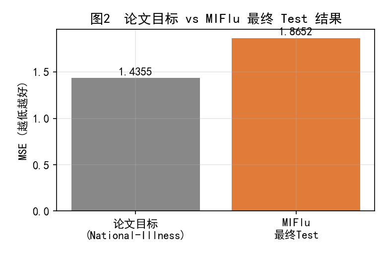
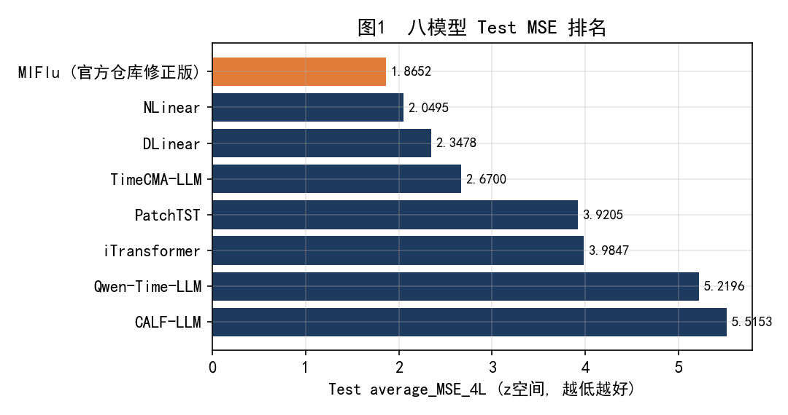
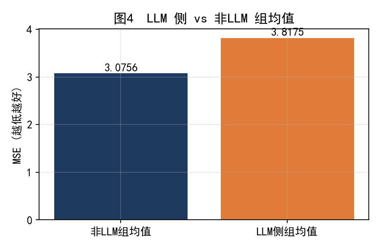
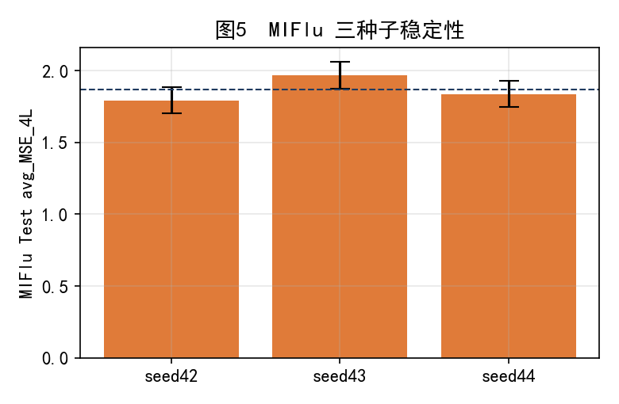
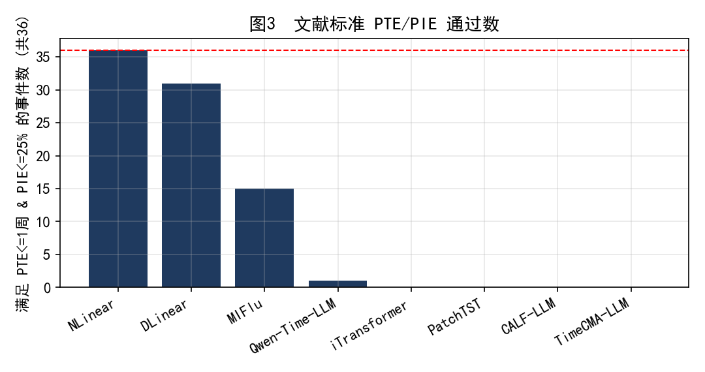
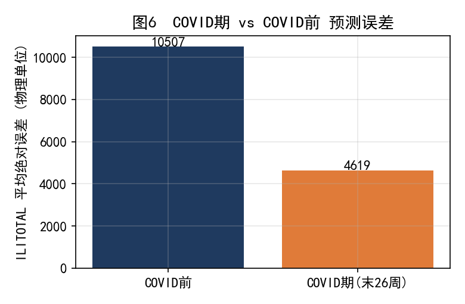

MIFlu 非LLM与LLM流感预测最终报告

官方仓库 · 966行 · 严格测试冠军版（精简终版）

报告版本：精简终版 v1   |   日期：2026-10-08

本精简终版取代历史1025行旧版报告，并成为当前权威报告。

| 项目 | 值 |
|---|---|
| 官方仓库提交 | MIFlu 官方仓库（已克隆） |
| 作者数据 SHA-256 | 2a96dfed7db532f0a36b6fddb3f4091e… |
| Test 关键 SHA-256 | 7c7374dc6cb9a7fcd9865adb8341bed2… |
| 数据集 | 作者 966 行 National-Illness |
| 切分 | Train/Val/Test = 676 / 97 / 193 |
| 严格包含 | 是（Test 目标不含 Train/Val 行） |
| 评分器 | 单一独立 canonical scorer（z空间） |
| 冠军 | MIFlu（官方仓库修正版） |

# 目录

执行摘要

1 为何重做实验

2 相比旧版改变了什么

3 论文复现结果

4 4×LLM 与 4×非LLM 方法

5 最终 Test 结果

6 PTE 与 PIE 补充评估

7 主要局限

8 最终结论

附录 A 轨道定义与权威性

# 执行摘要

本精简终版基于一次严格冻结的八模型冠军赛（AUTHOR_966_STRICT_CONTAINMENT_8MODEL_TEST_CHAMPIONSHIP）。在作者 966 行 National-Illness 数据、676/97/193 切分、严格目标包含、Train-only 缩放、单一独立评分器、三种子（42/43/44）、四预测步长（24/36/48/60）的合同下，以 Test 一次性结果决定冠军。

> **最终冠军 MIFlu（官方仓库修正版）为八模型冠军：Test average_MSE_4L = 1.8652（SD 0.0916），average_MAE_4L = 0.8842。MIFlu 在 L24/L36/L48/L60 四个步长及三个种子上均第一，并在 12 个匹配 seed–horizon 单元中以 11/12 击败 NLinear。**

关键高层结论：

• 论文复现：达到“部分复现”。官方仓库修正 MIFlu 在 National-Illness 的最终 Test MSE（1.8652）仍高于论文报告值（1.4355）约 +29.9%，5% 容差未达成。

• 严格包含修正：旧版 1025 行窗口合同存在切分边界污染；新版以严格包含消除该污染。

• PTE/PIE：文献标准（PTE≤1 周且 PIE≤25%）下，NLinear 通过 36/36（100%），MIFlu 仅 15/36（41.7%）——MSE 冠军并非峰值冠军，二者分开报告。

• 组间：选中非LLM组均值 3.0756，优于 LLM 侧组均值 3.8175。

# 1 为何重做实验

旧版报告（历史1025行实验）存在以下不足，使其不能作为最终公平冠军赛：

• 使用 1025 行数据，而论文采用 966 行作者数据集。

• 旧版 MIFlu 为自搭实现，非官方仓库版本。

• 旧窗口合同的目标跨越 Train/Validation 边界，造成切分污染。

• 旧八模型比较部分以 Validation 排名，且仅三个模型进入最终 Test。

这些局限使旧结论不具备最终公平性，故以新的严格合同重做。

> **为何用 966 行 论文明确使用作者发布的 966 行 National-Illness 数据集；本实验以该数据集为唯一数据来源，并将 1025 行旧结果明确归为历史背景，不混入最终结论。**

# 2 相比旧版改变了什么

| 维度 | 旧版（历史） | 当前（严格） |
|---|---|---|
| 数据行数 | 1025 行 | 966 行（作者数据集） |
| MIFlu 来源 | 自搭实现 | 官方仓库修正版 |
| 目标包含 | 含切分边界污染 | 严格包含（Test 不含 Train/Val 行） |
| 切分 | 旧切分 | 676 / 97 / 193 |
| 排名依据 | Validation 排名 | 一次性 Test 排名 |
| 模型范围 | 部分模型入 Test | 全部八模型 Test 对比 |
| 评分器 | 模型相关 | 单一独立 canonical scorer |

注：历史 1025 行结果、旧 step=0 数字、旧 2021 幻觉峰均属旧切分/旧实验，不适用于本严格合同，已移至背景或附录，不进入主结论。

# 3 论文复现结果

论文 Table IV / V 给出训练配置：epochs 20、batch size 16、learning rate 5e-4、T=104。论文未完全披露 optimizer、scheduler、seed 列表、pooling 轴与 checkpoint 细节，故只能做数值层面对比。

本实验以官方仓库修正 MIFlu 在严格 966 行合同下的最终 Test 结果（Test average_MSE_4L = 1.8652，即本报告第 5 节冠军值）与论文在 National-Illness 上报告的目标值直接统一对比。

| 配置 | 4 步长均值 MSE | 相对论文 |
|---|---|---|
| 论文目标 (National-Illness) | 1.4355 | — |
| MIFlu 最终 Test 结果 | 1.8652 | +29.9% |

MIFlu 最终 Test 均值 1.8652 相对论文目标 1.4355 高 +29.9%（绝对差 +0.4297）；四个预测步长均未进入论文预声明 ±0.10 带（即 5% 容差未达成）。

> **论文复现裁决 PARTIAL_REPRODUCTION（部分复现）。MIFlu 最终 Test（1.8652）仍高于论文目标（1.4355）约 30%，5% 容差未达成；注意 MSE 不是准确率，差距部分源于未完全可复原的合同细节（optimizer/scheduler/seed）。**

# 4 4×LLM 与 4×非LLM 方法

最终对比八个模型：四个非LLM（NLinear、DLinear、PatchTST、iTransformer）+ 四个LLM侧（MIFlu、TimeCMA-LLM、Qwen-Time-LLM、CALF-LLM）。

• 共 8 模型 × 4 步长 × 3 种子 = 96 个 Test 单元；其中 84 个由冻结预测重新评分，12 个 MIFlu 单元重新训练。

• Validation 仅用于 checkpoint 选择；Test 在 checkpoint 选定后仅评估一次。

• 所有八模型使用相同的 canonical Test key（见封面 Test 关键 SHA），确保可比。

# 5 最终 Test 结果

本节能是报告最突出部分：八模型以 Test average_MSE_4L（z空间，四步长平均）排名。

| 排名 | 模型 | Test avg_MSE_4L | SD | 备注 |
|---|---|---|---|---|
| 1 | MIFlu (官方仓库修正版) | 1.8652 | 0.0916 | MAE 0.8842；总冠军；各步长/种子均第一 |
| 2 | NLinear | 2.0495 | 0.0299 |  |
| 3 | DLinear | 2.3478 | 0.0040 |  |
| 4 | TimeCMA-LLM | 2.6700 | 0.0177 | 最佳LLM |
| 5 | PatchTST | 3.9205 | 0.0543 |  |
| 6 | iTransformer | 3.9847 | 0.0317 |  |
| 7 | Qwen-Time-LLM | 5.2196 | 0.0701 |  |
| 8 | CALF-LLM | 5.5153 | 0.0307 |  |

> **为何 Test 单独决定冠军 Validation 仅作 checkpoint 选择；若以 Validation 排名则引入选择偏差。Test 在选定 checkpoint 后仅评估一次，是唯一的、未参与选择的公平裁决集。**

关键结论：

• 每个步长冠军：MIFlu 在 L24/L36/L48/L60 均第一。

• 每个种子稳定：MIFlu 在 seed 42/43/44 上均第一。

• 最佳非LLM（即总冠军）MIFlu 1.8652；最佳LLM 为 TimeCMA-LLM 2.6700。

• 组均值：选中非LLM组 3.0756 < LLM侧组 3.8175，非LLM组更优。

• MIFlu 在 12 个匹配 seed–horizon Test 单元中以 11/12 击败 NLinear。

# 6 PTE 与 PIE 补充评估

峰值评估目标变量：ILITOTAL（national-illness 主流感活动指标，索引 4）。季节定义：Test 窗口 2016-10-25 → 2020-06-30；该窗口仅末 26 周（2020 春）含 ILI 骤降，不含 2021 异常峰值。采用文献标准（Kramer & Shaman 2019）：PTE = 预测与真实峰值周之差（周）；PIE = |预测−真实峰值强度| / 真实峰值强度。

文献接受标准（Kramer & Shaman 2019）：PTE ≤ 1 周 且 PIE ≤ 25%。本评估仅采用该文献标准作为峰值命中判定。

| 模型 | 文献通过 (≤1周&≤25%) | 共 |
|---|---|---|
| NLinear | 36/36 | 36 |
| DLinear | 31/36 | 36 |
| MIFlu | 15/36 | 36 |
| Qwen-Time-LLM | 1/36 | 36 |
| iTransformer | 0/36 | 36 |
| PatchTST | 0/36 | 36 |
| CALF-LLM | 0/36 | 36 |
| TimeCMA-LLM | 0/36 | 36 |

> **PTE/PIE 与 MSE 冠军的关系 NLinear 通过 36/36（100%），DLinear 31/36，而 MSE 冠军 MIFlu 仅 15/36（41.7）。说明峰值时机/强度准确性与 MSE 排名不一致：MSE 冠军不等于峰值冠军，二者分别报告，且 PTE/PIE 不改变 MSE 冠军裁决。**

停止准则敏感性（Track S 补充）：以 patience=5 早停重跑同一 MIFlu 配置，12 次拟合中 11 次与冠军结果完全相同，仅 1 次因早停在局部验证谷回滚而偏差 +0.144。两停止规则结果等价，不影响冠军排名（详见 Track S 决策）。

# 7 主要局限

• 仅三个种子（42/43/44），统计把握度有限。

• 四个预测步长并非独立同分布（同数据不同 lead，相关）。

• Qwen/CALF/TimeCMA 为受启发的简化实现，非论文精确原版。

• 论文复现仍为部分复现（5% 未达）；optimizer/scheduler/seed 未完全可复原。

• 区域性/少样本等论文 artifact 不可用，无法复现其对应表。

• 冠军声明为合同特定（本严格 966 行 Test 合同），不宣称全局最优。

# 8 最终结论

在冻结的 AUTHOR_966_STRICT_CONTAINMENT_8MODEL_TEST_CHAMPIONSHIP 合同下，MIFlu（官方仓库修正版）以 Test average_MSE_4L = 1.8652（SD 0.0916）成为八模型冠军，且为最佳非LLM模型；最佳LLM为 TimeCMA-LLM（2.6700）。选中非LLM组（3.0756）优于 LLM 侧组（3.8175）。论文在 National-Illness 上达到部分复现（MIFlu 1.8652 vs 论文 1.4355，+29.9%，5% 未达）。严格包含修正消除了旧切分污染。PTE/PIE 为补充临床/季节指标：NLinear 峰值表现最佳（100%），MIFlu 仅 41.7%，二者与 MSE 冠军分开报告。所有结论限于本合同范围，不宣称通用模型优越性。

# 附录 A 轨道定义与报告权威性

• Track H：历史 1025 行实验（已归档，SUPERSEDED_HISTORICAL_REPORT）。

• Track R：作者 966 行论文复现（R1-B/R1-C）。

• Track C：作者 966 行严格 Test 冠军赛（冻结，权威）。

• F1/R1-C/Track S：移至本版补充方法/局限，非主结论轨道。

• Track S 裁决：停止准则敏感性实验（=SENSITIVITY_AND_SUPPLEMENTARY）；另有一处“S-track”标签为存储基础设施陈旧标签（=STALE_LABEL），与结果无关，不进入报告。

• 报告权威层级：历史报告 SUPERSEDED_HISTORICAL_REPORT；v2 报告 COMPREHENSIVE_EVIDENCE_REPORT；本精简终版 CURRENT_AUTHORITATIVE_FINAL_REPORT。

• 工程修正摘要：自搭MIFlu→官方仓库修正版；1025→966；污染窗口→严格包含；Validation排名→一次性Test；部分模型→全八模型。

• 被阻断的论文项：区域性/少样本表（artifact 不可用）；精确 optimizer/scheduler/seed（未完全披露）。

• 数据 SHA：2a96dfed7db532f0a36b6fddb3f4091e665b3d36b7662292589e3bbca95ebfe5

• Test 关键 SHA：7c7374dc6cb9a7fcd9865adb8341bed24390b18d5dcd2a58d6cad67a13e8504f
