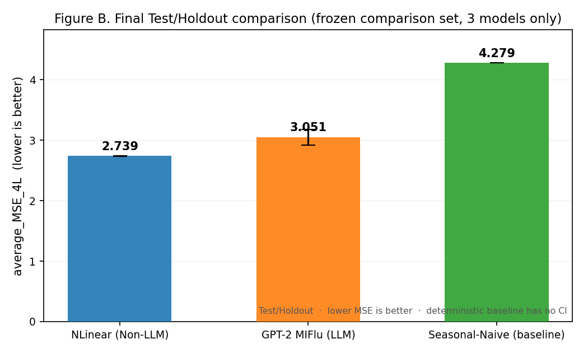

# Project Summary and Planning Chart — Updated DRAFT (with Final Test/Holdout)

> **DRAFT — pending student / tutor review. Do NOT submit as final.**
> This draft preserves the original form structure and identity fields, and updates only the fields supported by the Wave-1 evidence pack **plus the one-time Test/Holdout evaluation**. Original: `58324980_CHAN_Sing_Yeung_Project_Summary_and_Planning_Chart_202627A`.

---

## 1. Student and course identifiers
*(RETAIN unchanged — copy from the submitted original.)*

| Field | Value |
|-------|-------|
| Student ID | 58324980 |
| Student name | CHAN Sing Yeung |
| Course / programme | [RETAIN original] |
| Academic year / term | 2026/27 A |
| Supervisor | [RETAIN original] |

## 2. Project title
[RETAIN original title; if it over-claims LLM superiority, add the qualifier below.]

> Qualifier (recommended): "…with explicit reporting of Non-LLM baselines, the seasonal-naive reference, and a held-out Test/Holdout evaluation."

## 3. Problem statement
*(UPDATE)*

It is unclear whether integrating frozen large language models into time-series forecasters yields accuracy that is (a) superior to lightweight linear models, (b) attributable to the text/LLM mechanism rather than to the underlying seasonality of influenza-like-illness (ILI) data, and (c) robust when evaluated on a held-out, distribution-shifted (COVID-era) window.

## 4. Research question and objectives
*(UPDATE)*

**Research question:** Across four Non-LLM and four LLM-based forecasting architectures, which performs best under the frozen selection rule; does the LLM family as a whole reliably outperform the Non-LLM family; and do the validation conclusions survive a one-time held-out Test/Holdout evaluation?

**Objectives:**

1. Run a pre-registered, seed-replicated (10 seeds × 4 horizons) benchmark of 8 architectures.
2. Identify best Non-LLM, best LLM, and overall Wave-1 validation champion under the frozen rule.
3. Ablate the LLM mechanism (LoRA, multimodal fusion, prompt components) to localize any text contribution.
4. Execute a one-time, audited Test/Holdout evaluation of the frozen champion and runner-up against a seasonal baseline, after a full freeze audit.
5. Preserve strict test/holdout isolation and a quota-safe compact-checkpoint pipeline.

## 5. Completed methodology
*(UPDATE)*

| Item | Value |
|------|-------|
| Dataset | National ILI, seven variables, z-space (train-only normalization) |
| Horizons | 24, 36, 48, 60 |
| Seeds | 42–51 (10 frozen) |
| Early stopping | patience 7 |
| Selection rule | rank by `average_MSE_4L` (mean of per-horizon mean MSE, lower better); secondary `average_MAE_4L` |
| Wave-1 execution | serial fail-stop controller, 580 accepted, 0 ledger FAIL |
| Test/Holdout execution | one-time, 84 runs, 25/25 terminal audit passed, frozen script hash unchanged |

## 6. Models compared
*(UPDATE)*

| Family | Models |
|--------|--------|
| Non-LLM | nlinear, dlinear, patchtst (PatchTST-inspired), itransformer |
| LLM-based | gpt2_miflu, qwen_time_llm, calf_llm, timecma_llm |
| Deterministic references | seasonal_naive, last_value_naive |
| Test/Holdout arms | gpt2_miflu, nlinear (10 seeds × 4 horizons), seasonal_naive (4 horizons) |

## 7. Validated experimental scale
*(UPDATE)*

580 accepted rows = 320 primary + 8 baseline + 240 ablation + 12 negative control; 0 deleted / 0 duplicated. **Test/Holdout: 84 runs** = 2 stochastic models × 4 horizons × 10 seeds + 1 deterministic baseline × 4 horizons; 0 failed / 0 resubmitted.

## 8. Current progress and best result
*(REPLACE)*

**Wave-1 (validation):**

| Result | Model | Value |
|--------|-------|-------|
| Best Non-LLM | nlinear | avg MSE 4L = 1.0698 (95% CI [1.0677, 1.0719]) |
| Best LLM | gpt2_miflu | avg MSE 4L = 0.7709 (95% CI [0.7200, 0.8217]) |
| Overall Wave-1 validation champion | gpt2_miflu | runner-up nlinear (paired t = −13.33, p = 3.13×10⁻⁷) |
| Family finding | Non-LLM (1.142) vs LLM (1.243) | p = 1.44×10⁻⁶ |

**Final (one-time Test/Holdout, COVID-era window):**

| Result | Model | Value |
|--------|-------|-------|
| Best Test model | **nlinear** | avg MSE 4L = 2.739 (95% CI [2.731, 2.747]) |
| Wave-1 champion on Test | gpt2_miflu | avg MSE 4L = 3.051 (95% CI [2.922, 3.179]) |
| Seasonal baseline on Test | seasonal_naive | avg MSE 4L = 4.279 (deterministic) |
| Champion generalizes? | — | **No** — ordering reverses (C1: paired t = 5.46, p = 4.0×10⁻⁴) |
| Learned models beat baseline? | — | **Yes** — C2 p = 4.6×10⁻⁹, C3 p = 7.7×10⁻²¹ |
| Peak intensity (Test, PIE) | nlinear | 9–21% (vs gpt2 41–62%, seasonal 50–124%) |

**Central finding:** the LLM champion's validation advantage was window-specific; on a held-out, distribution-shifted window the simple linear `nlinear` is the more robust and more accurate model. **GPT-2 MIFlu is the best Wave-1 validation model, while NLinear achieved the best final generalization on the pre-frozen one-time Test/Holdout set.**

## 9. Contributions
*(REPLACE — conservative, evidence-supported)*

1. Empirical architecture comparison — pre-registered, seed-replicated, test-isolated benchmark of 8 Non-LLM/LLM architectures under a frozen selection rule.
2. Held-out generalization evidence — a one-time, audited Test/Holdout showing the validation champion's advantage does not survive distribution shift, while both learned models still beat the seasonal baseline.
3. Mechanism / ablation evidence — the LLM text contribution localized to the dataset-information component; LoRA and multimodal fusion statistically inert.
4. Reproducible quota-safe framework — fail-closed compact-checkpoint pipeline (580/580 + 84/84 accepted, 0 fail events).

## 10. Ablation and control work
*(UPDATE)*

6 ablations: only `without_dataset_information` significant (+12.85%, p = 0.004); LoRA / multimodality / task-instruction not significant. 12 executed negative controls (exploratory): zero_text −0.063, shuffled_text +0.081. 18 deferred negative controls remain pending Wave-2 (Family A parent = `gpt2_miflu`; Family B parent = `timecma_llm`, L60 +0.094 p = 0.0015, n small — kept separate, not pooled).

## 11. Remaining work
*(REPLACE)*

Final report written (Chinese report + this summary). Remaining: student/tutor review and sign-off; manuscript drafting; final QA manifest; decision on whether to run the 18 deferred Wave-2 controls before manuscript finalization.

## 12. Revised timeline
*(REPLACE)*

1. ~~Wave-2 deferred-control binding + execution~~ (pending, if required for manuscript).
2. ~~Freeze audit + final champion selection~~ → freeze audit passed; selection frozen at `gpt2_miflu`.
3. ~~Test/holdout evaluation only after freeze~~ → **complete** (84/84, 25/25 audit).
4. ~~Final metrics / figures / reports~~ → **complete** (this report set).
5. Manuscript drafting and submission (remaining).

## 13. Risks and mitigations
*(REPLACE)*

| Risk | Mitigation |
|------|------------|
| LLM superiority over-claimed | report family-level result + seasonal_naive honestly; Test reversal now documented |
| Validation advantage does not generalize (REALIZED) | reported plainly: Test ordering reverses, `nlinear` best on held-out window |
| gpt2_miflu seed instability (SD 0.071) | report seed SD + 95% CI |
| Distribution shift conflated with COVID | state explicitly the Test window is a single contiguous COVID-era window |
| PTE/PIE (peak metrics) | secondary metric, never a tie-breaker; documented lead-1 + reconstructed-target convention |
| patchtst fidelity (no pretraining/RevIN) | carry "PatchTST-inspired" caveat |
| LLM cost (409× params, 28× time vs nlinear) | present cost table transparently; now reinforced by Test result |

## 14. Status labels
*(ADD — must appear verbatim)*

- Wave 1 complete
- Test/Holdout evaluated (one-time, 84/84, 25/25 audit)
- final validation champion: gpt2_miflu (frozen); final Test best: nlinear
- 18 deferred controls pending binding/execution
- final report/manuscript pending student & tutor sign-off
