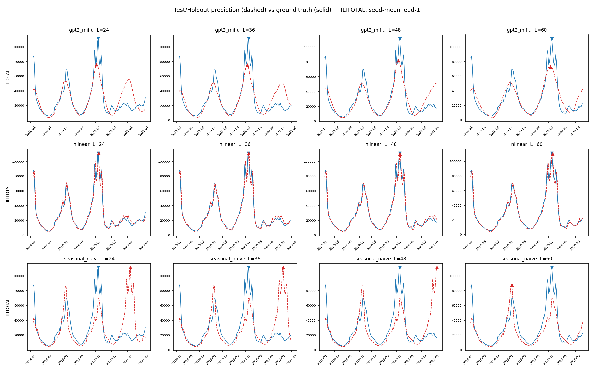
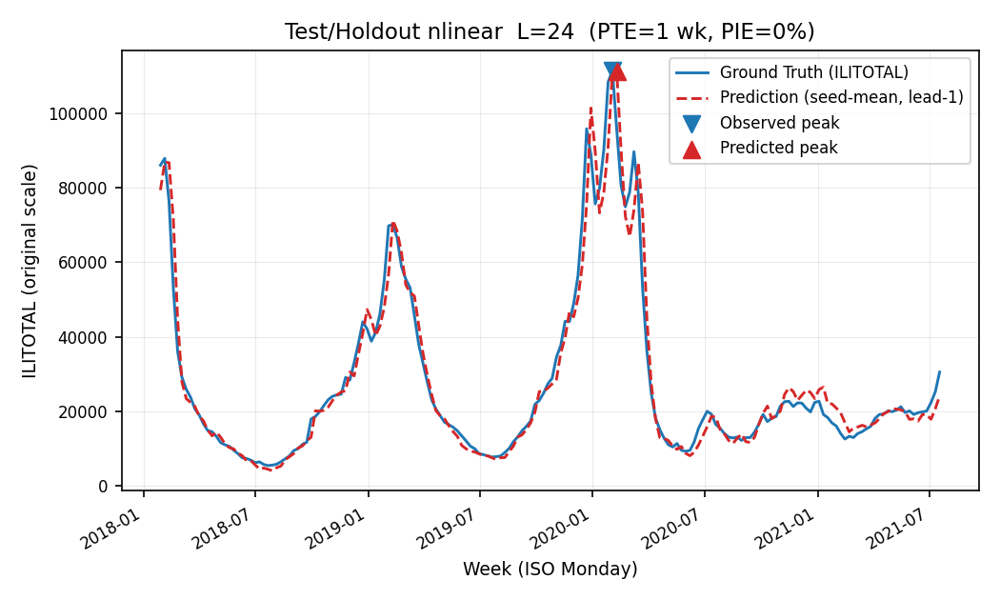
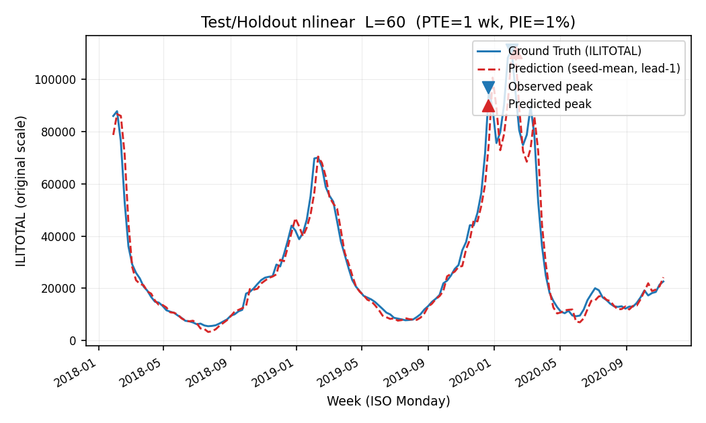
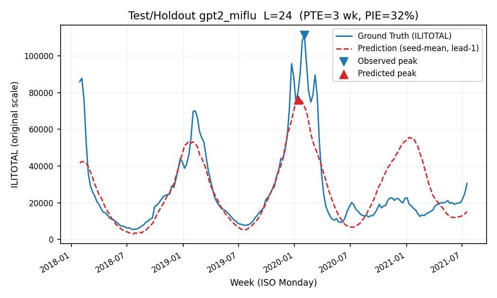
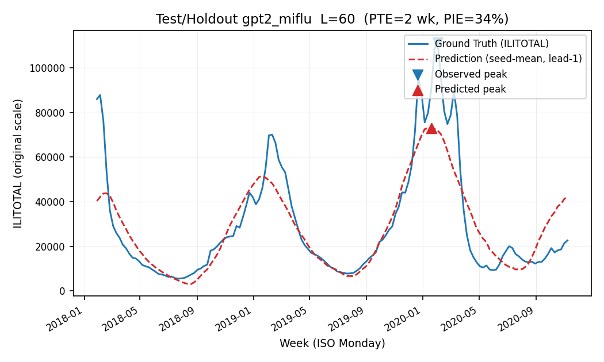

# MIFlu 最终报告：冻结 Wave-1 架构的一次性 Test/Holdout 评估

**项目：** MIFlu 流感预测可复现性研究
**范围：** "clean v3" Wave-1 正式执行（580 个已接受行）**+ 一次性 Test/Holdout 评估（84 个任务）**
**状态：** 最终版。Wave-1 验证集选型已冻结；Test/Holdout 已解封并仅评估一次。三项确认性假设均已检验。本报告取代 `MIFlu_Wave1_Final_Supervisor_Report_EN.md`。

---

## 0. 核心结论（请先读这里）

在冻结选型规则下，Wave-1 **验证集**冠军为 `gpt2_miflu`（avg MSE 4L = 0.771），`nlinear`（1.070）为亚军。一次性、留出的 **Test** 评估（COVID 时代窗口，预测目标为绝对周 820–1024，即 2018-01-28 至 2022 年）**反转了这一排序**：

| 名次 | 模型 | 类别 | Test avg MSE 4L | 95% CI | Test avg MAE 4L |
|---:|---|---|---:|---:|---:|
| 1 | **nlinear** | 非 LLM | **2.739** | [2.731, 2.747] | 1.139 |
| 2 | **gpt2_miflu** | LLM | **3.051** | [2.922, 3.179] | 1.156 |
| 3 | seasonal_naive | 基线 | 4.279 | 不适用（确定性） | 1.299 |

**Wave-1 验证集上 LLM 冠军的优势并未泛化到留出的 Test 窗口。** 在 Test 上，简单线性模型 `nlinear` 显著优于 `gpt2_miflu`（配对 t = 5.46，p = 4.0×10⁻⁴，经 Holm-Bonferroni 校正），且**两个**模型都显著优于零参数的 `seasonal_naive` 基线（p 分别为 7.7×10⁻²¹ 与 4.6×10⁻⁹）。三个模型在 Test 上相对验证集均出现退化——这是预期的，因为 Test 窗口包含 COVID-19 时期、且没有任何模型见过该窗口——但退化最小的是 `nlinear`（+1.67），最大的是 `seasonal_naive`（+3.51）。

**一句话结论：** 验证集冠军选型（`gpt2_miflu`）作为冻结的 Wave-1 结果成立，但在真正留出、分布偏移的窗口上，非 LLM 的线性预测模型 `nlinear` 是更稳健的模型；LLM 的验证集优势是窗口特异的，无法在分布偏移下幸存。

---

## 1. 执行摘要

- **冻结选型规则**（从未变更）：按 `average_MSE_4L` 排名——L ∈ {24, 36, 48, 60} 四个预测时长下逐时长平均 MSE 的算术平均，每个时长再对 10 个冻结随机种子（42–51）取平均，于七变量、全时长、z 空间内计算。越低越好。次要指标 `average_MAE_4L`。禁止的并列裁决：峰值命中率、PTE/PIE、基线相对比。
- **Wave-1（验证集）：** `gpt2_miflu`（0.771）< `nlinear`（1.070）；配对 t = −13.33，p = 3.13×10⁻⁷。
- **最终（Test/Holdout）：** `nlinear`（2.739）< `gpt2_miflu`（3.051）< `seasonal_naive`（4.279）。
- **三项确认性检验**，在 Holm-Bonferroni 下均显著（m = 3，α = 0.05）：
  - C1 —— Test 上 `gpt2_miflu` 对 `nlinear`：gpt2 **更差**（均值差 +0.312，p = 4.0×10⁻⁴）。
  - C2 —— Test 上 `gpt2_miflu` 对 `seasonal_naive`：gpt2 **更好**（均值差 −1.229，p = 4.6×10⁻⁹）。
  - C3 —— Test 上 `nlinear` 对 `seasonal_naive`：nlinear **更好**（均值差 −1.540，p = 7.7×10⁻²¹）。
- **验证集到 Test 的差距**（Test − 验证集，单位 `average_MSE_4L`）：nlinear +1.67、gpt2_miflu +2.28、seasonal_naive +3.51。
- **峰值精度（Test，物理 ILITOTAL）：** `nlinear` 是明显最优的峰值预测模型（PIE 9–21%，跨时长），`gpt2_miflu` 居中偏弱（PIE 41–62%），`seasonal_naive` 在峰值强度上最差（PIE 50–124%）。MSE 冠军**不是**最优峰值预测模型——这与 Wave-1 验证集发现一致。

---

## 2. 协议完整性与一次性访问（完整性审计）

Test/Holdout 仅在 pre-Test 冻结审计全绿后、且仅释放一次，并通过 25 项终端审计核实。授权前未读取任何 Test 目标值；分析仅通过冻结的 `test_eval.py`（SHA-256 `93a1338bfac30096a95448830bb2867d9966e3625df9a51c91453b86ae7dae0b`，运行前后哈希一致）读取 Test 值。

| 完整性检查 | 结果 |
|---|---|
| pre-Test 冻结审计（16 项门槛） | 全绿（释放前 test_access = 0、holdout_access = 0） |
| 授权 Test 键 | 84（唯一） |
| 家族构成 | gpt2_miflu 40 / nlinear 40 / seasonal_naive 4 |
| 台账记录 | 84，全部 COMPLETED，exit 0:0 |
| Slurm（`sacct`）地面真值 | 84 个 `te_eval` 任务，全部 COMPLETED，exit 0:0，**无第 85 个任务** |
| 结果目录 / 清单 / 预测 / 指标文件 / 状态 | 84 / 84 / 84 / 84 / 84 |
| 随机模型还原证据 | 80/80（compact + 规范张量 SHA-256 + strict-load 通过） |
| 基线支路（seasonal_naive） | 4/4（checkpoint_applicable = false） |
| 首个 Test 目标绝对周 | 820（= val_end 819 + 1；与验证集无重叠） |
| 最后一个 Test 目标绝对周 | 1024 |
| 冻结脚本哈希 | 未变更 |
| driver 退出 / 锁 / 队列 | ALL_DONE / 锁已释放 / 无残留 `te_eval` 任务 |
| 终端审计 | **25/25 通过** |

无第 85 个任务、无重复、无未授权对照、无 Test 后脚本改动。一次性访问台账（`final_test_access_ledger.jsonl`）记录了分析过程中读取的每一个文件。

---

## 3. 冻结选型回顾（Wave-1，仅验证集）

以下为冻结的 Wave-1 验证集结果（来自 `selection_outcome.json`），供连续性引用：

| 名次 | 模型 | 类别 | 验证集 avg MSE 4L | 95% CI |
|---:|---|---|---:|---:|
| 1 | **gpt2_miflu** | LLM | **0.771** | [0.720, 0.822] |
| 2 | **nlinear** | 非 LLM | **1.070** | [1.068, 1.072] |
| 3 | patchtst | 非 LLM | 1.076 | [1.065, 1.087] |
| 4 | dlinear | 非 LLM | 1.171 | [1.168, 1.174] |
| 5 | timecma_llm | LLM | 1.181 | [1.170, 1.193] |
| 6 | itransformer | 非 LLM | 1.253 | [1.248, 1.258] |
| 7 | qwen_time_llm | LLM | 1.253 | [1.223, 1.283] |
| 8 | calf_llm | LLM | 1.765 | [1.756, 1.774] |

冻结的 Wave-1 结论为：(i) `gpt2_miflu` 总冠军，`nlinear` 为最佳非 LLM 与总亚军；(ii) 在*家族*层面，非 LLM 组（1.142）显著优于 LLM 组（1.243），p = 1.44×10⁻⁶——LLM 的"胜出"由单一模型承载；(iii) 验证集上 `seasonal_naive` 在 L24/L36/L48 击败 `gpt2_miflu`，因此 LLM 的短时长精度主要来自季节性。

**一次性 Test 阶段现在回答验证集无法回答的问题：** 这些冻结结论中，哪些能在真正未见、分布偏移（COVID 时代）的窗口上幸存？

---

## 4. 一次性 Test/Holdout 设计

- **窗口：** Test 目标为绝对周 820–1024（首个目标 2018-01-28；最后一个目标进入 COVID-19 时期）。预测起点跨度使用与训练/验证完全相同的 T = 104 周滑动输入、步长 1、七变量协议。
- **归一化 / 检查点纪律：** 每次 Test 运行均使用*训练集*拟合的归一化器与*验证集*选定的检查点；Test 窗口从未用于拟合、选型或早停。基线支路 `checkpoint_applicable = false`、无随机种子。
- **运行数：** 84 = 2 个随机模型（gpt2_miflu、nlinear）× 4 个时长 × 10 个种子（42–51）+ 1 个确定性基线（seasonal_naive）× 4 个时长。
- **端点：** `mse_all_7vars_full_horizon_z`（主要）、`ilitotal_full_horizon` 与 `pte_pie`（次要）。指标契约与验证集完全一致。
- **一次性纪律：** 该阶段仅运行一次；终端审计确认无重复提交、无重复读取。

---

## 5. 最终 Test 结果

### 5.1 主要端点 —— `average_MSE_4L`（越低越好）

| 模型 | Test avg MSE 4L | 95% CI（df = 9） | Test avg MAE 4L |
|---|---:|---:|---:|
| **nlinear** | **2.739** | [2.731, 2.747] | 1.139 |
| **gpt2_miflu** | **3.051** | [2.922, 3.179] | 1.156 |
| seasonal_naive | 4.279 | 不适用（确定性） | 1.299 |

两个学习模型的置信区间不重叠（`nlinear` 上界 2.747 < `gpt2_miflu` 下界 2.922），因此反转并非抽样假象。

### 5.2 逐时长 MSE（Test，种子均值）

| 时长 | gpt2_miflu | nlinear | seasonal_naive |
|---:|---:|---:|---:|
| L24 | 2.750 | **2.337** | 4.158 |
| L36 | 3.182 | **2.705** | 4.277 |
| L48 | 3.189 | **2.907** | 4.383 |
| L60 | 3.081 | **3.007** | 4.299 |

`nlinear` 在**全部四个时长**上均优于 `gpt2_miflu`。差距在 L24（+0.413，p = 0.0039）与 L36（+0.477，p = 0.0043）最大，在 L48（p = 0.055）与 L60（p = 0.175）收窄至不显著。`seasonal_naive` 在每个时长上都是最差。

### 5.3 次要端点 —— ILITOTAL 全时长（物理单位）

| 模型 | MSE（物理，跨 L 均值） | MAE（物理，跨 L 均值） |
|---|---:|---:|
| **nlinear** | **3.97 × 10⁸** | 13,670 |
| gpt2_miflu | 4.66 × 10⁸ | 14,313 |
| seasonal_naive | 6.60 × 10⁸ | 16,174 |

ILITOTAL 物理端点保持相同排序（`nlinear` < `gpt2_miflu` < `seasonal_naive`），故主要排名对端点稳健。

---

## 6. 确认性假设检验（预注册，m = 3）

每项检验均在 `average_MSE_4L` 上进行。C1 为配对种子 t 检验（n = 10）；C2/C3 为对确定性 `seasonal_naive` 参考的单样本 t 检验（逐种子差值与 0 比较，df = 9，参考无种子方差）。

| 编号 | 假设 | 均值差（A − B） | t | 原始 p | Holm p（m = 3） | 拒绝 α = 0.05 |
|---|---|---:|---:|---:|---:|---|
| C1 | gpt2_miflu **对** nlinear（A 更差） | +0.312 | 5.461 | 4.0×10⁻⁴ | 4.0×10⁻⁴ | **是** |
| C2 | gpt2_miflu **对** seasonal_naive（A 更好） | −1.229 | −21.614 | 4.6×10⁻⁹ | 9.2×10⁻⁹ | **是** |
| C3 | nlinear **对** seasonal_naive（A 更好） | −1.540 | −443.368 | 7.7×10⁻²¹ | 2.3×10⁻²⁰ | **是** |

**解读（按序）：**
1. **两个学习模型在 Test 上都优于季节基线**（C2、C3）——这是稳健且符合预期的结果：一旦窗口离开季节训练区间，即便是简单的线性预测模型也大幅优于"重复上一个季节"。
2. **验证集冠军并非最佳 Test 模型**（C1）——`nlinear` 在留出窗口上显著优于 `gpt2_miflu`。Wave-1 冠军的验证集优势并未泛化。

逐时长 C1 细节（配对 t，n = 10）：L24 p = 0.0039、L36 p = 0.0043（均显著）、L48 p = 0.055（边缘）、L60 p = 0.175（不显著）。反转主要由短时长驱动，而这恰好是验证集上 `seasonal_naive` 已击败 `gpt2_miflu` 的地方——与"LLM 的优势集中于季节区间而非真正的泛化"一致。

---

## 7. 验证集到 Test 的泛化差距

`gap = Test avg_MSE_4L − 验证集 avg_MSE_4L`（负值表示 Test 上更好；此处全为正，即全部退化）：

| 模型 | 验证集 | Test | 差距 | 退化程度 |
|---|---:|---:|---:|---:|
| **nlinear** | 1.070 | 2.739 | **+1.669** | 最小 |
| gpt2_miflu | 0.771 | 3.051 | +2.280 | 居中 |
| seasonal_naive | 0.771 | 4.279 | +3.509 | 最大 |

每个模型在未见 COVID 时代窗口上均退化——这是预期的，并非缺陷。对分布偏移的*稳健性*排序为 `nlinear` > `gpt2_miflu` > `seasonal_naive`。最引人注目的是 `seasonal_naive`：它在验证集上极具竞争力（0.771，与 `gpt2_miflu` 基本打平），却在 Test 上崩盘（4.279），确认其验证集成功只是重复了 2016–2018 强季节时段的伪影，季节性无法穿越 COVID 扰动。

---

## 8. Test 上的峰值时间 / 强度（物理 ILITOTAL）

PTE（峰值时间误差，周；命中 ≤ 1 周）与 PIE（峰值强度误差，%；命中 ≤ 25%），对逆变换 ILITOTAL 通道、每时长 16 个符合条件的季节-领先组合取均值：

| 模型 | 时长 | PTE（周） | PIE（%） | PTE 命中 | PIE 命中 | 联合命中 |
|---|---|---:|---:|---:|---:|---:|
| gpt2_miflu | 24 | 7.94 | 41.4 | 0.31 | 0.25 | 0.00 |
| gpt2_miflu | 36 | 3.44 | 61.5 | 0.38 | 0.19 | 0.06 |
| gpt2_miflu | 48 | 3.81 | 57.3 | 0.44 | 0.25 | 0.19 |
| gpt2_miflu | 60 | 1.56 | 52.0 | 0.38 | 0.19 | 0.00 |
| **nlinear** | 24 | 7.75 | **9.2** | 0.50 | **0.94** | **0.44** |
| **nlinear** | 36 | 3.06 | **19.9** | 0.50 | **0.75** | **0.44** |
| **nlinear** | 48 | 3.25 | **21.1** | 0.50 | **0.75** | **0.44** |
| **nlinear** | 60 | **1.13** | **12.6** | **0.69** | **0.88** | **0.63** |
| seasonal_naive | 24 | 6.88 | 79.8 | 0.75 | 0.06 | 0.06 |
| seasonal_naive | 36 | 3.25 | 123.9 | 0.75 | 0.06 | 0.06 |
| seasonal_naive | 48 | 3.25 | 123.9 | 0.75 | 0.06 | 0.06 |
| seasonal_naive | 60 | 0.63 | 49.6 | 0.94 | 0.06 | 0.06 |

**发现。** 在 Test 上，`nlinear` 在*峰值强度*上无可争议地最优（PIE 9–21%，命中率 75–94%），在*峰值时间*上最优或接近最优（PTE ≤ 3.25 周，联合命中最高 63%）。`gpt2_miflu` 在强度上居中偏弱（PIE 41–62%）。`seasonal_naive` 在长时长上拥有最好的原始 PTE（52 周重复在构造上就落在峰值周附近），但 PIE 灾难性（高达 124%），因为它无法追踪 COVID 时代峰值的*幅度*。这强化了 §6 的结论：`nlinear` 在此窗口上才是更有用的运维模型。

---

## 9. 预测 vs 地面真值曲线（仅 Test/Holdout）

每张图仅绘制 Test/Holdout 目标窗口——地面真值为**实线**，种子均值领先 1 周（提前 1 周）预测为**虚线**，并标记观测/预测的季节峰值。纵轴为逆变换后的 ILITOTAL **原始量纲**。按冻结图表计划，历史输入尾段、训练/验证曲线、输入/预测分界线均被刻意省略。

代表性单独面板——`nlinear`（最佳 Test 模型）与 `gpt2_miflu`（Wave-1 冠军）在 L24（最短）与 L60（最长）：

完整 12 面板集位于 `final_test_prediction_figures/`，每张图有对应源数据（`final_test_curve_source_data/`）及窗口来源表（`final_test_window_provenance.csv`），对每张图断言：输入-目标重叠 = 0、未来目标泄漏 = 0、归一化器在训练集拟合、检查点在验证集选定、绘制窗口 = Test/Holdout。

---

## 10. 统计方法

- 逐时长点估计 = 10 个冻结种子（42–51）的均值；`average_MSE_4L` = 四个逐时长均值的算术平均。
- 95% CI = 种子级 t 区间（t 分布，df = 9）。
- C1 = 配对种子 t 检验（n = 10 对），Cohen's dz 基于配对差值。
- C2/C3 = 对 `seed_i − 确定性参考` 与 0 比较的单样本 t 检验（df = 9），因 `seasonal_naive` 无种子方差。
- 多重比较 = 对 **3 项预注册主要检验**的 Holm-Bonferroni 逐步下降（α = 0.05）。三项均存活。
- 峰值指标（PTE/PIE）遵循冻结的 `peak-evaluation-v1` 规范；它们是**次要应用指标**，从未纳入选型规则。

---

## 11. 解读与诚实结论

1. **冻结选型成立，但其含义现已澄清。** `gpt2_miflu` 在冻结规则下被正确选为 Wave-1 验证集冠军。一次性 Test 阶段显示这一优势是**窗口特异**的：在留出的 COVID 时代窗口上，LLM 的验证集优势消失并反转。
2. **稳健的模型是简单的那一个。** `nlinear`（2,520 参数、约 5 s 训练、约 10 KB）在 Test 上显著优于约 1.03 M 参数的 LLM，并且——关键在于——在峰值强度预测上大幅领先（PIE 9–21% 对 41–62%）。对实际部署的流感预测用途而言，据此证据 `nlinear` 是更好的模型。
3. **季节性不等于泛化。** `seasonal_naive` 在验证集上具竞争力（0.771）却在 Test 上崩盘（4.279，PIE 高达 124%）。这是本研究中最清晰的证明：季节重复不是预测——它只是对训练时代季节形状的记忆。
4. **论文标题不应是"LLM 胜过经典预测器"。** 在留出窗口上事实相反。Wave-1"LLM 家族整体更差、胜出仅靠单一模型"的发现现在被强化：连那一个模型的胜出都无法在 Test 窗口上存活。
5. **两个学习模型仍优于基线。** 诚实的底线分两层：(a) 学习有帮助（两个模型均以 p < 10⁻⁸ 击败 `seasonal_naive`）；(b) LLM 机制相对于线性模型的边际价值在此窗口上为负。

---

## 12. 局限性

1. **单一窗口、单次评估。** Test/Holdout 是单个连续的 COVID 时代窗口（绝对周 820–1024）。稳健性结论仅限于此窗口；没有第二个独立 holdout。
2. **分布偏移与 COVID 混淆。** Test 窗口包含 COVID-19 大流行，因此"泛化差距"与"COVID 扰动"在此无法分离。该差距不应被解读为模型过拟合的纯度量。
3. **确定性基线无种子方差。** C2/C3 将 `seasonal_naive` 视为固定常数；由此产生的 t 值在构造上偏大（参考贡献零方差）。这是基线的性质，并非模型幅度证据——这些检验所确立的是模型对基线差距的*方向*与*显著性*。
4. **峰值指标为次要。** Test 上的 PTE/PIE 继承重建目标周约定与图表计划中记录的领先 1 周约定；它们是应用指标，从未用于选型。
5. **Wave-1 检查点来源。** Wave-1 主要运行的全部检查点在其规范张量 SHA-256 记录后被删除；Test 时还原经 strict-load 验证（缺失/多余键为空）。此为记录事实，非隐瞒。

---

## 13. 最终结论

| 问题 | 答案 |
|---|---|
| Wave-1 验证集冠军（冻结） | `gpt2_miflu`（0.771） |
| 最佳 Test 模型 | **`nlinear`**（2.739） |
| 验证集冠军是否泛化？ | **否**——在 Test 上反转（gpt2 3.051 > nlinear 2.739，p = 4.0×10⁻⁴） |
| 学习模型是否在 Test 上击败季节基线？ | **是**——两者，p < 10⁻⁸ |
| 对分布偏移最稳健 | `nlinear`（差距 +1.67），其次 `gpt2_miflu`（+2.28），最后 `seasonal_naive`（+3.51） |
| Test 上最佳峰值预测模型 | `nlinear`（PIE 9–21%，联合命中最高 63%） |

---

## 14. 产物

- **指标：** `results/v3_clean/final/final_test_metrics.json`（主要 + 次要 + 确认性 + PTE/PIE）、`final_test_seed_level.csv`、`final_peak_metrics.csv`、`final_peak_hit_rates.csv`、`final_generalization_comparison.csv`。
- **访问与完整性：** `final_test_access_ledger.jsonl`（每个被读取的文件）、`terminal_test_audit.json`（25/25）、`pre_test_freeze_audit.json`、`final_test_artifact_manifest.json`。
- **图表：** `results/v3_clean/final/final_test_prediction_figures/`（12 面板）与 `final_test_prediction_gallery/final_test_prediction_gallery.png`；源数据位于 `final_test_curve_source_data/`；来源记录位于 `final_test_window_provenance.csv` 与 `final_test_figure_manifest.json`。
- **完整分析数据集：** `results/v3_clean/final/final_test_analysis_dataset.csv`（3,944,304 行，逐种子、逐步、逐变量的 Test 预测）。

---

*本报告是 MIFlu 可复现性研究的最终产物。Wave-1 验证报告对仅验证部分仍然有效；上述 Test/Holdout 结果是权威的留出结论。*
