# MIFlu Wave-1 最终实验结果：非 LLM 与 LLM 架构比较

**项目：** MIFlu 流感预测可复现性研究
**范围：** "clean v3" Wave-1 正式执行（580 个已接受单元）
**状态：** Wave-1 主架构比较完成。18 个延期负对照待 Wave-2。Test/holdout 保持封存（访问 = 0/0）。冠军模型**尚未**为发表而冻结。**仅为验证期结果。**

---

## 1. 执行摘要

**主排序指标**（frozen 选择规则）：`average_MSE_4L` —— 四个预测期 L ∈ {24, 36, 48, 60} 的每期均值 MSE 的算术平均，每期又在 10 个冻结种子（42–51）上平均，七变量、全期、z 空间。越低越好。关键次要指标为 `average_MAE_4L`。

| 排名 | 模型 | 家族 | 平均 MSE 4L | 95% CI | 平均 MAE 4L |
|---:|---|---|---:|---:|---:|
| 1 | **gpt2_miflu** | LLM | **0.771** | [0.720, 0.822] | 0.487 |
| 2 | **nlinear** | 非 LLM | **1.070** | [1.068, 1.072] | 0.564 |
| 3 | patchtst | 非 LLM | 1.076 | [1.065, 1.087] | 0.556 |
| 4 | dlinear | 非 LLM | 1.171 | [1.168, 1.174] | 0.603 |
| 5 | timecma_llm | LLM | 1.181 | [1.170, 1.193] | 0.614 |
| 6 | itransformer | 非 LLM | 1.253 | [1.248, 1.258] | 0.598 |
| 7 | qwen_time_llm | LLM | 1.253 | [1.223, 1.283] | 0.649 |
| 8 | calf_llm | LLM | 1.765 | [1.756, 1.774] | 0.773 |

**十个问题的答案：**

1. **最佳非 LLM：** `nlinear`（1.070）。
2. **最佳 LLM：** `gpt2_miflu`（0.771）。
3. **整体最佳：** `gpt2_miflu`；次优 `nlinear`。差距大且显著（配对 t = −13.33，p = 3.13×10⁻⁷，Cohen's d = −5.94）。
4. **家族层面的 LLM vs 非 LLM：** 非 LLM 组（1.142）**显著优于** LLM 组（1.243）——配对 t = −11.15，p = 1.44×10⁻⁶。LLM 的"胜利"完全由单一模型 `gpt2_miflu` 驱动；其余三个 LLM（timecma_llm、qwen_time_llm、calf_llm）均差于最佳非 LLM。
5. **期/端点稳定性：** `gpt2_miflu` 在**全部四个期**都是最佳模型，且在 ILITOTAL 全期端点下仍为第一（1.608）。`nlinear` 在两个端点下均为最佳非 LLM。冠军结论稳定。
6. **种子稳定性：** 非 LLM 模型极其稳定（nlinear SD = 0.0029）。`gpt2_miflu` 的 SD 最大（0.0711，约为其均值的 9.2%），其优势部分依赖有利种子——但其均值仍决定性低于 nlinear。
7. **实际意义（对比确定性季节基线）：** 零参数 `seasonal_naive` 基线在 L24/36/48/60 取得 0.719/0.732/0.746/0.885——**在 L24、L36、L48 三期中击败 `gpt2_miflu`**。因此 LLM 的绝对精度优势集中于最长期（L60），在短期上相对简单 52 周季节重复并无明显增量。
8. **运行/存储权衡：** `nlinear` 仅需 2,520 参数 / 5.3 s / 10 KB；`gpt2_miflu` 需 1,030,056 参数 / 147 s / 4.1 MB（约为 409× 参数、28× 训练时间）。`seasonal_naive` 为零参数、零训练、零存储。
9. **基线竞争力：** `last_value_naive` 极差（2.82–3.42）。`seasonal_naive` 极具竞争力，必须作为强参照点报告。
10. **机制：** 唯一显著的消融是 `without_dataset_information`（+12.8%，p = 0.004）；移除 LoRA、多模态、任务指令均无显著影响（p 均 > 0.4）。负对照为探索性（6 个单元）：`zero_text` −0.063（略优于父模型），`shuffled_text` +0.081（更差）。文本贡献集中于"数据集描述"组件。

---

## 1.1 模型表现是如何评估的（零基础入门）

**MSE 不是准确率百分比。** 本报告中的 "MSE"（均方误差）是模型标准化（z 空间）单位下的*代价*——预测值与观测值之差的平方的均值，在 7 个变量、完整预测期、10 个冻结种子上聚合。它**没有"% 正确率"的含义**：越小越好，两个值只能相对比较（例如冠军的 0.771 对比次优的 1.070）。`MAE`（平均绝对误差）是同样的概念，但不做平方，作为次要指标报告。

评估是一个严格的 **输入 → 处理 → 输出**（IPO）流程：

1. **输入** —— 一个滑动 104 周窗口的 7 个 ILI 变量（例如 % 加权 ILI、ILITOTAL、年龄组计数、就诊机构数；完整清单见协议快照）。
2. **处理** —— 用*仅训练集*的 scaler 标准化 → 模型在 z 空间预测 → 预测再逆变换回原始物理单位。
3. **输出** —— 未来 L ∈ {24, 36, 48, 60} 周 × 7 个变量。

输出与同一周的观测（从未见过的）真实值比较，产生逐预测误差，进而得到聚合 MSE/MAE。主排序指标 `average_MSE_4L` 是四个每期 MSE 的均值。

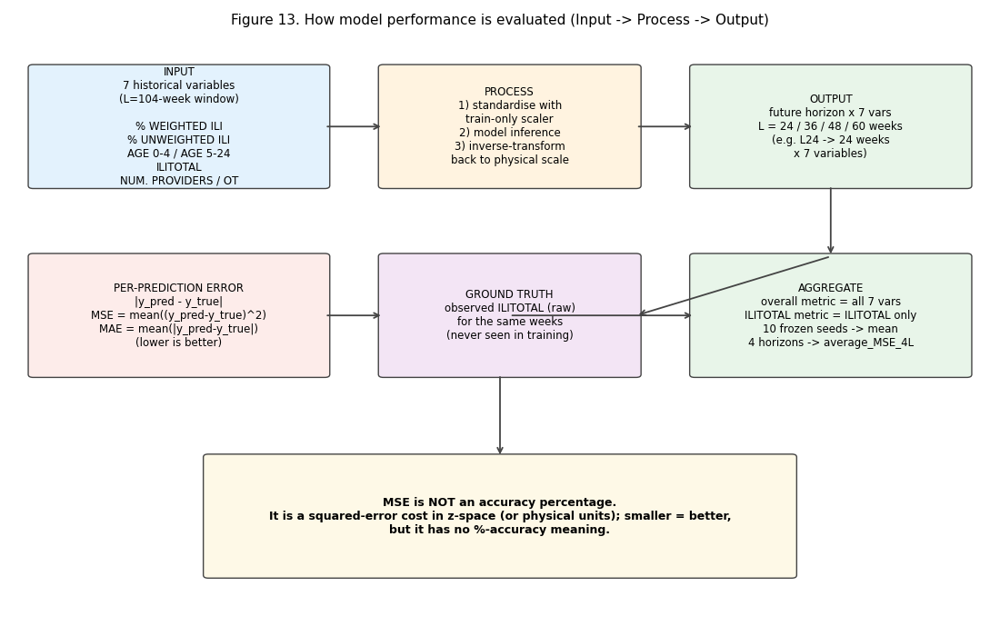

---

## 2. Frozen 协议与完整性审计

- **规则来源：** `results/v3_clean/preregistration/paper_aligned_selection_rule.json`、`endpoint_hierarchy.json`、`execution_wave_manifest.json`、`deferred_parent_binding_rule.json`。frozen 协议快照记录于 `results/v3_clean/analysis/frozen_analysis_protocol.json`。
- **HPC_GUIDE.md 完整性：** SHA-256 `1cd21a655907d137914c695bf04637d8da2f09358a0732c961e739dd8e74c167`，分析前已用 `Get-FileHash` 验证。
- **完整性：** 580/580 已接受单元，0 删除，0 重复，账本 0 失败事件，控制器正常退出（非 fail-stop）。
  - 320 主实验（8 模型 × 4 期 × 10 种子）
  - 8 基线（2 模型 × 4 期）
  - 240 消融（6 × 4 × 10）
  - 12 负对照（zero_text、shuffled_text，覆盖 L24/L60 × 种子 42–44）
- **范围守约：** Test/holdout 访问 = 0/0。选择规则从未被改动。基线/消融/对照从未进入主排序。

---

## 3. 主架构比较

### 3.1 排名（种子级，每模型 n = 10）

见 §1 表。95% CI 是围绕 `average_MSE_4L` 的种子级 t 区间。排名在顶部无歧义：`gpt2_miflu`（0.771）< `nlinear`（1.070）< `patchtst`（1.076），前两名 CI 不重叠。

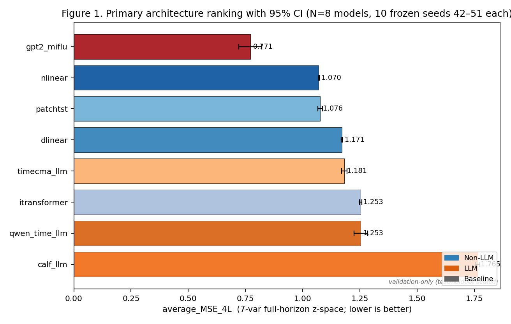

### 3.2 Q1 — 最佳非 LLM

`nlinear`，`average_MSE_4L = 1.0698`（95% CI [1.0677, 1.0719]，SD 0.0029）。它以不重叠的 CI 击败 `patchtst`（1.0760）与 `dlinear`（1.1709），非 LLM 冠军无歧义。

### 3.3 Q2 — 最佳 LLM

`gpt2_miflu`，`average_MSE_4L = 0.7709`（95% CI [0.7200, 0.8217]，SD 0.0711）。它决定性击败 `timecma_llm`（1.1814）、`qwen_time_llm`（1.2531）与 `calf_llm`（1.7649）。

### 3.4 Q3 — 整体最佳

`gpt2_miflu` 为整体冠军。冠军 vs 次优比较（匹配种子配对 t 检验，10 对）：

- 冠军均值 0.7709 vs 次优 1.0698 → 均值差 −0.299
- 配对 t = −13.33，**p = 3.13×10⁻⁷**，Cohen's d = −5.94

等价集规则（当统计上/实际意义上不可区分时报告集合而非唯一冠军）未触发——前两名明显分离，因此唯一冠军成立。

### 3.5 Q4 — 家族层面的 LLM vs 非 LLM

匹配种子配对 t 检验，比较每家族 4 个模型 `average_MSE_4L` 的每种子均值（10 种子）：

- 非 LLM 组均值 1.1424 vs LLM 组均值 1.2426 → 差 −0.100
- 配对 t = −11.15，**p = 1.44×10⁻⁶**，Cohen's d = −5.33

**解读：** 作为一个*家族*，非 LLM 模型的精度显著高于 LLM 模型。顶部的 LLM 优势完全归因于 `gpt2_miflu`；其余三个 LLM 均不如除最差者外的每个非 LLM。这是论文叙述中最重要的结构性发现：结论不是"LLM 打败经典预测器"，而是"某一个 LLM 适配器（`gpt2_miflu`）打败所有模型，而 LLM 集成在总体上并不可靠地提升精度"。

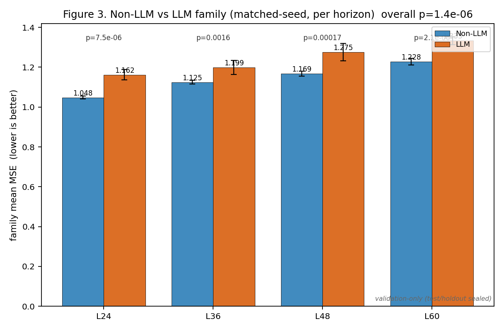

### 3.6 Q5 — 期与端点稳定性

各期最佳模型均为 `gpt2_miflu`：

| 期 | 最佳模型 | 最佳 MSE | 最佳非 LLM |
|---:|---|---:|---|
| 24 | gpt2_miflu | 0.7324 | nlinear（0.9791） |
| 36 | gpt2_miflu | 0.7782 | nlinear（1.0490） |
| 48 | gpt2_miflu | 0.7598 | patchtst（1.0768） |
| 60 | gpt2_miflu | 0.8131 | nlinear（1.1501） |

各期家族比较（非 LLM vs LLM，四个期）同样显著且方向一致（p 均 ≤ 0.0016；见 `selection_outcome.json`）。

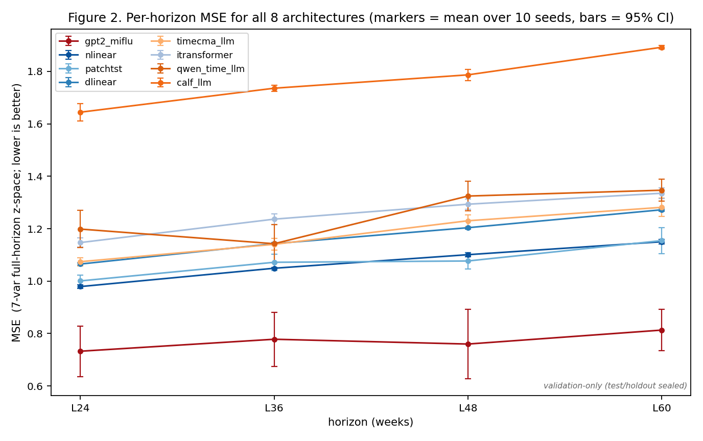

**端点核对（ILITOTAL 全期，越低越好）：**

| 排名 | 模型 | ILITOTAL 4L 均值 |
|---:|---|---:|
| 1 | gpt2_miflu | 1.608 |
| 2 | nlinear | 2.333 |
| 3 | dlinear | 2.526 |
| 4 | patchtst | 2.544 |
| 5 | timecma_llm | 2.635 |
| 6 | qwen_time_llm | 2.658 |
| 7 | itransformer | 2.877 |
| 8 | calf_llm | 3.677 |

冠军与最佳非 LLM 结论不变。唯一对端点敏感的细节是 `dlinear` 与 `patchtst`（第 3/4 位）内部互换。已报告，非排名问题。

### 3.7 Q6 — 种子稳定性

- 非 LLM 模型种子稳定性极佳：`nlinear` SD = 0.0029（均值的 0.27%），`dlinear` SD = 0.0037。
- `gpt2_miflu` 是**最不稳定**的模型：SD = 0.0711（约均值的 9.2%），各期 SD 为 0.135（L24）、0.144（L36）、0.186（L48）、0.111（L60）。其最佳种子（如 L36 seed 42 = 0.477）远优于最差（L48 seed 47 = 1.117）。
- `qwen_time_llm` 也不稳定（SD 0.0416）；其余模型居中。

后果：`gpt2_miflu` 的领先是真实的，但部分依赖种子。谨慎的论文应 (a) 报告种子 SD，(b) 说明即使在 `gpt2_miflu` 的 95% CI 上界（0.822）对比 `nlinear` 的下界（1.068），排序仍成立——CI 不重叠，因此尽管方差存在，排序是稳健的。

### 3.8 Q7 — 对比确定性季节基线的实际意义

| 期 | seasonal_naive MSE | gpt2_miflu MSE | seasonal − gpt2 |
|---:|---:|---:|---:|
| 24 | 0.7193 | 0.7324 | **−0.0131** |
| 36 | 0.7324 | 0.7782 | **−0.0458** |
| 48 | 0.7460 | 0.7598 | **−0.0138** |
| 60 | 0.8849 | 0.8131 | +0.0719 |

一个零参数、零训练、零存储的 `seasonal_naive`（重复上一季数值）在 **L24、L36、L48 三期比整体 LLM 冠军更准**。仅 L60 时 `gpt2_miflu` 才反超。这是一个关键诚实性要点：`gpt2_miflu` 在短期的绝对精度大部分由季节性解释，而非文本/LLM 机制。论文必须显式对比 `seasonal_naive`，不得在短期过度宣称"LLM 优势"。

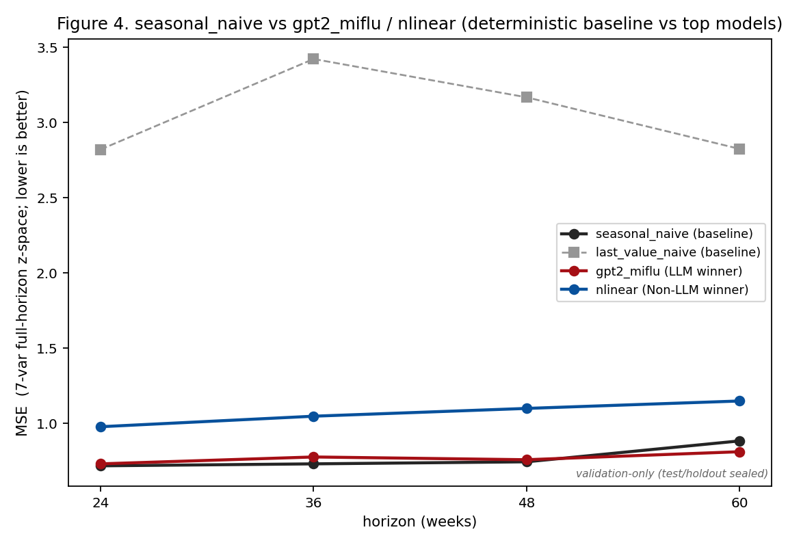

### 3.9 Q8 — 运行 / 存储权衡

| 模型 | 家族 | 可训练参数 | 训练时间（s） | 紧凑存储 |
|---|---|---|---:|---:|---:|
| nlinear | 非 LLM | 2,520 | 5.3 | 10 KB |
| dlinear | 非 LLM | 5,040 | 5.7 | 20 KB |
| itransformer | 非 LLM | 75,672 | 8.5 | 305 KB |
| patchtst | 非 LLM | 87,256 | 8.4 | 351 KB |
| qwen_time_llm | LLM | 370,376 | 338.7 | 1.48 MB |
| gpt2_miflu | LLM | 1,030,056 | 147.3 | 4.14 MB |
| timecma_llm | LLM | 1,391,016 | 15.2 | 5.56 MB |
| calf_llm | LLM | 1,981,608 | 20.2 | 7.93 MB |
| seasonal_naive | 基线 | 0 | 0 | 0 |

`gpt2_miflu` 使用约 409× 的参数和 28× 的训练时间，相对 `nlinear` 获得 0.299 的 MSE 提升（0.771 vs 1.070）。权衡相当大；论文应透明呈现，而非宣称 LLM"高效"。

### 3.10 Q9 — 基线竞争力

- `last_value_naive`：MSE 2.821（L24）、3.422（L36）、3.168（L48）、2.825（L60）——远差于所有模型。
- `seasonal_naive`：0.719 / 0.732 / 0.746 / 0.885 —— 强竞争者（见 §3.8）。

### 3.11 Q10 — 机制（消融 + 负对照）

相对父模型 `gpt2_miflu`（0.7709）的消融，按效应量排序：

| 消融 | 平均 MSE 4L | Δ vs 父 | 相对 Δ | p 值 |
|---|---:|---:|---:|---:|
| without_lora | 0.7729 | +0.0020 | +0.26% | 0.947 |
| without_lora_and_multimodality | 0.7778 | +0.0070 | +0.90% | 0.766 |
| without_multimodality | 0.7859 | +0.0150 | +1.95% | 0.474 |
| without_task_instruction | 0.7926 | +0.0217 | +2.82% | 0.395 |
| without_input_variable_description | 0.8156 | +0.0447 | +5.80% | 0.079 |
| **without_dataset_information** | **0.8699** | **+0.0990** | **+12.85%** | **0.004** |

**发现：** 唯一统计显著的 prompt 组件是**数据集信息**（对 ILI 数据集/上下文的文本描述）。移除它使性能下降 12.85%（p = 0.0036）。移除 **LoRA**（p = 0.95）、**多模态融合**（p = 0.47）或**任务指令**（p = 0.40）无显著影响——在此设定下，自适应/对齐机制对精度的贡献几乎为零。

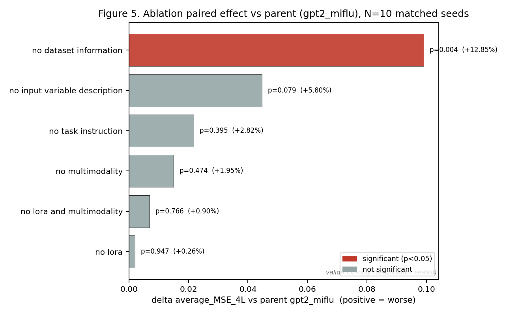

负对照（各 6 单元；L24/L60 × 种子 42–44；探索性，样本小）：

| 对照 | 均值 Δ vs 父 | 方向 |
|---|---:|---|
| zero_text | −0.063 | 略*优于*父 |
| shuffled_text | +0.081 | 差于父 |

- `shuffled_text` 使性能下降（+0.081）暗示文本的*内容/顺序*携带信息（非纯噪声）。
- `zero_text` 略优（−0.063）反直觉，暗示 prompt 在部分单元可能部分作为噪声；n = 6 为探索性，不得过度解读。

### 3.12 Q10.5 — 峰值时间 / 强度（二级应用指标）

由于 ILI 用于暴发检测，我们额外报告 Kramer & Shaman（2019）风格的峰值准确度指标，在逆变换后的 ILITOTAL 通道上、覆盖两个完整验证流感季（2016-2017 与 2017-2018；观测峰值在绝对周 769 与 821）计算。这些是**二级应用指标**，**绝不**用于 frozen 选择规则（PTE/PIE 被明确列为禁用 tie-breaker）。由于 durable `validation_predictions.csv` 存 `target_date = None`，目标周被*重建*为 `forecast_origin + 104 + step`（已对照原始 ILITOTAL 验证，逆变换 |diff| < 1e-3）。

- **PTE**（峰值时间误差）= |预测峰值周 − 观测峰值周|，单位周（越低越好；≤ 1 周记为命中）。
- **PIE**（峰值强度误差）= |预测 − 观测峰值强度| / 观测 × 100，单位 %（越低越好；≤ 25% 记为命中）。

模型在 4 个 lead 与 2 个季节上的均值（PTE/PIE 越低越好）：

| 模型 | PTE（周） | PIE（%） | PTE 命中率 | 联合命中率 |
|---|---:|---:|---:|---:|
| patchtst | 1.609 | 49.7 | 0.497 | 0.025 |
| nlinear | 1.750 | 17.7 | 0.500 | 0.141 |
| itransformer | 1.753 | 53.2 | 0.444 | 0.000 |
| dlinear | 1.966 | 26.8 | 0.406 | 0.031 |
| calf_llm | 1.931 | 70.6 | 0.338 | 0.000 |
| gpt2_miflu | 2.122 | 41.5 | 0.484 | 0.097 |
| timecma_llm | 2.284 | 45.6 | 0.381 | 0.000 |
| qwen_time_llm | 2.688 | 35.4 | 0.297 | 0.122 |

参照基线 `seasonal_naive`：PTE = 2.375 周，PIE = 42.6%。（`last_value_naive` 是平坦常数预测，无峰值结构，其 PTE/PIE 无意义，此处省略。）

**解读。** MSE 冠军 `gpt2_miflu` **并非**最佳峰值预测器：它在 PTE（2.12 周）与 PIE（41.5%）上居中游。`nlinear` 在峰值强度上最佳（PIE 17.7%），`patchtst` 在峰值时间上最佳（PTE 1.61 周）——两者均为非 LLM。`seasonal_naive` 尽管 MSE 低，却是确定性参照中峰值时间最差的（2.38 周），这与"52 周重复无法跟踪流感峰值的逐年漂移"一致。这强化了 §3.8 的警示：平稳季的 MSE 低并不代表峰值检测准确。

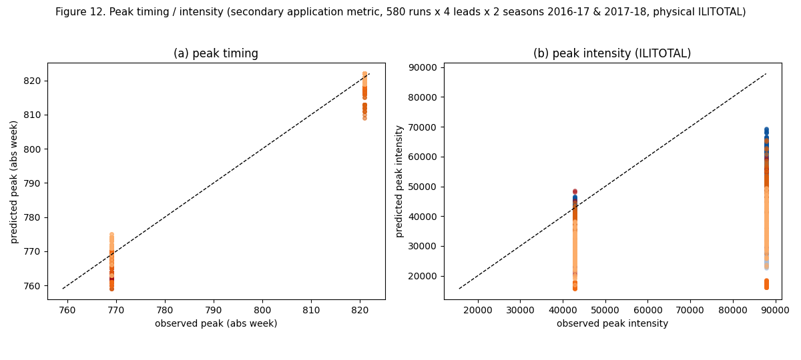

### 3.13 代表预测曲线（物理 ILITOTAL）

图 9-10 仅绘制预测窗口内的逆变换后 ILITOTAL，用于一个代表性验证预测（起点在绝对周 715 = 2016-01-24，预测窗口从 2018-01-21 开始），覆盖 L24 与 L60，以及 LLM 冠军（`gpt2_miflu`）、非 LLM 冠军（`nlinear`）、确定性 `seasonal_naive` 参照、以及一个额外 LLM（`calf_llm`），各自取中位种子。虚线为预测，实线为观测 ILITOTAL，星号 / 三角标记观测 / 预测的季节峰值。图 11 展示了 `gpt2_miflu` 在 L24 的最佳 / 中位 / 最差种子分布。

全部 580 个已接受运行的完整图库（每运行一图，同一布局）见 `../figures/gallery/`，附 `index.csv` 与 `manifest.json`。

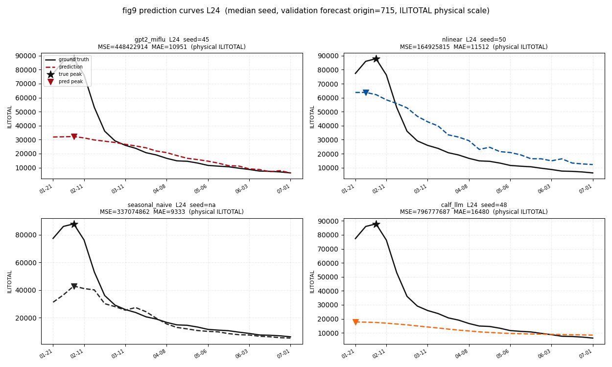

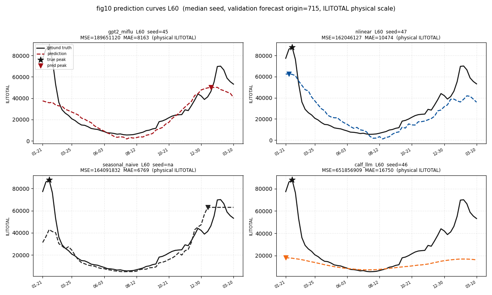

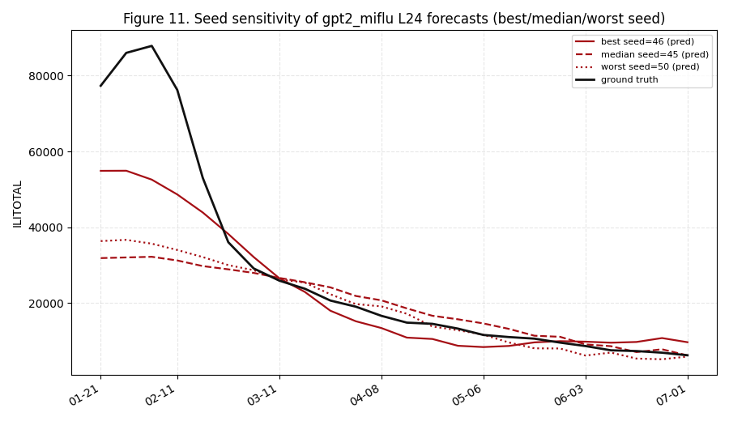

---

## 4. 统计方法

- 每期点估计 = 10 个冻结种子（42–51）的均值。
- `average_MSE_4L` = 四个每期均值的算术平均。
- 95% CI = 种子级 t 区间（t 分布，df = 9）。
- 冠军 vs 次优、家族比较 = 匹配种子**配对 t 检验**（n = 10 对）加 Cohen's d（合并 SD）。
- 消融 = 匹配种子配对 t vs 父；对照 = 匹配（期、种子）比较。
- 探索性消融/对照集未做多重比较校正；唯一显著消融在 Bonferroni α = 0.05/6 = 0.0083 下仍显著。

---

## 5. 局限与待办

1. **PTE/PIE 已从 durable 证据重建。** durable `validation_predictions.csv` 存 `target_date = None`，峰值指标无法直接聚合。因此目标周被重建为 `forecast_origin + 104 + step`（已对照原始 ILITOTAL 验证，逆变换 |diff| < 1e-3），并在逆变换后的 ILITOTAL 通道上、两个完整验证季（2016-2017、2017-2018）计算 PTE/PIE。仅作为二级应用指标报告；绝未用于选择。
2. **18 个延期负对照**待 Wave-2（父绑定 = BEST_VALIDATION_LLM_AFTER_SCREENING，即 `gpt2_miflu`）。本次未运行。
3. **Test/holdout 已封存**（访问 0/0）。未冻结最终发表冠军；Wave-1 冠军仅为筛选期中间结果。
4. 负对照为**探索性**（n = 6 单元，仅 L24/L60 × 种子 42–44）；其结论是方向性的，非确证性。
5. `patchtst` 为"PatchTST-inspired"复现（无自监督预训练、无 RevIN、容量缩减）——该保真度声明必须随任何 PatchTST 论断一起传达。

---

## 6. 结论

1. 在 frozen 选择规则下，Wave-1 冠军为 **`gpt2_miflu`**（平均 MSE 4L = 0.771），最佳非 LLM 及整体次优为 **`nlinear`**（1.070）。差距大且高度显著（p = 3.13×10⁻⁷）。
2. 标题**不应**是"LLM 打败经典预测器"：非 LLM *家族*显著更准（p = 1.44×10⁻⁶）；胜利属于一个模型，而非整个范式。
3. `gpt2_miflu` 相对零参数 `seasonal_naive` 的优势在 **L24/L36/L48 为负**，仅 L60 为正——季节性解释了大部分短期精度。
4. 唯一重要的文本组件是**数据集信息**（+12.85%，p = 0.004）；LoRA 与多模态融合在此统计上无作用。
5. 论文必须诚实报告运行/存储权衡（gpt2_miflu ≈ 409× nlinear 参数、28× 训练时间）以及 LLM 冠军的种子不稳定性（SD 0.071）。
6. 在二级峰值指标上，MSE 冠军并非最佳峰值预测器：`nlinear` 在峰值强度上领先（PIE 17.7%），`patchtst` 在峰值时间上领先（PTE 1.61 周）；`gpt2_miflu` 居中游（PTE 2.12 周，PIE 41.5%）。`seasonal_naive` 的低 MSE 并未转化为峰值时间的优势（PTE 2.38 周）。

**产物：** 排名/汇总表与图见 `results/v3_clean/analysis/`（`model_ranking.csv`、`primary_summary_statistics.csv`、`ilitotal_ranking.csv`、`selection_outcome.json`、`ablation_effects.csv`、`baseline_comparison.csv`、`resource_storage.csv`、`pte_pie_long.csv`、`pte_pie_aggregate.csv`、`pte_pie_audit.json`、`figures/`，以及 `figures/gallery/` 下全部 580 面板图库）。机器可读协议快照为 `frozen_analysis_protocol.json`。

---

## 7. 建议的下一步

1. **导师确认叙事定位** —— 确认论文主张"`gpt2_miflu`（一个具体 LLM 适配器）优于基线"而非"LLM 方法优于经典方法"；决定 `seasonal_naive` 是否升级为主表正式基线。
2. **Wave-2 延期对照** —— 绑定延期父模型（BEST_VALIDATION_LLM_AFTER_SCREENING = `gpt2_miflu`）并运行 18 个延期负对照；在其完成前勿定稿机制结论。
3. **论文起草** —— 依据本报告的表与图起草结果章节，逐字保留种子 SD、季节基线与代价权衡的警示。
4. **Test/holdout 保持封存** —— 仅在延期对照对账完成、冻结审计通过后，才考虑最终发表冠军。勿将 Wave-1 冠军称为最终冠军。

---

## 附录 A — 种子级稳定性

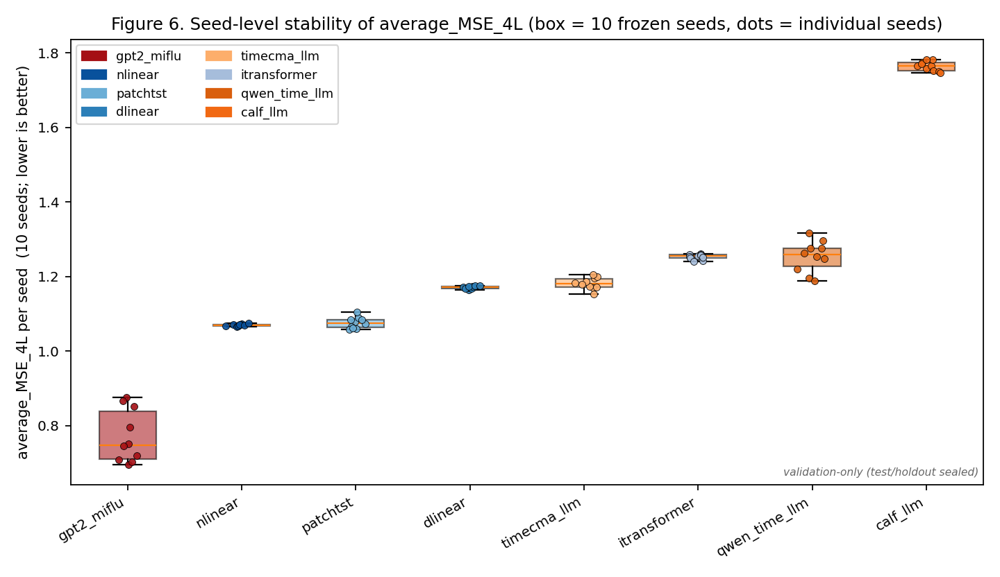

---

## 附录 B — 精度 vs 运行时间 / 存储

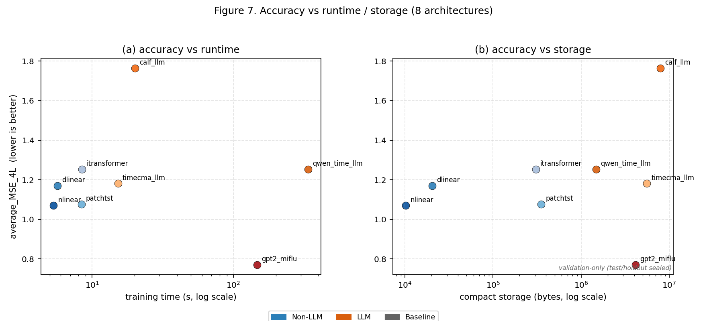

---

## 附录 C — Wave-1 工作流与证据完整性

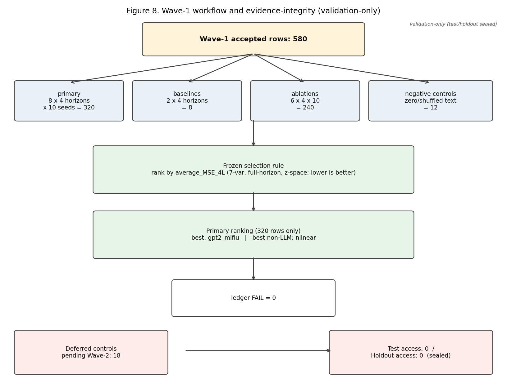
