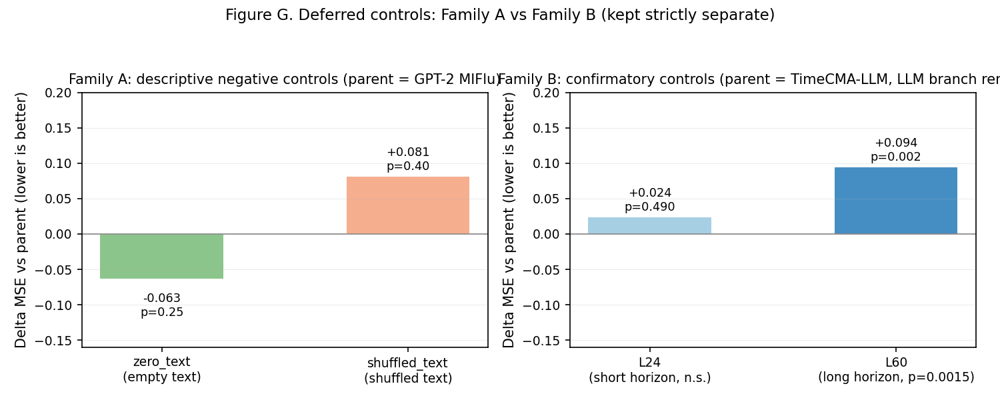
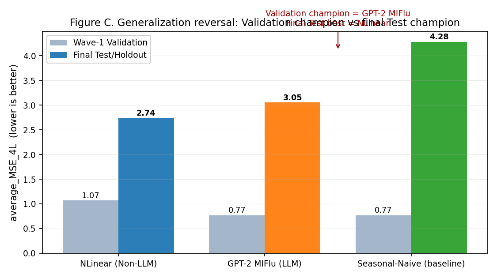
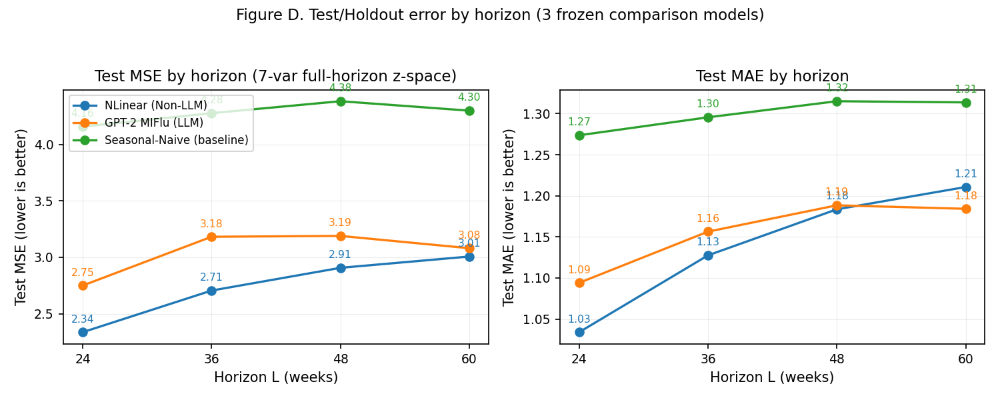
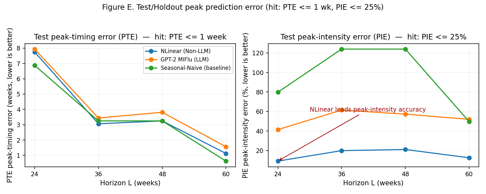
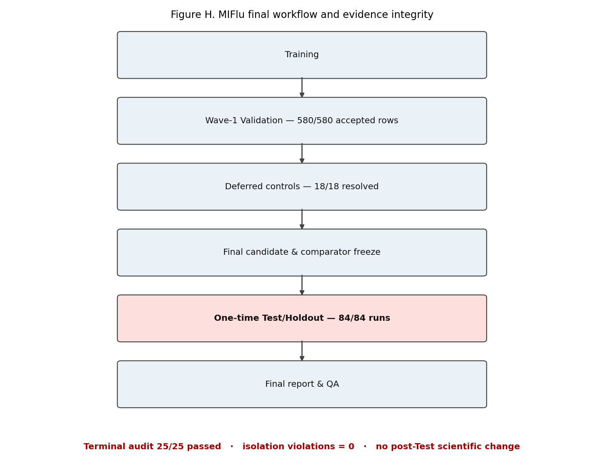

# MIFlu 非LLM与LLM流感预测最终报告（中文版）

**项目：** MIFlu 流感预测可复现性研究
**范围：** "clean v3" Wave-1 正式执行（580 个已接受行）+ 一次性 Test/Holdout 评估（84 个运行）
**状态：** 最终版。Test/Holdout 已解封并仅评估一次，三项确认性假设均已检验。本报告取代 Wave-1 版本。

---

## 一句话结论（先读这里）

在冻结选型规则下，Wave-1 **验证阶段**的最佳模型是 `gpt2_miflu`（GPT-2 架构的多模态流感预测模型，avg MSE 4L = 0.771），`nlinear`（NLinear 线性模型）为最佳非 LLM、总亚军（1.070）。

但一次性、留出的 **Test/Holdout** 评估（COVID 时代窗口，预测目标为绝对周 820–1024，即 2018-01-28 至 2021-12-26）**反转了这一排序**：

| 名次 | 模型 | 类别 | Test avg MSE 4L | 95% 置信区间 |
|---:|---|---|---:|---:|
| 1 | **NLinear** | 非 LLM | **2.739** | [2.731, 2.747] |
| 2 | **GPT-2 MIFlu** | LLM | **3.051** | [2.922, 3.179] |
| 3 | Seasonal-Naive | 基线 | 4.279 | 不适用（确定性） |

> **GPT-2 MIFlu 是 Wave-1 验证阶段的最佳模型，而 NLinear 在预先冻结的一次性 Test/Holdout 比较集合中取得了最低 Test MSE，因此最终泛化表现最好。**

关键事实：LLM 冠军在验证阶段取得的优势**没有**在独立、分布偏移的 COVID 时代窗口上保持。两个学习模型都显著优于零参数的 Seasonal-Naive 基线，但简单的线性模型 NLinear 更稳健、更准确。

---

## 一、这份报告如何评估模型性能（零基础导读）

**MSE 不是"正确率百分比"。** 本报告中 "MSE"（均方误差）是模型预测与真实观测之间**平均平方差**，在标准化后的 z 空间、7 个变量、整个预测时长、10 个冻结随机种子上汇总。它**没有"对了百分之几"的含义**：**越小越好**，两个数值只能相对比较（例如冠军 0.771 vs 亚军 1.070）。MAE（平均绝对误差）同理，只是不做平方。

评估遵循严格的"输入 → 处理 → 输出"（IPO）流程：

1. **输入** —— 一段 104 周的滑动窗口，含 7 个流感样疾病（ILI）变量（如加权 ILI 百分比、ILITOTAL、年龄组计数、就诊机构计数等）。
2. **处理** —— 用**仅训练集**拟合的归一化器标准化 → 模型在 z 空间预测 → 逆变换回物理单位。
3. **输出** —— 未来 L ∈ {24, 36, 48, 60} 周 × 7 个变量的预测。

将输出与同一周从未见过的观测值对比，得到逐预测误差，再汇总为 MSE/MAE。主要排名指标 `average_MSE_4L` 是四个时长的逐时长 MSE 的平均值。

---

## 二、研究方法与冻结选型规则

- **冻结选型规则（从未变更）：** 按 `average_MSE_4L` 排名——L ∈ {24, 36, 48, 60} 四个时长的逐时长平均 MSE 的算术平均，每个时长再对 10 个冻结种子（42–51）取平均，于七变量、全时长、z 空间计算。**越小越好**。次要指标 `average_MAE_4L`。禁止的并列裁决：峰值命中率、PTE/PIE、基线相对比。
- **数据划分：** National-Illness 共 **1025 个周时间点**（绝对周 0–1024，MMWR 2002 年第 1 周至 2021 年第 52 周）。按 70:10:20 时序切分为**训练 717 / 验证 102 / 测试 206 个时间点**（绝对周 0–716 / 717–818 / 819–1024；val_end = 819）。以 T = 104、步长 1 滑动生成预测窗口：**训练 613 / 验证 103 / 测试 = 206 − L**（L = 24/36/48/60 → 测试窗口 182/170/158/146）。测试目标自绝对周 820（2018-01-28）起。
- **归一化 / 检查点纪律：** 每次 Test 运行均使用**训练集**拟合的归一化器与**验证集**选定的检查点；Test 窗口从未用于拟合、选型或早停。
- **一次性纪律：** Test/Holdout 仅释放一次，通过 25 项终端审计核实，无重复提交、无重复读取、无 Test 后脚本改动。

---

## 三、Wave-1 验证阶段：8 个架构的筛选

首先在验证集上比较 4 个非 LLM 与 4 个基于 LLM 的架构，以决定谁进入冻结的最终比较集合。

**这张图看什么：** 横轴是 8 个模型，纵轴是验证集 average_MSE_4L，**越低越好**。蓝色系为非 LLM，橙色系为 LLM。

**结论：**
- `gpt2_miflu`（0.771）验证集第一名，成为冻结的 LLM 候选；
- `nlinear`（1.070）最佳非 LLM、总亚军，成为冻结的对照模型；
- 二者的置信区间不重叠，差距显著（配对 t = −13.33，p = 3.13×10⁻⁷）。

**重要提醒（本图没有证明的）：** 这是**仅验证阶段**的成绩，不是最终 Test 表现。验证集上 LLM 家族的"胜出"由单一模型 `gpt2_miflu` 承载——作为家族整体，非 LLM 组（1.142）显著优于 LLM 组（1.243），p = 1.44×10⁻⁶。此外，零参数的 `seasonal_naive` 在验证集的 L24/L36/L48 反而击败了 `gpt2_miflu`，说明 LLM 的短时长精度很大程度上来自季节性。

> 标注：本图使用 Wave-1 **验证**数据，仅用于解释模型筛选，**不代表最终 Test 性能**。

---

## 四、机制发现：LLM 的"创新点"到底有没有用

消融实验（在验证集上，对照父模型 `gpt2_miflu`）显示，**唯一**统计显著的文本组件是"数据集信息描述"（移除后 +12.85%，p = 0.004）；移除 LoRA、多模态融合或任务指令均无显著影响（p 均 > 0.4）。也就是说，LLM 的自适应/对齐机制在此设置下几乎不贡献精度，真正起作用的是提示词中描述 ILI 数据集的那一段文字。

**延迟对照（Family A 与 Family B 严格分开，未合并）：**

**这张图看什么：** 纵轴是"移除某组件后 MSE 的变化量"，**低于 0 = 变好，高于 0 = 变差**。左侧 Family A 是 `gpt2_miflu` 的两个负对照（空文本 / 打乱文本，均为描述性、探索性，n 小）；右侧 Family B 是 `timecma_llm` 移除 LLM/文本分支的确认性对照（L24 与 L60）。

**结论（措辞谨慎）：**
- **Family A（描述性）：** zero_text 平均 −0.063（p = 0.25）、shuffled_text 平均 +0.081（p = 0.40），均不显著——提示词文本的顺序/内容影响方向不稳定，属探索性证据。
- **Family B（确认性）：** L60 移除 LLM 分支显著变差（+0.094，p = 0.0015），支持"文本/LLM 分支在长时长上有贡献"；L24 无显著变化（+0.024，p = 0.49）。**注意 n=3，检验功效低，只作为支持性证据，非因果定论。**

---

## 五、一次性 Test/Holdout 最终评估

### 5.1 最终对比（三个冻结模型）

**这张图看什么：** 横轴是三个模型，纵轴是 Test 集 average_MSE_4L，**越低越好**。

**结论：** 最终 Test 排序为 **NLinear（2.739）< GPT-2 MIFlu（3.051）< Seasonal-Naive（4.279）**。这是预先冻结的最终比较集合（仅这 3 个模型），并非 8 个架构全部在 Test 上重新排名。NLinear 的置信区间上界（2.747）仍低于 GPT-2 MIFlu 的下界（2.922），因此反转不是抽样假象。

### 5.2 泛化反转：验证冠军 ≠ 最终 Test 冠军

**这张图看什么：** 每个模型两根柱子——浅色是验证集 MSE，深色是 Test 集 MSE，**越低越好**。两根柱子之间没有放在同一个未标注的排名里。

**结论：**
> GPT-2 MIFlu 在 Wave-1 验证阶段排名第一，但其优势没有在独立的 COVID-era Test/Holdout 窗口中保持。NLinear 在预先冻结的最终比较集合中取得最低 Test MSE，因此最终泛化表现最好。

三个模型在 Test 上都相对验证集退化（这是预期的——Test 窗口含 COVID 时期，没有任何模型见过），但退化程度不同：**NLinear +1.67、GPT-2 MIFlu +2.28、Seasonal-Naive +3.51**。Seasonal-Naive 退化最严重：它在验证集上（0.771）与 GPT-2 MIFlu 打平，却在 Test 上崩盘到 4.279——证明"重复上一个季节"只是记住了 2016–2018 强季节时段的形状，不是真正的预测。

### 5.3 逐时长误差

**这张图看什么：** 横轴是预测时长 L（周），纵轴是 Test 误差，**越低越好**。

**结论：** NLinear 在**全部四个时长**上都优于 GPT-2 MIFlu。差距在 L24（2.337 vs 2.750）与 L36（2.705 vs 3.182）最大，在 L48（2.907 vs 3.189，p = 0.055）与 L60（3.007 vs 3.081，p = 0.175）收窄至不显著。Seasonal-Naive 在每个时长上都是最差。

### 5.4 峰值预测误差（PTE / PIE）

**这张图看什么：** 左图横轴是时长 L，纵轴是 **PTE（峰值时间误差，周，越低越好，命中 = ≤ 1 周）**；右图纵轴是 **PIE（峰值强度误差，%，越低越好，命中 = ≤ 25%）**。

**结论：** 对疫情检测真正重要的峰值**强度**预测，NLinear 大幅领先（PIE 9–21%，命中率 75–94%）；GPT-2 MIFlu 居中偏弱（PIE 41–62%）；Seasonal-Naive 最差（PIE 50–124%）。MSE 冠军并不等于峰值预测冠军——这与 Wave-1 验证阶段的发现一致。

**直接回答：每个模型是否同时满足 PTE ≤ 1 周 与 PIE ≤ 25%？**

按图 F 的绘制约定（每个模型 × 每个时长一条代表曲线，即 lead-1 种子均值曲线），Test/Holdout 上的判定如下：

| 模型 | PTE（周）L24 / L36 / L48 / L60 | PIE（%）L24 / L36 / L48 / L60 | PTE ≤ 1 周？ | PIE ≤ 25%？ | 两项都命中？ |
|---|---|---:|---:|---|---|---|
| **NLinear** | 1 / 0 / 0 / 1 | 0.17 / 0.46 / 1.20 / 0.97 | 是（4/4） | 是（4/4） | **是（4/4）** |
| **GPT-2 MIFlu** | 3 / 2 / 2 / 2 | 31.6 / 32.2 / 26.6 / 34.4 | 否（0/4） | 否（0/4） | **否（0/4）** |
| **Seasonal-Naive** | 52 / 52 / 52 / 52 | 0.0 / 0.0 / 0.0 / 21.1 | 否（0/4） | 是（4/4） | **否（0/4）** |

- **NLinear：是**——四个时长**全部**同时命中两项阈值（PTE 0–1 周、PIE 0.17%–1.20%）。
- **GPT-2 MIFlu：否**——四个时长**全部**未同时命中：PIE 26.6%–34.4% 全部超过 25%，且 PTE 2–3 周超过 1 周。
- **Seasonal-Naive：否**——PIE 命中（≈0%–21%），但 PTE 灾难性失败：52 周（整整差了一年，因为"重复上一季节"完全错过 COVID 时代的新峰值）。

**重要限定（诚实说明）：** 上表是"代表曲线"层面的判定。若按更细的"逐季节 × 逐领先"粒度统计（`final_peak_hit_rates.csv`），**没有任何模型**在 100% 的合格季节上同时命中两项：NLinear 的联合命中率在 L24–L48 最高 75%、L60 的 lead-1/2 达 100%，唯一共同的失误是异常的 2020/2021 COVID 季节峰值（在 L24 上三个模型都约差 24–27 周）。因此"NLinear 满足两项命中"应理解为代表曲线层面，而非逐季节 100%。

### 5.5 最终预测曲线 vs 地面真值（必看）

**这张图看什么（零基础说明）：**
- **实线是真实值**（观测到的 ILITOTAL 病例数），**虚线是模型预测值**；
- **两条线越接近，通常表示预测越准确**；
- **真实峰值与预测峰值的位置差对应 PTE**（峰值时间误差，单位周）；
- **真实峰值与预测峰值的高度差对应 PIE**（峰值强度误差，单位百分比）。

每张图**只绘制 Test/Holdout 预测目标窗口**，纵轴为逆变换后的 ILITOTAL **原始量纲**（不是标准化后的 z 分数），并刻意省略历史输入尾段、训练/验证曲线、输入/预测分界线。这些曲线全部来自一次性的 Test/Holdout 阶段，**不是**验证集预测曲线。

单独的代表性面板（NLinear 与 GPT-2 MIFlu 在 L24 与 L60）：

---

## 六、统计方法与确认性检验

- 逐时长点估计 = 10 个冻结种子（42–51）的均值；`average_MSE_4L` = 四个逐时长均值的算术平均。
- 95% 置信区间 = 种子级 t 区间（t 分布，df = 9）。
- C1 = 配对种子 t 检验（n = 10 对）；C2/C3 = 对确定性 Seasonal-Naive 参考的单样本 t 检验（df = 9，参考无种子方差）。
- 多重比较 = 对 3 项预注册主要检验的 Holm-Bonferroni 逐步下降（α = 0.05）。

| 编号 | 假设 | 均值差 | t | p（Holm 校正后） | 结论 |
|---|---|---:|---:|---:|---|
| C1 | GPT-2 MIFlu vs NLinear（GPT-2 更差） | +0.312 | 5.46 | 4.0×10⁻⁴ | 拒绝（NLinear 显著更好） |
| C2 | GPT-2 MIFlu vs Seasonal-Naive（GPT-2 更好） | −1.229 | −21.61 | 9.2×10⁻⁹ | 拒绝（GPT-2 显著更好） |
| C3 | NLinear vs Seasonal-Naive（NLinear 更好） | −1.540 | −443.37 | 2.3×10⁻²⁰ | 拒绝（NLinear 显著更好） |

**三项检验全部显著。** 含义：(1) 两个学习模型在 Test 上都显著优于季节基线；(2) 验证集冠军 GPT-2 MIFlu 并非最终 Test 最佳——NLinear 显著更好。

---

## 七、最终工作流与证据完整性

**这张图看什么：** 从左到右的完整流程推进，以及底部的完整性结论。

| 完整性检查 | 结果 |
|---|---|
| pre-Test 冻结审计（16 项门槛） | 全绿（释放前 test_access = 0、holdout_access = 0） |
| 授权 Test 键 / 家族构成 | 84（gpt2_miflu 40 / nlinear 40 / seasonal_naive 4） |
| 台账 / Slurm（sacct） | 84 全部 COMPLETED，exit 0:0，**无第 85 个任务** |
| 结果目录 / 清单 / 预测 / 指标 / 状态 | 84 / 84 / 84 / 84 / 84 |
| 随机模型还原证据 / 基线支路 | 80/80（strict-load 通过）/ 4/4（checkpoint_applicable=false） |
| 首个 Test 目标绝对周 / 末个 | 820（无验证集重叠）/ 1024 |
| 冻结脚本哈希 / 终端审计 | 未变更 / **25/25 通过** |

**隔离违规 = 0，Test 后无科学变更。**

---

## 八、诚实结论

1. **冻结选型成立，但含义已澄清。** `gpt2_miflu` 在冻结规则下被正确选为 Wave-1 验证冠军；一次性 Test 显示这一优势是**窗口特异**的，未泛化。
2. **稳健的模型是简单的那一个。** NLinear（2,520 参数、约 5 秒训练、约 10 KB）在 Test 上显著优于约 103 万参数的 LLM，且在峰值强度预测上大幅领先。
3. **季节性不是泛化。** Seasonal-Naive 在验证集具竞争力、在 Test 崩盘，是"季节重复不是预测"的最清晰证明。
4. **论文标题不应是"LLM 胜过经典预测器"。** 在留出窗口上事实相反；LLM 机制相对于线性模型的边际价值在 Test 上为负。
5. **两个学习模型仍优于基线。** 学习确实有帮助（两者均以 p < 10⁻⁸ 击败 Seasonal-Naive）。

**明确禁止的表述：** 本报告**不**声称 gpt2_miflu 是最终 Test 冠军；**不**声称 nlinear 在 Test 上直接击败全部 8 个架构；**不**声称所有 LLM 在任何场景都更差；**不**声称 COVID 时代偏移已被证明是唯一因果解释。

---

## 九、局限性

1. **单一窗口、单次评估。** Test/Holdout 是单个连续的 COVID 时代窗口，稳健性结论仅限于此窗口，无第二个独立 holdout。
2. **分布偏移与 COVID 混淆。** "泛化差距"与"COVID 扰动"无法分离，不应解读为模型过拟合的纯度量。
3. **确定性基线无种子方差。** C2/C3 的 t 值在构造上偏大（参考贡献零方差），所确立的是方向与显著性，而非效应幅度。
4. **峰值指标为次要。** PTE/PIE 继承重建目标周与领先 1 周约定，是应用指标，从未用于选型。
5. **Family B 延迟对照 n 小。** 每时长仅 3 个配对种子，检验功效低，只作为支持性证据。

---

## 附录 A：12 张预测曲线面板（Test/Holdout）

以下为三个模型 × 四个时长的全部 12 张 Test/Holdout 预测曲线，供逐张核查（实线 = 真实值，虚线 = 预测值，纵轴 = ILITOTAL 原始量纲）。

- NLinear：L24 / L36 / L48 / L60
- GPT-2 MIFlu：L24 / L36 / L48 / L60
- Seasonal-Naive：L24 / L36 / L48 / L60

完整面板见 `results/v3_clean/final/final_test_prediction_figures/`，每张图有对应源数据（`final_test_curve_source_data/`）与来源表（`final_test_window_provenance.csv`），对每张图断言：输入-目标重叠 = 0、未来目标泄漏 = 0、归一化器在训练集拟合、检查点在验证集选定、绘制窗口 = Test/Holdout。

---

## 附录 B：数据与产物

- **指标：** `results/v3_clean/final/final_test_metrics.json`、`final_test_seed_level.csv`、`final_peak_metrics.csv`、`final_peak_hit_rates.csv`、`final_generalization_comparison.csv`。
- **访问与完整性：** `final_test_access_ledger.jsonl`、`terminal_test_audit.json`（25/25）、`pre_test_freeze_audit.json`。
- **图表：** `final_report_figures/`（本报告图 B/C/D/E/G/H）、`final_test_prediction_figures/`、`final_test_prediction_gallery/`。

---

*本报告是 MIFlu 可复现性研究的最终中文产物。*
